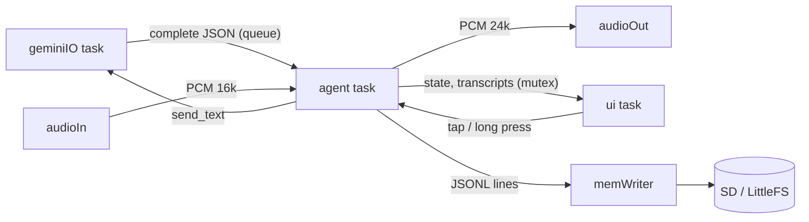
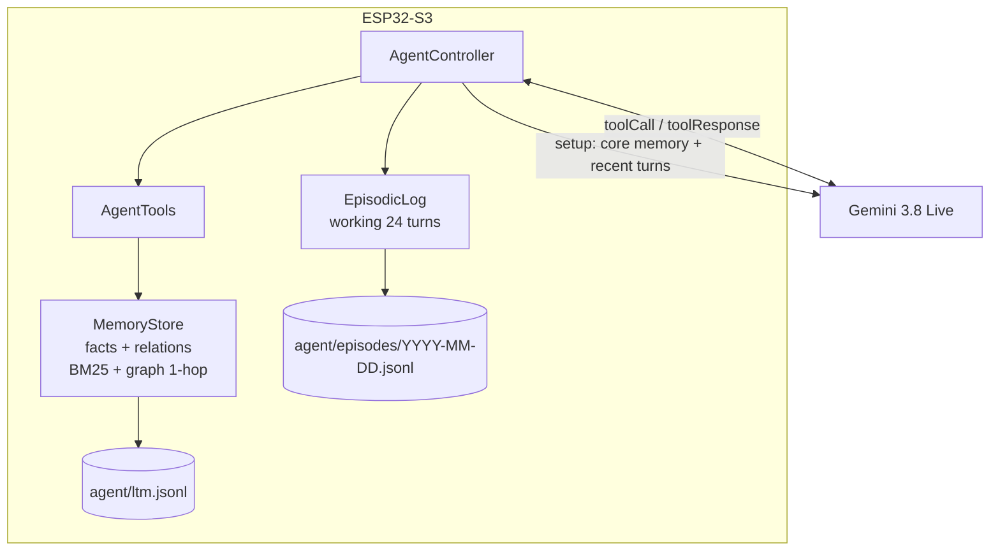

# 📘 ESP32-AI Personal Agent — Master Architecture Specification

> **Project:** Personal AI Agent on ES3C28P (ESP32-S3-N16R8)
> **Models:** Gemini 3.8 Live → 3.8 Live Extended Thinking → 3.1 Flash Live (auto fallback) · Flash-Lite 3.5 → 3.1 (background)
> **Target Board:** ES3C28P — 2.8" IPS LCD (ILI9341V) + FT6336G touch + ES8311 codec + FM8002E amp + MicroSD
> **Document Version:** 3.1.0 — + mic button, quota-aware fallback (Google Search), API self-test, PC Studio app
> **Date:** 2026-10-15
> **สำเนา:** ไฟล์นี้มี 2 ที่ (`/PROJECT_ARCHITECTURE_SPEC.md` และ `wiki/PROJECT_ARCHITECTURE_SPEC.md`) — แก้แล้วคัดลอกให้ตรงกันเสมอ

---

## 📑 สารบัญ

1. [ภาพรวมและเป้าหมาย](#1-ภาพรวมและเป้าหมาย)
2. [ฮาร์ดแวร์และขา GPIO](#2-ฮาร์ดแวร์และขา-gpio)
3. [เฟิร์มแวร์และหน่วยความจำ](#3-เฟิร์มแวร์และหน่วยความจำ)
4. [Tasks บน FreeRTOS](#4-tasks-บน-freertos)
5. [ระบบเสียง](#5-ระบบเสียง)
6. [Gemini Live Protocol](#6-gemini-live-protocol)
7. [Avatar UI และภาษาไทย](#7-avatar-ui-และภาษาไทย)
8. [AI Agent + ความจำระยะยาวแบบ Standalone](#8-ai-agent--ความจำระยะยาวแบบ-standalone)
9. [โครงสร้างโปรเจกต์](#9-โครงสร้างโปรเจกต์)
10. [Build, Test และสถานะ](#10-build-test-และสถานะ)
11. [PC Studio app และ serial protocol](#11-pc-studio-app-และ-serial-protocol)

---

## 1. ภาพรวมและเป้าหมาย

อุปกรณ์ AI ตั้งโต๊ะที่คุยด้วยเสียงภาษาไทยแบบ real-time ผ่าน Gemini Live มีใบหน้าหุ่นยนต์บนจอ
และเป็น **AI Agent** ที่จำผู้ใช้ได้ข้ามวันด้วย **ความจำระยะยาวที่เก็บและค้นหาในตัวเครื่องทั้งหมด** (ไม่มี backend/vector DB ภายนอก)

**จุดเด่นเชิงวิศวกรรม (v2)**
- Bidirectional streaming: ไมค์ 16 kHz ขึ้น / เสียง AI 24 kHz ลง ผ่าน WSS ที่ **ตรวจใบรับรอง TLS**
- ข้อความ server ขนาดใดก็ได้ (ESP-IDF `esp_transport_ws` บน task `geminiIO` ตัวเดียว + ประกอบ frame ใน PSRAM — v3.1)
- Agent tools 8 ตัว (ความจำ + อุปกรณ์) ประกาศแบบ `BLOCKING`
- ความจำ 4 ชั้น: working (RAM) · episodic (JSONL รายวัน) · semantic facts · knowledge graph — ค้นด้วย **BM25 บน character bigram + ขยายกราฟ 1 hop** (รองรับภาษาไทยโดยไม่ต้องตัดคำ)
- Session ยาวไม่จำกัด (context window compression) + resume อัตโนมัติ (session resumption, goAway)
- Half-duplex echo gate (ไม่มี AEC) · แตะจอเพื่อหยุด AI
- ซับไตเติลภาษาไทย (TH Sarabun New VLW) ตัดบรรทัดตามพยางค์ · 30 FPS sprite ไม่กระพริบ
- **v3:** ดวงตาเด้งดึงแนวนอน 320×240 (14 อารมณ์, ฟิสิกส์สปริง), โปรไฟล์ 8 แบบ / 30 เสียง / 7 นิสัย / เพศ,
  เมนูทัช + คีย์บอร์ดไทย-อังกฤษ (Wi-Fi สแกน, API key, ชื่อ), 20 tools + Google Search (timers, reminders, to-do),
  auto model fallback, local VAD + auto-sleep สำหรับงบ 65k TPM, จัดระเบียบความจำด้วย Flash-Lite
- **v3.1:** ปุ่มเปิด/ปิดไมค์บนจอ, fallback รู้จักโควตา Google Search (ปิด Search อัตโนมัติ) และหยุดพักเมื่อทุกโมเดลติดโควตา,
  setup timeout 15 วิ, ทดสอบ API key บนเครื่อง (`apitest`), Wi-Fi back-off + เหตุผลบนจอ, จอ IPS กลับสี (พื้นดำ),
  **ESP32-AI Studio** (แอป PC: ตั้งค่า เครื่องมือ debug log จอเสมือน build/upload)

---

## 2. ฮาร์ดแวร์และขา GPIO

- MCU ESP32-S3R8 dual-core 240 MHz · Flash 16 MB QSPI · PSRAM 8 MB OPI
- LCD ILI9341V 240×320 SPI 40 MHz · Touch FT6336G I2C `0x38` · Codec ES8311 I2C `0x18`
- Amp FM8002E · WS2812 · MicroSD 4-bit SDMMC · Battery ADC (÷2) · USB-C = native USB (VID `303A`)

| GPIO | หน้าที่ | หมายเหตุ |
|---|---|---|
| 0 | BOOT button | Active LOW — ใช้เป็นปุ่มแตะ/กดค้าง |
| 1 | FM8002E PA_ENABLE | ⚠️ **Active LOW** |
| 4 / 5 / 7 | I2S MCLK / BCLK / LRCK | MCLK = 256·fs |
| **8** | I2S data **MCU → codec** (speaker) | ⚠️ ตรวจด้วย loopback แล้ว (เอกสารผู้ผลิตกลับด้าน) |
| **6** | I2S data **codec → MCU** (mic) | ⚠️ ดู wiki T013 |
| 9 | Battery ADC | `analogReadMilliVolts × 2` |
| 10–13, 46 | LCD CS/MOSI/SCK/MISO/DC | |
| 15 / 16 | I2C SCL / SDA (touch + codec) | ใช้ `Wire` + mutex ตัวเดียว |
| 17 / 18 | Touch INT / RST | |
| 38, 39, 40, 41, 47, 48 | SD CLK, D0, CMD, D1, D3, D2 | |
| 42 | WS2812 | |
| 45 | LCD backlight | ⚠️ Active HIGH |

---

## 3. เฟิร์มแวร์และหน่วยความจำ

- Platform `espressif32 @ 7.1.3` (Arduino-ESP32 2.0.17 / IDF 4.4), C++17
- Partition `default_16MB.csv`: app 6.25 MB × 2 (OTA) + LittleFS 3.4 MB
- Firmware 1.24 MB (18.9%), static RAM 17.8%

| ส่วน | ที่อยู่ | ขนาด |
|---|---|---|
| Playback ring | PSRAM | 1 MB (~21 s) |
| Capture ring | PSRAM | 64 KB |
| LCD sprite | PSRAM | 150 KB |
| WebSocket buffers + reassembly | PSRAM | 2 × 16 KB + ตามข้อความ |
| JSON (server messages) | PSRAM allocator | ชั่วคราว |
| mbedTLS buffers (ทุกการเชื่อมต่อ TLS) | PSRAM (`mbedtls_platform_set_calloc_free`, ก้อน < 512 B อยู่ RAM ภายใน) | ~40 KB ต่อการเชื่อมต่อ |
| ความลับ (Wi-Fi pass, API key, MT5 token) | การ์ด SD `agent/secrets.json` (ไม่มีการ์ด: NVS) เข้ารหัส AES-256-GCM (`SecretBox`, กุญแจจาก MAC + eFuse unique ID); นำเข้า `ai-setup.txt` จากรากการ์ดแล้วลบ | ~30 B overhead ต่อค่า |
| ความจำระยะยาว index | PSRAM | ~0.8 KB/รายการ (≤ 2,000) |
| **คงเหลือหลังบูต (วัดจริง)** | | internal heap ~243 KB, PSRAM ~6.9 MB |

---

## 4. Tasks บน FreeRTOS

| Task | Core | Prio | หน้าที่ |
|---|---|---|---|
| audioOut | 0 | 6 | playback ring → I2S (mono→stereo), prebuffer 120 ms |
| audioIn | 0 | 6 | I2S → เลือกช่อง L/R → 24→16 kHz → capture ring |
| geminiIO | — | 5 | เจ้าของการเชื่อมต่อคนเดียว: esp_transport_ws + TLS, outbox, ping, reconnect, ประกอบข้อความ, close handshake |
| agent | 1 | 4 | AgentController: session, tools, memory, mic gate, derived state |
| ui | 1 | 3 | AvatarUI 30 FPS, ทัช, BOOT, แบตเตอรี่ |
| memWriter | 1 | 2 | เขียน JSONL ลง SD แบบ async |
| led | 0 | 1 | สีสถานะ / tool override |



ความจำถูกแตะจาก agent task เท่านั้น (console ใช้ `runTool()` ผ่าน queue)

---

## 5. ระบบเสียง

```
🎤 → ES8311 ADC (PGA 30 dB + 18 dB) → I2S 24 kHz (GPIO 6) → audioIn
   → Downsampler 24→16 kHz (polyphase FIR 48 taps, fc 7 kHz) → capture ring
   → [gate เปิด] 40 ms → Base64 → {"realtimeInput":{"audio":{...rate=16000}}} → Gemini
Gemini → inlineData PCM 24 kHz → Base64 decode → playback ring 1 MB
   → audioOut → I2S (GPIO 8) → ES8311 DAC → FM8002E (GPIO1 LOW) → 🔊
```
- I2S 24 kHz ทั้งสองทางเพราะ ADC/DAC ใช้ LRCK ร่วมกัน
- Echo gate: ปิดไมค์ระหว่างเล่น + 350 ms แล้วส่ง `audioStreamEnd`
- ทดสอบบนบอร์ด: codec loopback (`reg 44 60`) ได้ RMS 0.12946 ตรงกับทฤษฎี 0.1295

---

## 6. Gemini Live Protocol

- Endpoint: `wss://generativelanguage.googleapis.com/ws/google.ai.generativelanguage.v1beta.GenerativeService.BidiGenerateContent?key=…`
- TLS roots: GTS Root R1/R3/R4 + GlobalSign ECC R4 (`tools/gen_root_ca.py`)
- Setup: `responseModalities:["AUDIO"]`, voice `Aoede`, `systemInstruction` (persona + กฎการใช้ความจำ + วันเวลา + core memory + บทสนทนาล่าสุด), `tools` (8, BLOCKING), `input/outputAudioTranscription`, `contextWindowCompression.slidingWindow`, `sessionResumption{handle}`
- จัดการ: `setupComplete`, `serverContent` (audio/transcripts/interrupted/generationComplete/turnComplete), `toolCall`, `toolCallCancellation`, `sessionResumptionUpdate`, `goAway`, close code/reason
- gemini-3.8-live: tools default NON_BLOCKING (เราตั้ง BLOCKING), ห้าม `thinkingLevel`, proactive audio เปิดถาวร
- v3.1: `googleSearch` ใส่เมื่อเปิดใช้และไม่ได้ถูกพักเพราะโควตา (โควตา Search หมด → เซิร์ฟเวอร์ปิดด้วย 1011 "exceeded your current quota"
  → ลองใหม่โดยไม่มี Search) · ไม่มี `setupComplete` ภายใน 15 วิ → reconnect · close reason ถูกตัดที่ 123 ไบต์ จึงมี `apitest` (REST) ไว้ดู QuotaFailure

รายละเอียด: `wiki/05-Gemini-Live-API-Protocol.md`

---

## 7. Avatar UI และภาษาไทย (v3: แนวนอน 320×240 พื้นดำ)

```
┌ (🎤 ปุ่มไมค์) • Wi-Fi • HH:MM • แบตเตอรี่ • ⚙ ─────────────┐
│            ดวงตาสองข้าง (สปริงเด้งดึง, 14 อารมณ์)            │
│        ซับไตเติลไทย 2 บรรทัด (ฟ้า=ผู้ใช้ ขาว=AI เทา=ระบบ)      │
└──────────────────────────────────────────────────┘
```
อารมณ์: neutral happy excited love sad worried angry surprised sleepy thinking curious confused shy wink
(ตั้งโดย AI ผ่าน `set_expression` หรืออัตโนมัติตามสถานะ) — รายละเอียด `wiki/06-Avatar-and-Thai-UI.md`
เดิม (v2) ด้านล่างเป็นตารางสถานะ/LED ซึ่งยังใช้ได้ โดยเพิ่ม SLEEP (ตาหลับ + Zzz, LED ม่วง) และ SETUP (ยังไม่ตั้งค่า)

| State | ตา | ปาก | LED |
|---|---|---|---|
| BOOT | ปกติ | ตรง | ขาวสลัว |
| CONNECTING | หรี่ | ตรง | น้ำเงินกะพริบ |
| IDLE | กะพริบ | ยิ้ม | เขียวสลัว |
| LISTENING | โต มองลง | O | น้ำเงิน |
| THINKING | หรี่ + สแกน | ตรง | เหลือง pulse |
| SPEAKING | กะพริบ | ตาม RMS | เขียว pulse |
| ERROR | X แดง | คว่ำ | แดงกะพริบ |

v3.1: แตะปุ่มไมค์ = เปิด/ปิดไมค์ · แตะที่อื่น = หยุดพูด/ปลุก/ลองเชื่อมต่อใหม่/ตาเด้ง (ไม่สลับไมค์แล้ว) · ERROR ครอบคลุมช่วงพักเพราะโควตา ·
จอ IPS ต้องเปิด color inversion (`lcdInvert`, ค่าเริ่มต้นเปิด) จึงได้พื้นดำ

ฟอนต์ `ThaiFont26` (TH Sarabun New, 192 glyphs, 27 KB) สร้างด้วย `tools/gen_thai_font.py`
การตัดบรรทัด `src/util/TextWrap.h` ไม่แยกสระบน/ล่าง/วรรณยุกต์/สระหน้า

---

## 8. AI Agent + ความจำระยะยาวแบบ Standalone



| Layer | เก็บ | ใช้ |
|---|---|---|
| 1 Working | PSRAM (24 turns) | บริบทให้ session ใหม่ |
| 2 Episodic | `episodes/YYYY-MM-DD.jsonl` (365 วัน SD / 30 วัน flash) | `recall_conversation` |
| 3 Semantic facts | `ltm.jsonl` (`k:"f"`) | `save_memory`, `recall_memory`, core memory |
| 4 Knowledge graph | `ltm.jsonl` (`k:"r"`) | `save_relation`, ขยายกราฟตอน recall |

Tools (v3.2.1, 40 + MT5 2 ตัวเมื่อตั้งค่า + Google Search; สั่งเครื่องด้วยเสียง: set_volume/set_brightness (level หรือ change +/-), configure_device, rest_screen (พักหน้าจอ), mute_microphone (เปิดไมค์ได้เฉพาะบนจอ, จำข้ามรีบูต); tools ข้อมูลแสดงการ์ดกราฟิก — `wiki/11-Data-Tools-and-Cards.md`): get_weather • get_oil_price • get_market_quote • convert_currency • get_news • calculate • convert_units • get_world_time • get_location • search_knowledge • notes • [finance] market_overview • market_analysis • market_scan • economic_calendar • position_size • price_alert • [MT5] mt5_account • mt5_trade (ยืนยัน 2 ขั้น, จำกัด lot) • ความจำ 5 • set_timer/set_reminder/list_reminders/cancel_reminder • add_task/list_tasks/update_task •
get_device_status • set_expression • configure_assistant • list_assistant_options • set_volume • set_brightness • control_led • go_to_sleep
— behavior ตามโมเดล (3.8 Live BLOCKING, Extended Thinking NON_BLOCKING, 3.1 ไม่ระบุ) — ดู `wiki/09-Assistant-Profiles-and-Tools.md`

### งบโทเคนและ auto fallback (v3)
- Live API คิดโทเคนบริบททั้งหมดทุก turn → `contextWindowCompression` trigger 12k → target 5k, local VAD ส่งเฉพาะเสียงพูด, auto-sleep ปิด session
- v3.1 ไมค์ (hybrid VAD): pre-roll 600 ms, เกณฑ์ max(0.004, noise×2.5), hangover 1.5 วิ, ฟังต่อ 6 วิหลัง AI ตอบ, AGC ≤ ×6 (เป้า RMS 0.08),
  server `automaticActivityDetection` start HIGH / end LOW, เลือกช่อง mic เฉพาะตอนลำโพงเงียบ, log `[Mic]` + คำสั่ง `rec` อัดเสียงที่ส่งจริง
- ModelFallback: quota → พัก 10-120 นาที, unavailable → 5 นาที, not found → 24 ชม., หลุดก่อน ready 3 ครั้ง → 2 นาที; API key ผิดไม่สลับ
- v3.1: quota ขณะ setup มี Google Search → ลองโมเดลเดิมโดยไม่มี Search (พัก Search 6 ชม.) · ทุกโมเดล cool-down → agent หยุดพัก (hold)
  จนโมเดลแรกพ้น พร้อมเวลาบนจอ (แตะ = ลองทันที) · cool-down ไม่ถูกย่อ · ไม่นับ disconnect หลัง close frame ซ้ำ · เปลี่ยน key = reset
- 1008 "session not found or expired" = handle หมดอายุ → session ใหม่ (ไม่ลงโทษโมเดล) · ปิด session ด้วย WebSocket close handshake
  ทุกครั้ง (พัก/สลับ/รีบูต) เพื่อไม่ให้ session ค้างฝั่งเซิร์ฟเวอร์กินโควตา
- Flash-Lite consolidation: เงียบ ≥45 วิ + ≥4 turn, 1 ครั้ง/5 นาที, ≤150/วัน, fallback 3.5 → 3.1

- Retrieval: UTF-8 → ตัดวรรณยุกต์ → bigram (ไทย) / คำ (อังกฤษ) → FNV hash → BM25 (k1 1.2, b 0.5) × importance; coverage ≥ 25% ของ IDF ที่รู้จัก
- Graph: seed จาก relation ที่เจอ + ชื่อ entity ในคำค้น (ไม่ใช้ hub เช่น "ผู้ใช้"), ดึงเพิ่ม ≤ 6
- Persistence: append-only op log, compaction ตอนบูต, กู้ `.tmp`, merge ข้อความซ้ำ (Jaccard ≥ 0.75), จำกัด 2,000 รายการ
- เขียนไฟล์ผ่าน `AsyncFileSink` (ไม่บล็อกเสียง)

รายละเอียด: `wiki/08-Long-Term-Memory-GraphRAG.md`

---

## 9. โครงสร้างโปรเจกต์

```
ESP32-AI/
├── README.md · PROJECT_ARCHITECTURE_SPEC.md · platformio.ini · AGENTS.md · CLAUDE.md
├── include/        pins_config.h · secrets.example.h · secrets.h (ไม่ commit)
├── src/
│   ├── main.cpp            boot, ui/led tasks, serial console
│   ├── app/                AppConfig.h, Settings (NVS)
│   ├── agent/              AgentController, AgentTools, WebTools(+Extra, Common), Personas, Scheduler, TaskList, Consolidation
│   ├── ai/                 GeminiLiveClient, TextModelClient, ModelFallback, GoogleRootCA.h
│   ├── ui/                 Eyes, FaceScreen, CardScreen, UiManager, ListScreen, KeyboardScreen, SettingsScreens
│   ├── audio/              AudioManager, ES8311, Resampler
│   ├── display/            TouchFT6336, LGFX_ES3C28P, fonts/ThaiFont26 + ThaiFont20
│   ├── memory/             MemoryStore, EpisodicLog, TextFeatures, AppendSink, AsyncFileSink
│   ├── system/             I2cBus, Storage
│   └── util/               Utf8, Base64, TextWrap, TimeFmt, JsonFrame, PsramAlloc, JsonAlloc
├── host_tests/     test_main.cpp, run_tests.bat
├── tools/          gen_thai_font.py, gen_root_ca.py
│   └── pc_app/     esp32_ai_studio.py (ESP32-AI Studio), run_studio.bat, requirements.txt
├── _backup/        โค้ดและเอกสารก่อนอัปเกรด v2 / v3
└── wiki/           Obsidian vault 00–10 + สำเนาเอกสารนี้
```

---

## 10. Build, Test และสถานะ

```powershell
pio run                                   # build
pio run -t upload --upload-port COM4      # flash
pio device monitor                        # serial + console (พิมพ์ help)
host_tests\run_tests.bat                  # unit tests บน PC (MSVC)
```

| รายการ | ผล (2026-10-15) |
|---|---|
| Build (v3.1) | ✅ SUCCESS — RAM 19.7%, Flash 22.2% |
| Host unit tests | ✅ 24 suites / 1,362 checks |
| บอร์ดจริง: จอ + ฟอนต์ไทย (screenshot) | ✅ |
| บอร์ดจริง: touch `0x38`, codec `0x18` (chip id 0x83), I2S loopback | ✅ |
| บอร์ดจริง: SD 4-bit, ความจำบันทึก/ค้น/ลบ/ข้าม reboot | ✅ |
| ไมค์ (noise floor ~ -68 dBFS) | ✅ มีสัญญาณ · ⏳ ทดสอบเสียงพูดจริง |
| ลำโพงได้ยินจริง | ⏳ รอผู้ใช้ยืนยัน |
| v3 บนบอร์ด: ดวงตา 14 อารมณ์, เมนู, คีย์บอร์ดไทย/อังกฤษ, สแกน Wi-Fi, พัก/ตื่น (screenshot) | ✅ |
| Touch calibration บนบอร์ดจริง | ✅ ผู้ใช้แตะ 3 จุดแล้ว (ทัชหมุน 180° เทียบ LCD) |
| API key ของผู้ใช้ (`apitest`) | ✅ มองเห็น 5 โมเดล • Flash-Lite 200 |
| Gemini 3.8 Live setup บนบอร์ด | ✅ session ready (หลังปิด Google Search ที่โควตาหมด — wiki T028) |
| คุยกับ AI end-to-end (พิมพ์ `ask` → ตอบเป็นเสียง) | ✅ 2026-10-15 · ⏳ พูดผ่านไมค์จริง |
| ปุ่มไมค์ (ผู้ใช้แตะบนบอร์ดจริง) | ✅ log `Mic off` จากพิกัด 19,26 |
| ESP32-AI Studio กับบอร์ดจริง | ✅ config / options / 20 tools / diag / screenshot / tool run |
| สีจอจริง (invert) | ✅ แผงนี้ต้อง `invert = 1` (ยืนยันโดยผู้ใช้ 2026-10-15) |

---

## 11. PC Studio app และ serial protocol

`tools/pc_app/esp32_ai_studio.py` (Python 3.9+, Tkinter, pyserial) ต่อ USB serial 115200 โดยไม่รีเซ็ตบอร์ด

- แท็บ: Debug log (สี/กรอง/บันทึก/คำสั่ง) • แชท (`ask`) • ตั้งค่า (Wi-Fi สแกน, API key + ทดสอบ, ผู้ช่วย, โมเดล, เครื่อง, ส่งออก/นำเข้า)
  • เครื่องมือ (เสียง, ไมค์, I2C, อารมณ์, ความจำ, รัน 20 tools, วินิจฉัย Live) • หน้าจอ (ภาพสด + แตะ/ลาก/กดค้างจาก PC) • สถานะ (`diag` + กราฟโทเคน) • เฟิร์มแวร์ (build/upload/tests)
- คำตอบที่เครื่องอ่านได้: หนึ่งบรรทัด `<TAG> <json>` — `CONFIG`, `OPTIONS`, `TOOLS`, `DIAG`, `WIFISCAN`, `APITEST`, `TOOL <name>`;
  ภาพจอ `SCREENSHOT w h n` + RGB565 big-endian; `set` ตอบ `OK`/`ERR`
- ความลับ: เฟิร์มแวร์ไม่พิมพ์ key/รหัส Wi-Fi (มีแค่ `keyLen`, `keyHint`) · แอปซ่อน `key=` ใน log และไม่เขียนความลับลงไฟล์ที่ส่งออก

รายละเอียด: `wiki/10-PC-Studio-App.md`
