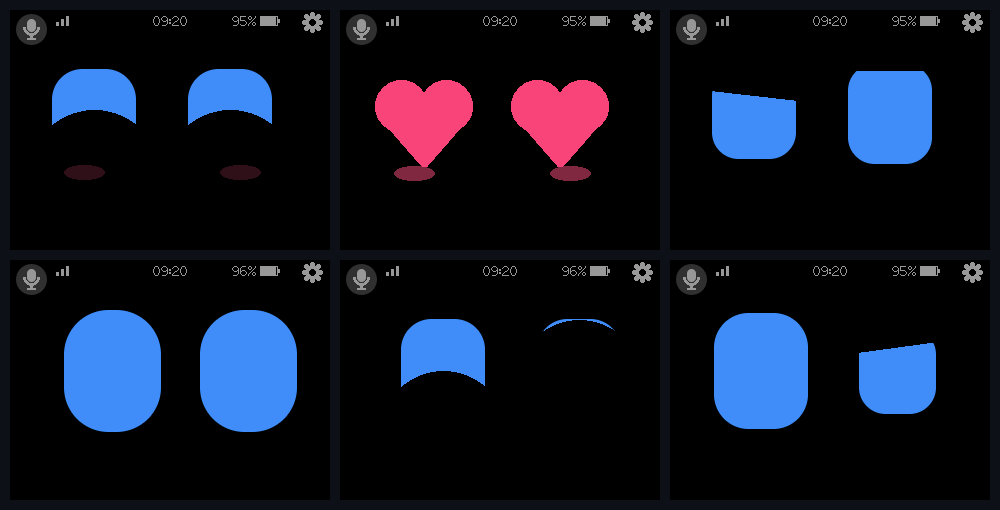
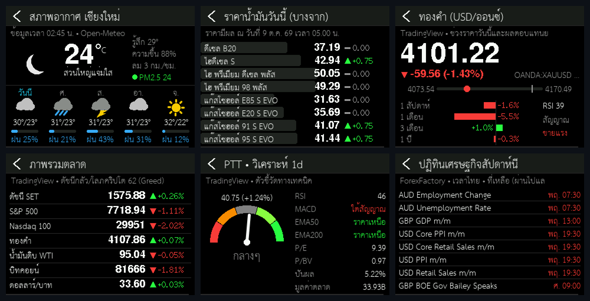
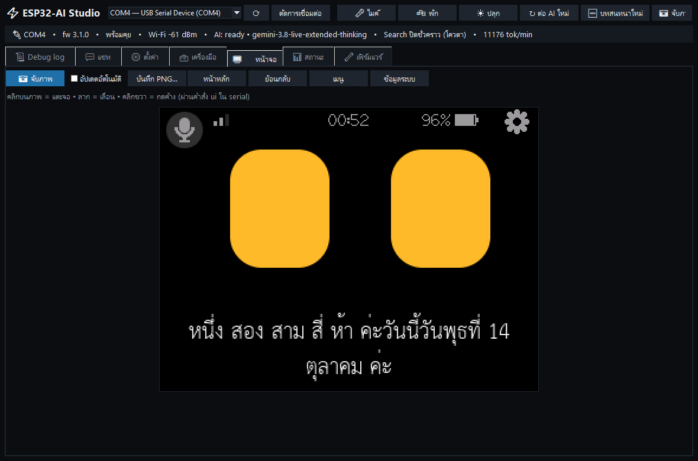
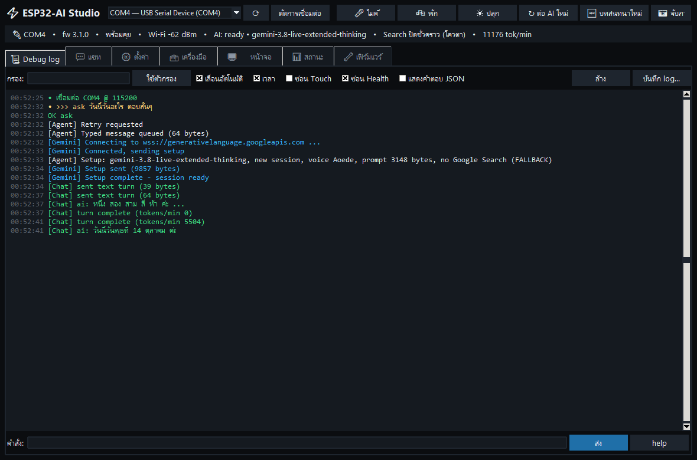
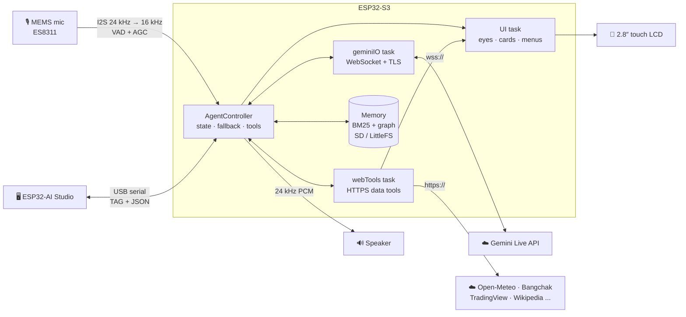

<div align="center">

# 🤖 PersonalAIBot-ESP32

### A Thai-speaking, real-time voice AI assistant on an ESP32-S3 touch screen

**Gemini Live voice** · **on-device long-term memory** · **42 tools with on-screen cards** · **PC companion app**

[](wiki/01-Hardware-ES3C28P-Pinout.md)
[](platformio.ini)
[](wiki/05-Gemini-Live-API-Protocol.md)
[](src/app/AppConfig.h)
[](host_tests/)
[](#)
[](LICENSE)

**English** · [ภาษาไทย](README.th.md)



</div>

---

## ✨ What it does

Talk to it like a person — in Thai or English. It answers with natural speech, shows its mood with animated eyes,
remembers you across days, and pulls live data (weather, fuel prices, markets, news…) onto the screen while it explains.
Everything runs on the board itself: **no server, no Raspberry Pi, no vector database** — just Wi-Fi and a Gemini API key.

| | |
|---|---|
| 🎙️ **Real-time voice** | Full-duplex audio over a TLS-verified WebSocket (mic 16 kHz up, voice 24 kHz down). Local VAD + AGC, barge-in by tapping the screen. |
| 🧠 **Long-term memory** | Facts, a small knowledge graph (GraphRAG-lite, BM25 search) and a daily conversation log stored on MicroSD — or internal flash when there is no card. Background consolidation with Flash-Lite. |
| 🧑‍💼 **Personalities** | 8 ready-made profiles, 30 voices, 7 personalities, male/female Thai politeness (ค่ะ / ครับ). Change them by touch or just by asking. |
| 👀 **Expressive face** | Cozmo-style eyes with 14 emotions, Thai subtitles, on-screen mic button, dark theme. After a while asleep it turns into a **dim clock** (power save) and wakes up — full brightness — as soon as it hears you. |
| 📊 **Live data cards** | Weather + PM2.5, Thai fuel prices, stocks / gold / crypto / FX, technical analysis, market scanner, economic calendar, news, Wikipedia — drawn as graphics while the AI talks. |
| 📻 **Internet radio** | A radio-app screen with 16 tested Thai stations (up to 40; `python tools/radio_check.py` checks a station export the way the board plays it): swipe and tap a station, ± volume, ⏸ pause, a red ⏻ button to switch the radio off, and tap the middle of the screen to talk to the assistant as usual. Say "play the luk thung station" or "station 4" and the assistant picks from your list. Edit the list (add, edit, delete, reorder, test URL) in ESP32-AI Studio. MP3/AAC via the Helix decoder; the radio dips to 12 % while you talk. Volume buttons and "turn it down" change the radio only — the assistant's voice stays at its own level (80 by default, `set aivolume`). After "play the radio" the assistant names the station and goes to sleep at once (it never answers the DJ), and "play the radio" with no station resumes the last one. [wiki/12](wiki/12-Internet-Radio.md) |
| ⏰ **Personal assistant** | Timers, reminders (daily / weekdays / weekly), to-do list, notes, price alerts that speak up, calculator, unit & world-time conversion. |
| 🔁 **Self-healing** | Automatic model fallback, quota-aware back-off, Google Search pause on quota (if enabled), session resumption, Wi-Fi reconnect. |
| 🖥️ **ESP32-AI Studio** | Dark-mode PC app: all settings, live debug log, chat, remote screen with touch, mic recorder, tool runner, build & flash. |

## 🖼️ Screenshots

<div align="center">

**Live data cards** — the AI fetches, the board draws, the AI summarises out loud



**ESP32-AI Studio** — the PC companion app

 

</div>

## 🔧 Hardware

| Part | Details |
|---|---|
| **Board** | **ES3C28P** — ESP32-S3R8 (dual-core 240 MHz, 16 MB flash, 8 MB PSRAM) with 2.8" 320×240 IPS (ILI9341V) and capacitive touch (FT6336G) |
| **Audio** | ES8311 codec, on-board MEMS mic, FM8002E amplifier → **a small 4–8 Ω speaker on the 2-pin JST connector** (required) |
| **Extras** | WS2812 RGB LED · MicroSD slot (FAT32, optional) · LiPo connector with battery gauge · BOOT button used as a push-button |
| **Network** | 2.4 GHz Wi-Fi (5 GHz is not supported by the ESP32) |

Pinout, board photos and connector guide → [wiki/01-Hardware-ES3C28P-Pinout.md](wiki/01-Hardware-ES3C28P-Pinout.md)

## 🚀 Quick start

> **No passwords or keys ship with this project.** You only need your own **2.4 GHz Wi-Fi** and a free
> **Gemini API key** from **[aistudio.google.com/api-keys](https://aistudio.google.com/api-keys)** — both are entered on the
> device after flashing and stored encrypted on *your* board.

### Option A — ready-made firmware (no programming tools)

1. Download `PersonalAIBot-ESP32-v…-factory.bin` from **[Releases](https://github.com/skyliner2008/PersonalAIBot-ESP32/releases)**.
2. Open **[espressif.github.io/esptool-js](https://espressif.github.io/esptool-js/)** in Chrome or Edge, plug the board in with USB-C and press **Connect**
   (if it is not found: hold **BOOT**, tap **RESET**, release BOOT, then connect again).
3. Flash address **`0x0`** → choose the `.bin` file → **Program**. When it finishes, press **RESET**.

Command-line alternative: `esptool.py --chip esp32s3 write_flash 0x0 PersonalAIBot-ESP32-v4.1.0-factory.bin`

> The factory image starts at `0x0`, so it also **clears saved settings** on that board (a clean install).
>
> **Already running v3.5.0 or later?** Update over Wi-Fi instead: Settings → **อัปเดตเฟิร์มแวร์** (firmware update). The board downloads the latest release's `-app.bin`, checks it (sha256, image header, version marker) and keeps your settings and memory; if the new version fails to start properly it goes back to the old one by itself. See [wiki 13](wiki/13-OTA-Update.md).

### Option B — build from source

```bash
git clone https://github.com/skyliner2008/PersonalAIBot-ESP32.git
cd PersonalAIBot-ESP32
pio run -t upload
pio device monitor
```

Needs [PlatformIO](https://platformio.org/install) (VS Code extension or `pip install platformio`); libraries download automatically.
Updating this way keeps your saved Wi-Fi / API key.

> **Optional:** pre-fill Wi-Fi and the API key at build time by copying `include/secrets.example.h` to `include/secrets.h`
> (it is git-ignored). Never publish a firmware image built that way — `tools/make_release.py` refuses to.

### First boot — enter your own Wi-Fi and API key

1. **Touch calibration** — tap the three targets.
2. Tap ⚙ (or hold **BOOT** for 1.5 s) → **Wi-Fi** → scan and pick your network → type the password with the on-screen Thai/English keyboard.
3. **API key** → type the key → **Test API key** shows which models your key can use.
4. When the screen says **"พร้อมคุย" (ready)** — just start talking.

**Or set it up from a PC with the SD card:** copy [`tools/sd_card/ai-setup.txt`](tools/sd_card/ai-setup.txt) to the root of the
micro SD card (FAT32), fill in `WIFI_SSID`, `WIFI_PASSWORD` and `GEMINI_API_KEY`, put the card in the board and power it on.
The board imports the file, stores the values encrypted in `agent/secrets.json` on the card and deletes the plain file.
(The Studio's **💾 SD card file…** button writes this file for you.)

Prefer a keyboard? Use the PC app instead (step below) — every setting is there.

### ESP32-AI Studio (PC app, optional)

Needs Python 3.9+ (the python.org installer includes Tkinter). Get the repo (`git clone`, or **Code → Download ZIP**), then:

```bash
pip install -r tools/pc_app/requirements.txt
python tools/pc_app/esp32_ai_studio.py
```

On Windows you can double-click `tools\pc_app\run_studio.bat`. Close the Studio (or press **Disconnect**) before flashing from another tool — or flash from the Studio's **🔧 Firmware** tab, which releases the port for you.

## 💬 Using it

| Do this | What happens |
|---|---|
| Speak when the screen shows **พร้อมคุย** | Voice answer + subtitles (and a data card when relevant) |
| Tap 🎤 (top-left) | Mute / unmute the mic |
| Tap the screen or press BOOT while it speaks | Stop talking (barge-in) |
| Tap while asleep / paused | Wake up / reconnect immediately |
| Say **"Hi ESP"** while asleep | Offline wake word (ESP-SR WakeNet after our echo removal, works over the radio) — ⚙ menu "ปลุกด้วยเสียง" / Studio / `set wake level\|word\|both`, `set wakeword hiesp\|jarvis`, `set wakethreshold 0.5` |
| Say **"Hi ESP"** while the assistant is talking | It stops and listens to you at once - the speaker is removed from the mic first, so its own voice cannot interrupt it |
| "turn on the fan", "dim the desk lamp to 30", "is the door closed?" | Your own relays, dimmers, buttons/sensors and analog inputs on the free pins, listed by name in `agent/devices.json` on the SD card — see [wiki 15](wiki/15-Expansion-Ports.md) for the free ports and what they can drive |
| Long-press the screen 1.5 s | Fresh conversation (long-term memory stays) |
| Silent for 3 min → asleep (closed eyes); 5 more min → **dim clock** | Speak or tap to wake: full brightness + eyes open (times: ⚙ menu / Studio / by voice) |
| "turn it down a bit", "brighter", "rest the screen", "mute the mic" | Volume / brightness up-down, dim clock right away, mic off by voice — turning the mic **on** is only possible with the 🎤 button (the mute survives reboots) |
| Tap a data card | Close it (cards also close after ~30 s) |

**Things to try** *(Thai shown, English works too)*

```text
"จำไว้นะว่าฉันแพ้กุ้ง"                    → saves a memory          ("Remember I'm allergic to shrimp")
"อากาศที่เชียงใหม่วันนี้เป็นยังไง ฝุ่นเยอะไหม" → weather + PM2.5 card
"ราคาน้ำมันดีเซลวันนี้เท่าไหร่"               → Thai fuel price table
"วิเคราะห์ทองคำทุกกรอบเวลา"                 → multi-timeframe gauge card
"หุ้นไทยตัวไหนขึ้นแรงวันนี้"                  → SET top gainers
"สัปดาห์นี้มีข่าวเศรษฐกิจอะไรสำคัญ"            → economic calendar in Thai time
"เตือนฉันถ้าบิทคอยน์ต่ำกว่า 80,000"           → spoken price alert (checked every 2 min)
"เตือนกินยาทุกวันสองทุ่ม"                    → daily reminder that rings
"เปลี่ยนเป็นเสียงผู้ชาย" / "ราตรีสวัสดิ์"         → change voice / go to sleep
```

## 🛠️ Tools

The model calls these by itself. Data tools run in a background task and draw a card while the AI keeps talking. The same lookup asked again within its refresh time (weather 10 min, fuel 30 min, news 5 min, quotes 1 min) is answered from memory - no new HTTPS round trip. Weather for any of the 77 Thai provinces takes ~3 s: their coordinates are built in (no geocoding request), and a lookup someone is waiting for runs above the screen animation.

<details>
<summary><b>All 42 tools</b> (36 without the optional finance pack)</summary>

| Group | Tools |
|---|---|
| **Memory** | `save_memory` · `save_relation` · `recall_memory` · `forget_memory` · `recall_conversation` |
| **Time & tasks** | `set_timer` · `set_reminder` · `list_reminders` · `cancel_reminder` · `add_task` · `list_tasks` · `update_task` |
| **Assistant & device** | `get_device_status` · `set_expression` · `configure_assistant` · `list_assistant_options` · `set_volume` · `set_brightness` (level or +/- change) · `configure_device` (mic, sleep, clock mode) · `rest_screen` (clock now) · `play_radio` / `stop_radio` (Internet radio) · `mute_microphone` · `control_led` · `go_to_sleep` |
| **Live data** 🖼️ | `get_weather` (Open-Meteo + PM2.5, IP location by default) · `get_oil_price` (Bangchak) · `get_market_quote` (TradingView) · `convert_currency` · `get_news` (Google News) |
| **Utilities** 🖼️ | `calculate` · `convert_units` (incl. Thai ไร่/งาน/ตารางวา, บาททอง) · `get_world_time` (DST-aware) · `get_location` · `search_knowledge` (Wikipedia th/en) · `notes` |
| **Finance pack** 🖼️ | `market_overview` (+ crypto Fear & Greed) · `market_analysis` (RSI, MACD, EMA, ADX, multi-timeframe, P/E, dividend) · `market_scan` (gainers / losers / volume / RSI, TH-US-crypto) · `economic_calendar` (ForexFactory, Thai time) · `position_size` · `price_alert` |
| **Web search** | No general web search by default: Google Search grounding needs a key with a Search allowance (free-tier projects have none — `set search 1` to enable on a paid key). Current events go through `get_news` (Google News, last 7 days first), facts through `search_knowledge`. DuckDuckGo was evaluated and is not usable (no free search API; the HTML page blocks automated requests). |

All data sources are free and key-less; every HTTPS connection is certificate-verified.
Results say **when** a figure is valid, so the assistant does not call old data "today": `as_of` on every live-data result, the fuel price's effective date, market open/closed + quote time, news publish time.
Market data comes from TradingView's public scanner endpoint (unofficial) and is **read-only** — the assistant cannot place trades or connect to a broker. **For information only, not investment advice.**

Details and timings → [wiki/11-Data-Tools-and-Cards.md](wiki/11-Data-Tools-and-Cards.md) · [wiki/09-Assistant-Profiles-and-Tools.md](wiki/09-Assistant-Profiles-and-Tools.md)

</details>

## 🏗️ Architecture



- **Models:** preferred Live model → `gemini-3.8-live` → `gemini-3.8-live-extended-thinking` → `gemini-3.1-flash-live-preview`; text tasks use `gemini-3.5-flash-lite` → `gemini-3.1-flash-lite`. Quota / overload / auth errors are classified and each model cools down separately.
- **Memory budget:** audio rings, the LCD sprite, WebSocket frames and all TLS buffers live in PSRAM, keeping ~85 KB of internal RAM free under full load.
- **Tokens:** local VAD, context compression and auto-sleep keep usage well under the 65k tokens/min Live limit.

Full design → [PROJECT_ARCHITECTURE_SPEC.md](PROJECT_ARCHITECTURE_SPEC.md)

## 🖥️ ESP32-AI Studio

| Tab | Highlights |
|---|---|
| 📜 Debug log | Colour-coded live log, regex filter, copy/save, console with history |
| 💬 Chat | Type to the assistant; it answers through the board's speaker |
| ⚙️ Settings | Wi-Fi scan, API key + self-test, profile / voice / personality, models, Search, mic sensitivity, finance tools, import/export (no secrets) |
| 🧰 Tools | Record what the AI hears (waveform + WAV), speaker test, run any of the AI's tools, eye emotions, memory tools |
| 🖥️ Screen | Live mirror of the LCD — click to tap, drag to swipe, right-click to long-press |
| 📊 Status | Session, models & cool-downs, tokens/min graph, RAM, storage, battery |
| 🔧 Firmware | Build, build + upload, host unit tests |
| 📻 Radio | Station list: play / stop, add, edit, delete, reorder, reset to defaults, test a stream URL from the PC |

Copy/paste works with both Thai and English keyboard layouts. Docs → [wiki/10-PC-Studio-App.md](wiki/10-PC-Studio-App.md)

## 🧪 Tests

Portable modules (memory, tools, scheduler, tasks, personas, model fallback, calculator, units …) are tested on the PC:

```bat
host_tests\run_tests.bat
```

43 suites · 2,007 checks · needs Visual Studio Build Tools (`cl.exe`) and one `pio run` first (for ArduinoJson).
Linux / macOS / CI: `bash host_tests/run_tests.sh` (g++ or clang++).

## 📁 Project layout

```text
src/agent      AgentController (the brain: setup/loop) + AgentSession (Wi-Fi, Live session, fallback, tool calls),
               AgentMic (VAD/AGC), AgentRoutines (sleep, reminders, consolidation), AgentDevice (status, device, radio),
               AgentTools, WebTools + WebToolsExtra (data tools), Personas, Scheduler, TaskList
src/ai         GeminiLiveClient (geminiIO task), TextModelClient, ModelFallback, root CAs
src/ui         Eyes, FaceScreen, CardScreen (data cards), menus, Thai keyboard
src/audio      AudioManager (I2S), ES8311 driver, resampler
src/memory     MemoryStore (BM25 + graph), EpisodicLog
src/display    LovyanGFX config, touch driver, Thai fonts 26/20 px
src/system     I2C bus, storage (SD / LittleFS) · src/util  UTF-8, calculator, units, time, JSON helpers
tools/pc_app   ESP32-AI Studio (Python + Tkinter + pyserial)
tools/         gen_thai_font.py, gen_root_ca.py
host_tests/    PC unit tests
wiki/          Obsidian knowledge base (Thai): hardware, setup, protocol, UI, memory, troubleshooting log
```

## 📚 Documentation

| | |
|---|---|
| [00 Home dashboard](wiki/00-Home-Dashboard.md) | Index and change log |
| [01 Hardware](wiki/01-Hardware-ES3C28P-Pinout.md) · [02 Installation](wiki/02-Installation-and-Setup.md) · [03 Libraries](wiki/03-Libraries-and-Dependencies.md) | Board, setup, dependencies |
| [04 Architecture](wiki/04-System-Architecture.md) · [05 Gemini Live protocol](wiki/05-Gemini-Live-API-Protocol.md) | How it works |
| [06 Eyes & Thai UI](wiki/06-Avatar-and-Thai-UI.md) · [08 Long-term memory](wiki/08-Long-Term-Memory-GraphRAG.md) | Face, menus, memory design |
| [09 Profiles & tools](wiki/09-Assistant-Profiles-and-Tools.md) · [11 Data tools & cards](wiki/11-Data-Tools-and-Cards.md) | What the assistant can do |
| [10 PC Studio](wiki/10-PC-Studio-App.md) · [07 Troubleshooting log](wiki/07-Troubleshooting-Log.md) | Tools and 40+ solved problems |
| [12 Internet radio](wiki/12-Internet-Radio.md) | Streaming, mixing/ducking, voice wake over music |
| [13 Firmware update (OTA)](wiki/13-OTA-Update.md) | Over Wi-Fi from GitHub Releases, verified, automatic rollback |

## 🔒 Security & privacy

**Where your Wi-Fi password and API key live**

| Place | Contains secrets? |
|---|---|
| Source code in this repo | **No.** Secrets are typed on the device (touch menu or Studio), never into the code. |
| `include/secrets.h` (optional build-time defaults) | Only if you fill it in — it is **git-ignored**, so it is never uploaded. `secrets.example.h` holds placeholders only. |
| Firmware binary (`.pio/`) | Only if you used `secrets.h`; the build folder is git-ignored. |
| The SD card — `agent/secrets.json` (or the board's NVS flash when no card is inserted) | **Yes, encrypted** — AES-256-GCM with a key derived from this chip's factory MAC + unique-ID eFuses (`src/app/SecretBox.*`). The file opens only on the board that wrote it (moving the card to another board = set up again with `ai-setup.txt`); reading the card on a PC shows no secrets. A plain `ai-setup.txt` is overwritten and deleted right after import. Older plain-text copies are wiped automatically once (including the Wi-Fi driver's own copy, now disabled with `WiFi.persistent(false)`). |

- This is not full flash encryption: someone who has your board **and** this firmware could still derive the key. Use a dedicated API key and rotate it if the board is lost.
- Neither the firmware nor the Studio ever prints the API key or Wi-Fi password; `config` shows only a masked hint and `secretsSealed`. Exported settings files contain no secrets; voice recordings (`recordings/`) are git-ignored.
- Audio is streamed to Google's Gemini API while the mic is open. Memory and notes stay on the board's SD card / flash.
- The Gemini key is sent in the `x-goog-api-key` header (never in a URL). Data tools only use certificate-verified HTTPS; plain `http://` is refused.

## 🧑‍💻 For developers

- **Fork & build:** `pio run` builds from a clean clone — no `secrets.h` needed. Settings live in NVS (`src/app/Settings.*`), so your own keys never touch the source tree.
- **Add a tool:** declare it in `AgentTools::addDeclarations` (`src/agent/AgentTools.cpp`); network tools go in `src/agent/WebToolsExtra.cpp` and draw a `CardData` (see [wiki/11](wiki/11-Data-Tools-and-Cards.md)).
- **Test without a board:** `host_tests\run_tests.bat`; on a board, every tool can be called from the Studio's 🧰 tab or the serial console (`tool <name> {json}`).
- **See the Live API conversation:** `trace on` on the serial console prints one `[Trace]` line per server event (transcripts, tool calls, `generationComplete` / `turnComplete`; audio chunks only counted) and per JSON message the board sends (`trace off` to stop, not saved) — how a doubled answer after tool calls was tracked down ([T071](wiki/07-Troubleshooting-Log.md)).
- **Publishing a release:** bump `FIRMWARE_VERSION` in `src/app/AppConfig.h` → commit → `git push` → `python tools/publish_release.py`. The script builds the factory image (`tools/make_release.py`), creates the GitHub Release as a draft, uploads the factory image and the OTA `-app.bin` (each with a `.sha256`), publishes it and re-downloads it to check the sha256. The host tests run before anything is published (`--skip-tests` only on a PC without a compiler). Releases here are **immutable**: a published version can never get new files or reuse its tag, so every release needs a new version number. (`--dry-run` only checks.)
- **CI:** [`.github/workflows/firmware.yml`](.github/workflows/firmware.yml) does the same on GitHub Actions but is manual-only for now (*Actions → Firmware → Run workflow*); the release job waits for the host-tests job. `tools/make_release.py` refuses to run while `include/secrets.h` holds real values and scans the image for API-key-like strings.
- **Docs:** the `wiki/` folder is an Obsidian vault; please add problems you solve to [wiki/07-Troubleshooting-Log.md](wiki/07-Troubleshooting-Log.md).

Pull requests and issues are welcome.

## 📄 License

[MIT](LICENSE) © 2026 skyliner2008 — free to use, modify and share; keep the copyright notice. Third-party fonts, libraries and data services keep their own licenses/terms (see [LICENSE](LICENSE)).

## 🙏 Credits

- [Google Gemini Live API](https://ai.google.dev/gemini-api/docs/live) · [LovyanGFX](https://github.com/lovyan03/LovyanGFX) · [ArduinoJson](https://arduinojson.org/) · [Adafruit NeoPixel](https://github.com/adafruit/Adafruit_NeoPixel)
- Thai font: **TH Sarabun New** (SIPA, Thai national font) · MP3/AAC decoding: **RealNetworks Helix** (RPSL, `lib/helix-*`) — `noiseless.c` patched: a damaged AAC frame is rejected instead of looping forever (a station rebooted the board) · default station list checked with the help of [Radio Browser](https://www.radio-browser.info)
- Data: [Open-Meteo](https://open-meteo.com/) · [Bangchak](https://www.bangchak.co.th/) · [TradingView](https://www.tradingview.com/) · [Wikipedia](https://www.wikipedia.org/) · [ForexFactory](https://www.forexfactory.com/) · [alternative.me](https://alternative.me/crypto/fear-and-greed-index/) · [ipwho.is](https://ipwho.is/) · Google News
- Tools and finance features ported from the **PersonalAIBot** Android app

<div align="center">

Made with ❤️ in Thailand · ⭐ Star the repo if it helped you

</div>
