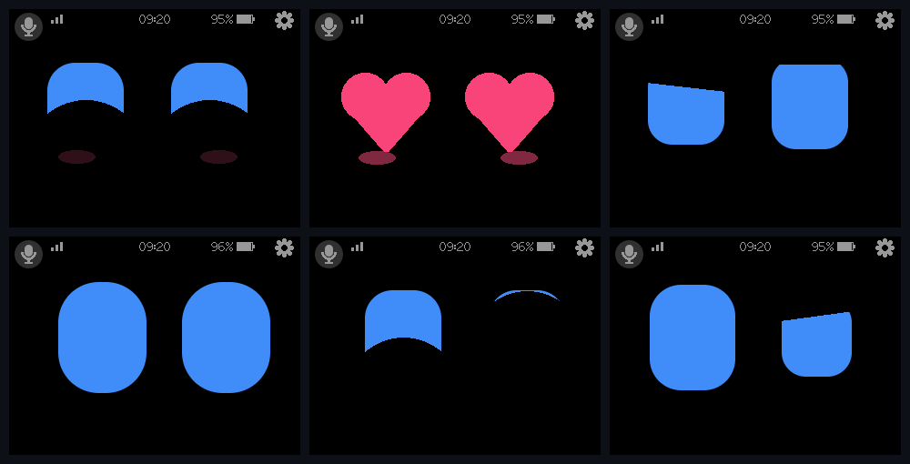
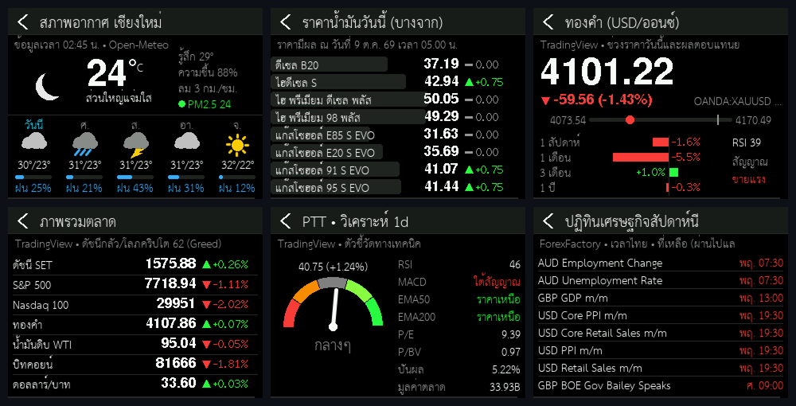
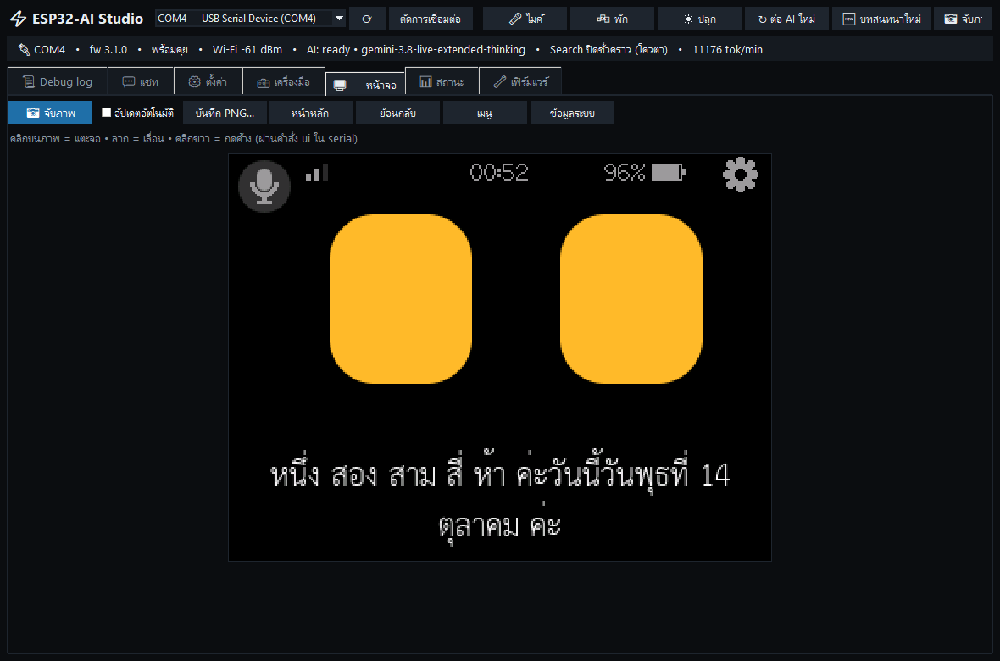
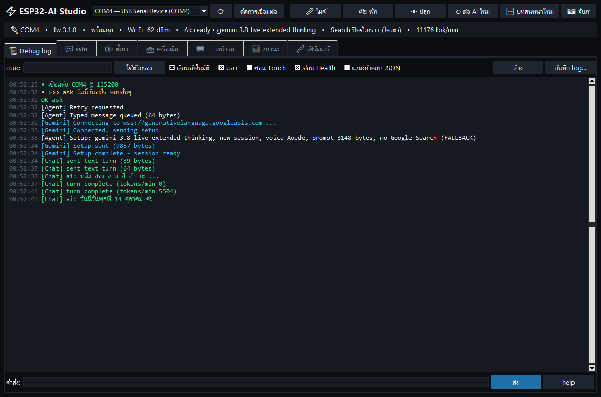
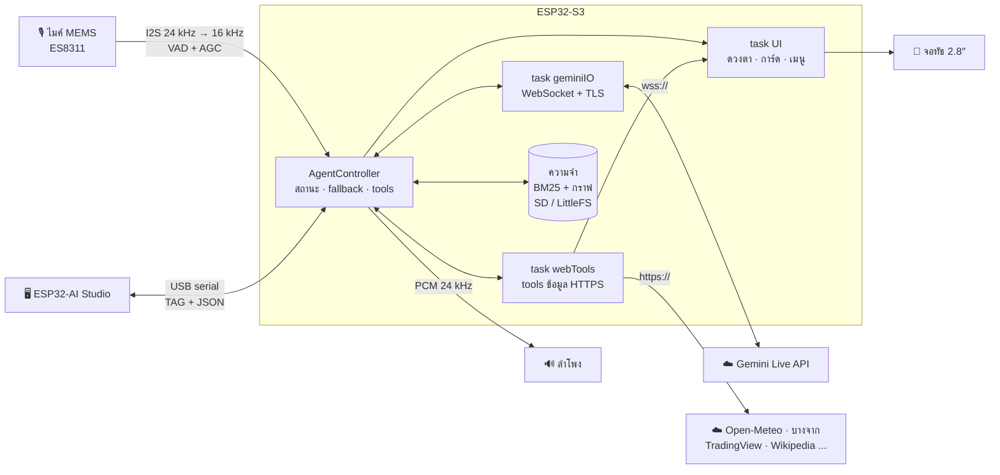

<div align="center">

# 🤖 PersonalAIBot-ESP32

### ผู้ช่วย AI คุยด้วยเสียงภาษาไทยแบบเรียลไทม์ บนบอร์ด ESP32-S3 จอสัมผัส

**คุยเสียงด้วย Gemini Live** · **ความจำระยะยาวในตัวเครื่อง** · **42 tools พร้อมการ์ดกราฟิกบนจอ** · **แอปคู่หูบน PC**

[](wiki/01-Hardware-ES3C28P-Pinout.md)
[](platformio.ini)
[](wiki/05-Gemini-Live-API-Protocol.md)
[](src/app/AppConfig.h)
[](host_tests/)
[](#)
[](LICENSE)

[English](README.md) · **ภาษาไทย**



</div>

---

## ✨ ทำอะไรได้บ้าง

คุยกับมันได้เหมือนคุยกับคน — ภาษาไทยหรืออังกฤษ มันตอบด้วยเสียงที่เป็นธรรมชาติ แสดงอารมณ์ด้วยดวงตาบนจอ
จำเรื่องของคุณข้ามวันได้ และดึงข้อมูลสด (อากาศ, ราคาน้ำมัน, หุ้น, ข่าว ฯลฯ) มาแสดงเป็นกราฟิกบนจอระหว่างที่อธิบาย
ทุกอย่างทำงานบนบอร์ดเอง: **ไม่ต้องมี server, ไม่ต้องมี Raspberry Pi, ไม่ต้องมี vector database** — ใช้แค่ Wi-Fi กับ Gemini API key

| | |
|---|---|
| 🎙️ **คุยเสียงเรียลไทม์** | เสียงสองทางผ่าน WebSocket ที่ตรวจใบรับรอง TLS (ไมค์ 16 kHz ขึ้น / เสียง AI 24 kHz ลง) มี VAD + AGC ในเครื่อง แตะจอเพื่อขัดจังหวะได้ |
| 🤖 **ทำงานแบบเอเจนต์** | เสียงคือช่องทางหลัก ไม่ต้องอ่านจอ: ตอบละเอียด ตัวเลขตรงตามข้อมูล (ทศนิยม 2 หลัก) เรื่องที่มีรายละเอียดมากเล่ายาวจนครบ พูดมีอารมณ์ร่วมแบบคนจริง บอกว่าตัวเลขแปลว่าอะไร ลงมือเรียกเครื่องมือเอง ต่อกันหลายขั้นได้ ("พรุ่งนี้ฝนตกไหม ถ้าตกตั้งเตือนพกร่ม 7 โมง" → ดูอากาศ → ตั้งเตือนให้) ตอบคำถามซ้อนให้ครบ บน Gemini 3.8 Live ระหว่างดึงข้อมูลจากเน็ต AI พูด "ขอเช็คแป๊บนึง" แทนการเงียบรอ ถามราคาทองได้ราคาทองแท่งไทยบาทละโดยประมาณด้วย |
| 🧠 **ความจำระยะยาว** | เก็บข้อเท็จจริง, กราฟความสัมพันธ์ (GraphRAG-lite ค้นด้วย BM25) และบันทึกบทสนทนารายวันลง MicroSD — ไม่มีการ์ดก็ใช้แฟลชในตัว จัดระเบียบความจำเบื้องหลังด้วย Flash-Lite |
| 🧑‍💼 **บุคลิก** | โปรไฟล์สำเร็จรูป 8 แบบ (ไข่มุก, ภูมิ, ลีน่า, ธันวา, มะปราง, โอม, น้ำ, ครูเก่ง), เสียง 30 แบบ, นิสัย 7 แบบ, ลงท้าย ค่ะ/ครับ — เปลี่ยนผ่านเมนูทัชหรือสั่งด้วยเสียง |
| 👀 **ใบหน้ามีชีวิต & เมนูสมาร์ทวอช** | ดวงตาสไตล์ Cozmo 14 อารมณ์, ซับไตเติลภาษาไทย, ไอคอนคมชัดแบบ anti-aliased (ปุ่มไมค์มุมซ้ายล่าง), status bar สูงเท่ากัน (Wi-Fi แบบพัด + เวลา Oswald), ตรวจจับไฟ `USB ⚡` / `% แบต` อัตโนมัติ (T170: แยก USB / แบตจากการกระโดดของแรงดันตอนเสียบ/ถอด + สัญญาณ USB ของ PC, % เปลี่ยน ≤ 1 %/นาที - บน USB ขึ้นอย่างเดียว บนแบตลงอย่างเดียว - และ `% ⚡` ตอนชาร์จ; console `bat`), ปุ่มลัดมุมขวาล่างเปิดได้ทั้ง **เครื่องเล่น วิทยุ/MP3 (`♫`)** และ **หน้าปัดรถ**, พร้อม **เมนูตั้งค่าสไตล์สมาร์ทวอช** (การ์ดไอคอนสีสันสดใส 8 หมวด 2 หน้า ปัดซ้าย/ขวาได้) — พักนานจะเปลี่ยนเป็น**หน้าจอพักนาฬิกาหรี่แสง 7 ธีม** (*ดิจิทัล + สภาพอากาศ*, *สมาร์ทวอช วงแหวน*, *ฟลิปการ์ด ไซเบอร์*, *คลาสสิก มินิมอล*, *อนาล็อก เข็มนาฬิกา*, *ตัวเลขใหญ่ ตั้งโต๊ะ*, *ดวงอาทิตย์ & ดวงจันทร์*) เลือก**สีนีออนได้ 9 สี** (ฟ้า เขียว ชมพู ส้ม เหลือง ม่วง แดง ขาวนวล หรือตามสีดวงตา) นาฬิกาใหญ่เต็มจอ แสดงเวลา วันที่ไทย และสภาพอากาศสด + PM2.5 ของจังหวัดที่เลือก และตื่นพร้อมจอสว่างทันทีที่ได้ยินคำปลุกหรือแตะจอ |
| 📊 **การ์ดข้อมูลสด** | อากาศ + PM2.5, ราคาน้ำมันไทย, หุ้น/ทอง/คริปโต/ค่าเงิน, วิเคราะห์เทคนิค, สแกนหุ้น, ปฏิทินเศรษฐกิจ, ข่าว, Wikipedia — วาดเป็นกราฟิกขณะ AI พูด |
| 📻 **วิทยุออนไลน์** | หน้าจอแบบแอปวิทยุ พร้อม 16 สถานีไทยที่ทดสอบแล้ว (เพิ่มได้ถึง 40 — `python tools/radio_check.py` ตรวจรายชื่อสถานีแบบเดียวกับที่บอร์ดเล่น; ถอดรหัส AAC ที่เฟรมเสียไม่ค้างจนรีบูตแล้ว): เลื่อนแล้วแตะเลือกสถานี ปุ่มเพิ่ม/ลดเสียง ปุ่ม ⏸ หยุดชั่วคราว ปุ่ม ⏻ ปิดวิทยุ (สีแดง) และแตะกลางจอเพื่อสั่งงาน AI ได้เหมือนเดิม พูด "เปิดวิทยุลูกทุ่ง" หรือ "สถานีที่ 4" แล้ว AI จะเลือกจากรายการให้ แก้รายการ (เพิ่ม แก้ ลบ เรียงลำดับ ทดสอบ URL) ได้ใน ESP32-AI Studio ถอดรหัส MP3/AAC ด้วย Helix และวิทยุจะเบาลงเหลือ 12% ระหว่างคุย ปุ่มปรับเสียงและคำสั่ง "เบาเสียงหน่อย" ปรับเฉพาะวิทยุ — เสียง AI ล็อกไว้ที่ระดับของตัวเอง (ค่าเริ่มต้น 80, `set aivolume`) สั่งเปิดวิทยุแล้ว AI บอกชื่อสถานีแล้วพักทันที (ไม่ฟังหรือตอบเสียงดีเจ) และสั่ง "เปิดวิทยุ" เฉยๆ จะเล่นสถานีล่าสุด ถามข้อมูล (อากาศ ข่าว ...) ระหว่างเปิดวิทยุ เซสชันจะรอจน AI ตอบเสร็จ (T119) **เพลง MP3 จาก SD card (T122):** ปุ่มสลับ [วิทยุ | MP3] บนหน้าวิทยุ เล่นเพลงในโฟลเดอร์ `music` ของ SD card (และโฟลเดอร์ย่อย 1 ชั้น) แสดงชื่อเพลงและศิลปินจาก ID3 tag (รองรับ tag ภาษาไทย) หรือชื่อไฟล์ จบเพลงเล่นเพลงถัดไป หยุดแล้วเล่นต่อจากจุดเดิม สั่งด้วยเสียง "เปิดเพลง ...", "เปลี่ยนเพลง", "เพลงก่อนหน้า", "สุ่มเพลง" หรือ console `music` ถ้าการ์ดหยุดตอบ บอร์ด mount ใหม่เองโดยไม่ต้องรีบูต (T125) **ใส่เพลงจาก PC (T123):** ESP32-AI Studio → แท็บ 🎵 เพลง (SD) ส่งไฟล์ MP3 ลงการ์ดผ่านสาย USB (ตรวจ sha256, ~140 KB/s ≈ 1 นาทีต่อเพลง 8 MB) ดูรายการ เล่น และลบได้ — ใช้ตัวถอดรหัสเดียวกับวิทยุ ไม่กิน RAM เพิ่ม [wiki/12](wiki/12-Internet-Radio.md) |
| 🏁 **หน้าปัดรถ** (ใหม่, **เฉพาะ ES3C28P** — ไม่มีในเฟิร์มแวร์ P4 และบอร์ดจิ๋ว) | หน้าปัดรถยนต์และมอเตอร์ไซค์ 3 รูปแบบ — **รถแข่ง** (บาร์รอบ), **วงกลมดิจิทัล สปอร์ต** (วงแหวนไฟ) และ **เข็มวงกลม คลาสสิก** (วัดรอบ + ความเร็ว) — มี shift light, ความเร็ว, เกียร์, ช่องอุณหภูมิเครื่อง / แบต / อากาศเข้า เปลี่ยนเป็นเหลือง/แดงเมื่อเกินเกณฑ์ เปิดด้วยปุ่มรูปหน้าปัดมุมขวาล่างของหน้าหลัก หรือพูด "เปิดหน้าปัด" (ยังไม่ได้เลือกแหล่งข้อมูล = เปิดตัวจำลองให้) แตะแถบหัวเพื่อสลับแบบ ข้อมูลจาก **Honda K-Line** (Wave 110i / 125i, Click, PCX ... ผ่านบอร์ดแปลงแบบ L9637D), OBD-II ผ่าน ELM327 ต่อสาย, ข้อความจากบอร์ดอื่น หรือตัวจำลองในตัว (นิ้วเป็นคันเร่ง) — ELM327 แบบ Bluetooth LE (หรือ dual-mode) ใช้เฟิร์มแวร์แยก `pio run -e esp32s3-ble -t upload` (ไม่อยู่ใน release ตั้งแต่ T192 — RAM ~23 KB ของบลูทูธให้สตรีมราคาสดแทน) — ตั้งแต่ T113 ใช้ OBD ผ่านบลูทูธพร้อมผู้ช่วยเสียงได้ (ย้าย buffer/ออบเจกต์ไป PSRAM, pool ของ NimBLE อยู่ใน PSRAM, ฟังคำปลุกคำเดียวขณะใช้บลูทูธ; บลูทูธเปิดเฉพาะตอนเปิดหน้าปัด ปิดหน้าปัดแล้วได้ RAM คืน) **ล็อกภาษาของ AI (T116):** ตั้งค่า "ภาษาที่ AI พูด" ไทย (ล็อก, ค่าเริ่มต้น) / English / ตามภาษาที่ผู้ใช้พูด (`set language th` / `en` / `auto`, Studio) **log OBD + เล่นย้อนหลัง (T115; ตรวจ log จากรถจริงครั้งแรกใน T117: แก้ VIN ที่รถตอบ "รอสักครู่"):** ทุกคำสั่ง/คำตอบของ adapter สถานะ เหตุการณ์ ค่าทุกวินาที รหัสปัญหา และสุขภาพรถ ลง SD card (`agent/obdlog`, sync ทุก 2 วิ) ดึงลง PC ด้วย `python tools/obd_log.py` (`pull`, `summary`, `csv`, `replay`) และแหล่งหน้าปัด "เล่นย้อนหลังจาก log" เล่นการขับที่บันทึกไว้ผ่านตัวคุยกับ ELM327 ตัวเดิม — อัปเดต OTA จะได้เฟิร์มแวร์ปกติที่ไม่มีบลูทูธ AI อ่านค่าสดได้ ("เครื่องร้อนไหม") และพูดเตือนเองเมื่อเครื่องร้อนจัดหรือไดชาร์จไม่ชาร์จ **OBD-II อัจฉริยะ (T112):** หาโปรโตคอลของรถเอง (จำไว้ และลองทีละตัวเมื่อ adapter หาเองไม่เจอ) และหา baud ของ adapter เอง อ่าน**ทุก PID ที่รถมี** โดยอ่านตัวที่จำเป็นก่อน (เร็วตอนเปิดหน้าปัด ช้าลงตอนปิด) **รหัสปัญหาพร้อมความหมาย** (stored / pending / permanent) freeze frame, VIN, readiness และล้างรหัส **วิเคราะห์สุขภาพรถ**จากค่าสด (ความร้อนขึ้นเร็ว ไดชาร์จไม่ชาร์จ แบตอ่อนตอนจอด/ตอนสตาร์ท ส่วนผสมบาง/หนาหรือมีรอยรั่วอากาศ เดินเบาไม่นิ่ง น้ำมันใกล้หมด) และ**ทริปพร้อม กม./ลิตร** (จาก PID อัตราใช้น้ำมัน, MAF หรือ MAP) ใช้ความเร็วจาก GPS มือถือเมื่อกล่องมอเตอร์ไซค์ไม่มี หน้าปัดแบบที่ 4 **"ข้อมูลรถ + วิเคราะห์"** (9 ค่า, รหัสปัญหา, สิ่งผิดปกติที่ร้ายแรงสุด) และไอคอนเครื่องยนต์สีอำพันเมื่อไฟเช็คเครื่องติด ถาม "รถเป็นยังไงบ้าง" "สแกนรถให้หน่อย" "P0420 คืออะไร" (ไม่ต้องมีรถ) หรือ "ล้างรหัสปัญหา" — ตัวจำลองในตัวมีรหัสปัญหาด้วย ลองได้ทั้งหมดโดยไม่มีรถ — ยังไม่ได้ทดสอบกับรถจริง [wiki/16](wiki/16-Vehicle-Dash.md) |
| 🧭 **นำทางร่วมกับมือถือ** (ใหม่ ยังไม่ได้ลองในรถ) | ⚠️ **แอปมือถือ 2.2.0 ขึ้นไปไม่ส่งจุดเลี้ยวให้บอร์ดแล้ว** (T182: ตัดการอ่านแจ้งเตือนของ Google Maps ออก เพราะ Play Protect บล็อก APK ที่มีสิทธิ์นี้) — ใช้ได้: GPS มือถือบนหน้าปัด, "ตอนนี้อยู่ไหน", "นำทางไป …" เปิด Google Maps · ระบบเดิม: Google Maps บนมือถือ Android คำนวณเส้นทาง บอร์ดแสดงจุดเลี้ยวถัดไป (ลูกศร ระยะ ชื่อถนน เวลาถึง) เป็นจอนำทางหรือแถบบนหน้าปัด และ AI **พูดเตือนก่อนเลี้ยว ~20 วินาที** ("อีก 300 เมตร เลี้ยวขวาเข้า ถ.พระราม 4") พูด "นำทางไปเซ็นทรัลเวิลด์" มือถือจะเปิด Google Maps ให้ ถาม "อีกไกลไหม" "ถึงกี่โมง" "ตอนนี้อยู่ไหน" ได้ GPS มือถือใช้เป็นความเร็วของหน้าปัดได้ด้วย (รถทุกคัน) เชื่อมผ่าน Hotspot มือถือ (Wi-Fi) หรือ USB จับคู่ด้วย USB ครั้งเดียว ทั้งสองฝั่งพิสูจน์การจับคู่ (HMAC โดยบอร์ดพิสูจน์ก่อน) และทุกบรรทัดทาง Wi-Fi มีตราประทับ HMAC คนอื่นใน Wi-Fi เดียวกันแทรกข้อมูลไม่ได้ [wiki/18](wiki/18-Phone-Link-Navigation-Plan.md) |
| ⏰ **ผู้ช่วยส่วนตัว** | ตั้งเวลา, แจ้งเตือน (ทุกวัน/วันทำงาน/ทุกสัปดาห์), รายการงาน, สมุดโน้ต, แจ้งเตือนราคาด้วยเสียง, เครื่องคิดเลข, แปลงหน่วย, เวลาต่างประเทศ |
| 🔁 **ซ่อมตัวเองได้** | สลับโมเดลอัตโนมัติ, หยุดพักเมื่อติดโควตา, ปิด Google Search อัตโนมัติเมื่อโควตาหมด, resume เซสชัน, ต่อ Wi-Fi ใหม่ — และ**จำ Wi-Fi ที่เคยต่อได้ 6 เครือข่าย** ถ้า Wi-Fi หลักใช้ไม่ได้จะสลับไปตัวที่สัญญาณแรงที่สุดเอง และย้ายไปตัวที่จำไว้ที่แรงกว่าชัดเจน (≥ 10 dB) เมื่อกลับมาอยู่ในระยะ เมนู Wi-Fi บอกว่าต่อตัวไหนอยู่จริง |
| 🖥️ **ESP32-AI Studio** | แอป PC โหมดมืด: ตั้งค่าทุกอย่าง (ฟอร์มอ่านค่าจากบอร์ดตอนเชื่อมต่อ / หลังบันทึกเท่านั้น, T185), debug log สด, แชท, จอเสมือนแตะได้, อัดเสียงไมค์, รัน tool, build & flash |

## 🖼️ ภาพตัวอย่าง

<div align="center">

**การ์ดข้อมูลสด** — AI ดึงข้อมูล บอร์ดวาดกราฟิก แล้ว AI พูดสรุปให้ฟัง



**ESP32-AI Studio** — แอปคู่หูบน PC

 

</div>

## 🔧 ฮาร์ดแวร์

| ชิ้นส่วน | รายละเอียด |
|---|---|
| **บอร์ด** | **ES3C28P** — ESP32-S3R8 (ดูอัลคอร์ 240 MHz, แฟลช 16 MB, PSRAM 8 MB) จอ IPS 2.8" 320×240 (ILI9341V) ทัชแบบ capacitive (FT6336G) |
| **เสียง** | codec ES8311, ไมค์ MEMS บนบอร์ด, แอมป์ FM8002E → **ต้องต่อลำโพงเล็ก 4–8 Ω ที่ขั้ว JST 2 ขา** |
| **อื่นๆ** | ไฟ RGB WS2812 · ช่อง MicroSD (FAT32, ไม่บังคับ) · ขั้วแบตเตอรี่ LiPo พร้อมวัดระดับแบต · ปุ่ม BOOT ใช้เป็นปุ่มกด |
| **เครือข่าย** | Wi-Fi 2.4 GHz (ESP32 ใช้ 5 GHz ไม่ได้ — ถ้าเราเตอร์แยกชื่อ เช่น `..._2.4G` ให้เลือกชื่อนั้น) |
| **บอร์ดอื่นที่รองรับ (โปรเจกต์แยก)** | • **LCDWIKI ES3C35P (env `es3c35p` ซอร์สเดียวกับ ES3C28P)**: ESP32-S3-N16R8 + จอ IPS 3.5" 320×480 ST77922 QSPI, ทัชในตัว, ES8311 — หมุน + ขยายหน้าจอ 320×240 แบบ 4:3 ด้วยซอฟต์แวร์; build ผ่านแล้ว ยังไม่ได้ลองบนบอร์ดจริง (T205, [wiki/25](wiki/25-ES3C35P-3.5inch.md))<br>• **ESP32-P4 (`firmware-p4/`)**: Guition JC4880P443C จอ 4.3" 480×800 MIPI-DSI ([wiki/19](wiki/19-ESP32-P4-JC4880P443C.md))<br>• **SparkleIoT XH-S3E-AI_V1.0 (`firmware-s3-mini/`)**: บอร์ดจิ๋วสีม่วง ESP32-S3-N16R8 + จอ 0.96" 128×64 OLED + ลำโพงดิจิทัล NS4168 + ไมค์ MEMS กันเสียงห้อง/เสียงลำโพงก้องเข้าไมค์ (T179) การ์ดผลของ tool จัดให้พอดีจอ 128×64 เลื่อนหน้าเอง (T180), ไม่มีซับไตเติลคำพูด, ข้อความแจ้งเตือนวิ่งในแถบสถานะ (T183), ดับเบิลคลิก BOOT ปิด/เปิดไมค์ (T184) ([wiki/22](wiki/22-Mini-OLED-Boards-XHS3E-XminiC3.md))<br>• **Xmini-C3 (`firmware-c3-mini/`)**: บอร์ดจิ๋วสีดำ ESP32-C3 16 MB (No PSRAM) + จอ 0.96" 128×64 OLED + ES8311 + NS4150B สลับขา V1/V2 & V3 อัตโนมัติ — คุยด้วยเสียง + tool การลงทุน (TradingView) ใช้ได้บนบอร์ดจริงแล้ว (T181); ไม่มี PSRAM จึงปิด session ระหว่างดึงข้อมูลแล้วต่อใหม่ (ช้ากว่า ~3–5 วิ), ไม่มีวิทยุ/เพลง, ไม่มีซับไตเติลคำพูด (จอ OLED สองสี, T183); ระดับน้ำ / ฝน (ทีละจังหวัด), ปฏิทินเศรษฐกิจ, ภาพรวมเศรษฐกิจ, สัญญาณกลยุทธ์ และกราฟเทียบสินทรัพย์ ใช้ได้ใน RAM ของบอร์ดแล้ว ส่วนดัชนีกลัว/โลภหุ้นไม่มีบนบอร์ดนี้ (T203) ([wiki/22](wiki/22-Mini-OLED-Boards-XHS3E-XminiC3.md)) |

ผังขา, ภาพบอร์ด, ตำแหน่งคอนเน็กเตอร์ → [wiki/01-Hardware-ES3C28P-Pinout.md](wiki/01-Hardware-ES3C28P-Pinout.md) · บอร์ดจิ๋วจอ OLED → [wiki/22-Mini-OLED-Boards-XHS3E-XminiC3.md](wiki/22-Mini-OLED-Boards-XHS3E-XminiC3.md)

## 🚀 เริ่มใช้งาน

> **โปรเจกต์นี้ไม่มีรหัสหรือ key ของใครติดมา** สิ่งที่ต้องมีคือ **Wi-Fi 2.4 GHz** ของคุณเอง และ **Gemini API key** ฟรีจาก
> **[aistudio.google.com/api-keys](https://aistudio.google.com/api-keys)** — ใส่ที่บอร์ดหลังแฟลช และเก็บแบบเข้ารหัสในบอร์ด*ของคุณ*เท่านั้น

### ทางเลือก A — ใช้เฟิร์มแวร์สำเร็จรูป (ไม่ต้องลงโปรแกรมพัฒนา)

1. ดาวน์โหลด `PersonalAIBot-ESP32-v…-factory.bin` จากหน้า **[Releases](https://github.com/skyliner2008/PersonalAIBot-ESP32/releases)**
   บอร์ดอื่นมีไฟล์ของตัวเอง (ตั้งแต่ release ถัดไป): `-factory-p4.bin` (ESP32-P4), `-factory-xh-s3e-ai.bin` (XH-S3E-AI),
   `-factory-xmini-c3.bin` (Xmini-C3) — อัปเดตผ่าน Wi-Fi ก็หยิบเฉพาะ `-app-….bin` ของบอร์ดตัวเอง
2. เปิด **[espressif.github.io/esptool-js](https://espressif.github.io/esptool-js/)** ด้วย Chrome หรือ Edge เสียบบอร์ดด้วยสาย USB-C แล้วกด **Connect**
   (ถ้าหาบอร์ดไม่เจอ: กด **BOOT** ค้าง → แตะ **RESET** → ปล่อย BOOT แล้วกด Connect ใหม่)
3. ช่อง Flash Address ใส่ **`0x0`** → เลือกไฟล์ `.bin` → **Program** เสร็จแล้วกด **RESET** ที่บอร์ด

ใช้ command line ก็ได้: `esptool.py --chip esp32s3 write_flash 0x0 PersonalAIBot-ESP32-v4.9.4-factory.bin`

**📱 แอปเล็กสำหรับแฟลช (T195):** **`ESP32-AI-Flasher.apk`** จาก release (~0.8 MB ขอสิทธิ์แค่อินเทอร์เน็ต) ทำแค่: ตรวจว่าเสียบบอร์ดรุ่นไหน (4 รุ่น) → โหลดเฟิร์มแวร์ล่าสุดจาก GitHub แฟลชให้ · ตั้งค่า · ดู log (`python tools/build_flasher_apk.py`) — ถ้ามีแอป Flasher 1.0 เดิม ให้ถอนก่อนครั้งเดียว · บอร์ดที่รันเฟิร์มแวร์อื่น (เช่น XiaoZhi) ซึ่งไม่อ่านคำสั่ง จะขึ้น "บอร์ดไม่รับคำสั่ง" และค้างการเชื่อมต่อไว้ ไม่วนต่อ/หลุดอีก (Flasher 2.1.2, T207) — แฟลชกลับที่แท็บแฟลช ถ้าไม่ผ่าน: กด BOOT ค้าง แตะ RESET แล้วปล่อย BOOT ก่อน

**📱 แฟลชจากมือถือ Android (ไม่ต้องมีคอม):** ติดตั้งแอปมือถือ **Personal AI Bot** (`PersonalAIBot-Mobile.apk` — ไม่อยู่ใน release ตั้งแต่ v4.9.6 (T196, ~225 MB) ให้ build เอง:
`python tools/build_mobile_apk.py`) แตะไอคอนชิปที่แถบบนเพื่อเปิดหน้า **บอร์ด ESP32** เสียบสาย USB-C จากมือถือเข้าบอร์ด (มือถือต้องรองรับ USB OTG) แล้วกด **แฟลชลงบอร์ด**
แอปดาวน์โหลด release ล่าสุดเองและตรวจ sha256 (และลายเซ็นของ release) · **อัปเดต** เขียนไฟล์ `-app.bin` โดยค่าที่ตั้งไว้และความจำอยู่ครบ ·
**ติดตั้งใหม่ทั้งหมด** เขียนไฟล์ factory · เลือกไฟล์ `.bin` ในเครื่องก็ได้ · ใช้ได้เฉพาะ Android 8 ขึ้นไป (iOS ไม่ให้แอปใช้ USB serial)
แอปเดียวกันนี้ใช้เป็น **ESP32-AI Studio ฉบับพกพา** ผ่านสายเส้นเดิมได้ด้วย: ดูสถานะ + ปุ่มด่วน (ไมค์ / พัก / ปลุก / ต่อ AI ใหม่ / บทสนทนาใหม่ / รีบูต),
พิมพ์แชทกับผู้ช่วย, log สด (กรอง, แชร์, พิมพ์คำสั่ง console) และตั้งค่า (สแกน Wi-Fi, API key + ทดสอบ, โปรไฟล์, เสียง, โมเดล, ความดัง, ความสว่าง ...) — ดู [wiki 17](wiki/17-Mobile-Flasher.md)
แอป**อัปเดตตัวเองได้**จากหน้า release: ตั้งค่า → **อัปเดตแอป** (ตรวจเองวันละครั้ง ตรวจ sha256 แล้ว Android ถามก่อนติดตั้ง ข้อมูลในแอปอยู่ครบ) — ใช้ได้กับ release ที่มี `PersonalAIBot-Mobile.json` (ตั้งแต่ v4.4.2)

> ไฟล์ factory เริ่มที่ `0x0` จึง**ล้างค่าตั้งค่าเดิมในบอร์ด**ไปด้วย (ติดตั้งใหม่สะอาด)
>
> **บอร์ดเป็น v3.5.0 ขึ้นไปแล้ว?** อัปเดตผ่าน Wi-Fi ได้เลย: เมนูตั้งค่า → **อัปเดตเฟิร์มแวร์** บอร์ดดาวน์โหลดไฟล์ `-app.bin` ของ release ล่าสุด ตรวจ (sha256, header, เวอร์ชัน และลายเซ็นของ release เมื่อตั้งกุญแจแล้ว) แล้วติดตั้ง โดย**ค่าที่ตั้งไว้และความจำอยู่ครบ** ถ้าเวอร์ชันใหม่เปิดไม่ผ่านจะกลับเป็นเวอร์ชันเดิมเอง · เช็คอัปเดตได้แม้เปิดวิทยุหรือ AI กำลังพูด (T121: handshake TLS กับ GitHub รันที่ priority สูงขึ้น — เดิมช้าจน GitHub ตัด ขึ้น "ติดต่อ GitHub ไม่ได้ (HTTP -1)") — ดู [wiki 13](wiki/13-OTA-Update.md)

### ทางเลือก B — build จากซอร์สโค้ด (เฉพาะผู้ดูแลโปรเจค)

> **ไม่ได้เผยแพร่ซอร์สโค้ด** repo บน GitHub นี้มีแค่เอกสาร (README, `wiki/`) กับหน้า
> **[Releases](https://github.com/skyliner2008/PersonalAIBot-ESP32/releases)** (เฟิร์มแวร์ทุกบอร์ด + แอปมือถือ)
> ให้ใช้ทางเลือก A, แอปมือถือ หรืออัปเดตผ่าน Wi-Fi — ขั้นตอนด้านล่างใช้กับสำเนาของผู้ดูแลเท่านั้น (T178)

```bash
pio run -t upload
pio device monitor
```

ต้องมี [PlatformIO](https://platformio.org/install) (extension ของ VS Code หรือ `pip install platformio` บน **Python 3.10–3.14** เพราะ platform ESP32 ไม่รับ 3.15) ไลบรารีดาวน์โหลดให้อัตโนมัติ ·
host tests ต้องมี Visual Studio 2022 C++ Build Tools (หรือ g++/clang++)
อัปเดตด้วยวิธีนี้ Wi-Fi / API key ที่บันทึกไว้ยังอยู่

> **ไม่บังคับ:** ใส่ Wi-Fi และ API key ไว้ล่วงหน้าตอน build ได้ โดยคัดลอก `include/secrets.example.h` เป็น `include/secrets.h`
> (ไฟล์นี้ถูก git-ignore ไว้) — ห้ามเผยแพร่เฟิร์มแวร์ที่ build แบบนั้น (`tools/make_release.py` จะไม่ยอมสร้างให้)

### บูตครั้งแรก — ใส่ Wi-Fi และ API key ของคุณเอง

1. **ปรับแต่งทัช** — แตะเป้า 3 จุด
2. แตะ ⚙ (หรือกด **BOOT** ค้าง 1.5 วิ) → **Wi-Fi** → สแกนแล้วเลือกเครือข่าย → พิมพ์รหัสด้วยคีย์บอร์ดไทย/อังกฤษบนจอ
3. **API key** → พิมพ์ key → **ทดสอบ API key** จะบอกว่า key ใช้โมเดลไหนได้บ้าง
4. เมื่อจอขึ้น **"พร้อมคุย"** — พูดได้เลย

**หรือตั้งค่าจากคอมพิวเตอร์ผ่านการ์ด SD:** คัดลอก [`tools/sd_card/ai-setup.txt`](tools/sd_card/ai-setup.txt) ไปไว้ที่หน้าแรกของการ์ด
micro SD (FAT32) กรอก `WIFI_SSID`, `WIFI_PASSWORD`, `GEMINI_API_KEY` แล้วเสียบการ์ดเข้าบอร์ดและเปิดเครื่อง
บอร์ดจะอ่านไฟล์ เก็บค่าแบบเข้ารหัสใน `agent/secrets.json` บนการ์ด แล้วลบไฟล์ข้อความธรรมดาทิ้ง
(ปุ่ม **💾 ไฟล์สำหรับการ์ด SD...** ใน Studio สร้างไฟล์นี้ให้ได้)

ไม่อยากพิมพ์บนจอเล็ก? ใช้แอป PC (หัวข้อถัดไป) ตั้งค่าได้ทุกอย่าง

### ESP32-AI Flasher สำหรับ Windows (ง่ายที่สุด)

**`ESP32-AI-Flasher.exe`** จาก [release ล่าสุด](https://github.com/skyliner2008/PersonalAIBot-ESP32/releases/latest) — ไฟล์เดียว ~100 KB สำหรับ Windows 10/11 ไม่ต้องติดตั้ง (T199) เสียบบอร์ดด้วยสาย USB แล้วโปรแกรมต่อให้เอง มี 5 แท็บเหมือนแอปมือถือ: สถานะบอร์ด + แชท, log, ตั้งค่า (Wi-Fi, API key, ผู้ช่วย, โมเดล, เครื่อง), **เครื่องมือ** (หน้าจอบอร์ด + แตะสั่ง, วิทยุ / MP3, ไฟล์ในการ์ด SD) และ **แฟลช** — เฟิร์มแวร์ล่าสุดลงบอร์ดได้ทั้ง 4 รุ่น บอร์ดใหม่ก็ได้ ("ติดตั้งใหม่ทั้งหมด" — แยก ESP32-S3 สองรุ่นด้วยการสแกนขา I2C) · ถ้า SmartScreen ถาม: *More info → Run anyway*

### ESP32-AI Studio (แอปบน PC, ไม่บังคับ)

**ไม่ต้องมี Python (T194):** ดาวน์โหลด **`ESP32-AI-Studio.exe`** จาก [release ล่าสุด](https://github.com/skyliner2008/PersonalAIBot-ESP32/releases/latest) แล้วดับเบิลคลิกได้เลย (Windows 10/11 ไฟล์เดียว ไม่ต้องติดตั้ง — ถ้า SmartScreen ถาม: *More info → Run anyway*) ใช้ได้ทุกแท็บ ยกเว้น Build / Upload / host tests ที่ต้องมีซอร์สโค้ด · **แท็บ 🔧 → แฟลชผ่านสาย USB (T197)** เขียนเฟิร์มแวร์ล่าสุดจาก GitHub ลงบอร์ดทั้ง 4 รุ่น — บอร์ดใหม่ก็ได้ ("ติดตั้งใหม่ทั้งหมด" — สแกนขา I2C แยก ES3C28P / XH-S3E-AI ให้เอง, T198) และอัปเดตผ่าน Wi-Fi ได้ด้วย ไฟล์อัดเสียงเก็บที่ `Documents\ESP32-AI Studio\recordings`

จากซอร์สโค้ด (ไม่ได้เผยแพร่ใน repo นี้, T178) — บน PC ของผู้ดูแล: Python 3.9+ (ตัวติดตั้งจาก python.org มี Tkinter มาให้) แล้ว:

```bash
pip install -r tools/pc_app/requirements.txt
python tools/pc_app/esp32_ai_studio.py
```

บน Windows ดับเบิลคลิก `tools\pc_app\run_studio.bat` ได้เลย (`python tools/build_studio_exe.py` สร้าง .exe ไว้ใน `dist/` — `publish_release.py` แนบให้ทุก release) — ก่อนแฟลชด้วยโปรแกรมอื่นให้ปิด Studio (หรือกด **ตัดการเชื่อมต่อ**)
หรือแฟลชจากแท็บ **🔧 เฟิร์มแวร์** ใน Studio ซึ่งปล่อยพอร์ตให้เอง

## 💬 วิธีใช้

| ทำแบบนี้ | ผลลัพธ์ |
|---|---|
| พูดเมื่อจอขึ้น **พร้อมคุย** | ตอบเป็นเสียง + ซับไตเติล (และการ์ดข้อมูลถ้าเกี่ยวข้อง) |
| แตะ 🎤 (มุมซ้ายล่าง) | ปิด/เปิดไมค์ |
| แตะ 🔔 (ข้าง Wi-Fi) | ดูการแจ้งเตือนทั้งหมด (เตือนความจำ ตัวจับเวลา ราคา งานเฝ้าคาดการณ์ล่วงหน้า) และหน้า **"ประวัติคาดการณ์ล่วงหน้า"** (แดชบอร์ดสถิติสรุปเลือกช่วงเวลา วันนี้/7วัน/30วัน/ทั้งหมด, แยกรายการแจ้งเตือน NOTIFY และรายการข้าม SKIP, ติดตามผล TP / SL / ไม้เปิด / กำไรขาดทุน R, ดูเหตุผลวิเคราะห์ละเอียด) |
| `market_anticipation` แจ้ง NOTIFY (การ์ดสัญญาณ) | เด้งขึ้นทับทุกหน้าจอ: BUY / SELL, ความมั่นใจ, ราคาเข้า + RR, TP / SL และเหตุผลสั้นๆ — ไม่แตะ 1 นาทีปิดเอง, แตะการ์ดแล้วค้างไว้จนกว่าจะกด ✕ |
| แตะจอหรือกด BOOT ขณะ AI พูด | หยุดพูด |
| แตะจอขณะพัก / หยุดเชื่อมต่อ | ปลุก / ต่อใหม่ทันที |
| พูด**คำปลุก**ขณะพัก | คำปลุกออฟไลน์ (ESP-SR WakeNet หลังตัดเสียงสะท้อนของเรา ใช้ได้ขณะวิทยุเล่นและที่หน้านาฬิกาพักหน้าจอ ทุกโหมด) **เลือกได้ 1 จาก 9 คำ** (T145) — Jarvis, Hi ESP, Alexa, Hi M Five, Hey Gigi, Computer, Sophia, Mycroft, Hey Willow — ที่เมนู ⚙ "เสียง & ไมโครโฟน" → "คำปลุก", Studio หรือแอปมือถือ สลับแล้วใช้ได้ทันทีไม่ต้องรีบูต · "ความไวคำปลุก" (0.40–0.70) ตื่นเองบ่อย = ปรับให้ตื่นยากขึ้น · ตอนหลับ log บอกทุกเสียงดังที่ไม่ใช่คำปลุก (ระดับเสียง, เสียงแตก) · เมนู "ปลุกด้วยเสียง" เลือกว่าเสียงดังปลุกที่ไหนด้วย · `set wakeword alexa`, `set wakethreshold 0.6`, `set wake level\|word\|both` |
| พูด**คำปลุก**ตอน AI กำลังพูด | AI หยุดพูดแล้วฟังทันที — ตัดเสียงลำโพงออกจากไมค์ก่อน เสียง AI เองจึงไม่ขัดจังหวะตัวเอง |
| "เปิดพัดลม", "หรี่ไฟโต๊ะเหลือ 30", "ประตูปิดอยู่ไหม" | สั่ง/อ่านอุปกรณ์ที่ต่อเองกับขาว่าง (รีเลย์, ไฟหรี่, ปุ่ม/เซนเซอร์, analog) ตั้งชื่อไว้ใน `agent/devices.json` บนการ์ด SD — พอร์ตว่างและต่ออะไรได้ดู [wiki 15](wiki/15-Expansion-Ports.md) |
| กดค้างบนจอ 1.5 วิ | เริ่มบทสนทนาใหม่ (ความจำระยะยาวยังอยู่) |
| เงียบ 3 นาที → พัก (ตาหลับ) ต่ออีก 5 นาที → **นาฬิกาหรี่แสง** | พูดหรือแตะเพื่อปลุก: จอสว่างเหมือนเดิม + ตาลืม (ตั้งเวลาได้ที่เมนู ⚙ / Studio / สั่งด้วยเสียง) · ที่หน้านาฬิกาปลุกด้วย**คำปลุก** ("Jarvis" / "Hi ESP") หรือแตะ — เสียงดังทั่วไปไม่ปลุก (T120) |
| "ลดเสียงลงหน่อย", "เพิ่มความสว่าง", "พักหน้าจอ", "ปิดไมค์" | ปรับเสียง/แสงขึ้นลง เข้าโหมดนาฬิกาทันที ปิดไมค์ด้วยเสียงได้ — **เปิด**ไมค์ได้เฉพาะปุ่ม 🎤 บนจอ (ปิดไว้แล้วรีบูตก็ยังปิดอยู่) |
| แตะการ์ดข้อมูล | ปิดการ์ด (ปิดเองหลัง ~30 วิ) |

**ลองพูดว่า**

```text
"จำไว้นะว่าฉันแพ้กุ้ง"                    → บันทึกความจำ
"อากาศที่เชียงใหม่วันนี้เป็นยังไง ฝุ่นเยอะไหม" → การ์ดอากาศ + PM2.5
"ราคาน้ำมันดีเซลวันนี้เท่าไหร่"               → ตารางราคาน้ำมัน
"วิเคราะห์ทองคำทุกกรอบเวลา"                 → การ์ดเกจหลายกรอบเวลา
"หุ้นไทยตัวไหนขึ้นแรงวันนี้"                  → หุ้น SET ขึ้นแรง
"สัปดาห์นี้มีข่าวเศรษฐกิจอะไรสำคัญ"            → ปฏิทินเศรษฐกิจเวลาไทย
"เตือนฉันถ้าบิทคอยน์ต่ำกว่า 80,000"           → แจ้งเตือนราคาด้วยเสียง (ตรวจทุก 2 นาที)
"เตือนกินยาทุกวันสองทุ่ม"                    → แจ้งเตือนรายวันพร้อมเสียงกริ่ง
"ห้าร้อยไร่เป็นกี่ตารางเมตร"                  → แปลงหน่วยไทย
"เปลี่ยนเป็นเสียงผู้ชาย" / "ราตรีสวัสดิ์"         → เปลี่ยนเสียง / พักเครื่อง
```

## 🛠️ Tools

AI เลือกเรียกเองตามบทสนทนา tool ข้อมูลทำงานใน task เบื้องหลังและวาดการ์ดบนจอขณะ AI พูดต่อได้ • ถามหลายอย่างในประโยคเดียว ("ราคาทอง อากาศวันนี้ และข่าว") การ์ดจะเข้าคิวและขึ้นทีละใบตอนที่เสียงพูดถึงเรื่องนั้น ข้อความของ AI ขึ้นจอตามจังหวะที่ลำโพงพูดจริง (T210) • ถามข้อมูลเดิมซ้ำภายในเวลาที่ข้อมูลยังสด (อากาศ 10 นาที, น้ำมัน 30 นาที, ข่าว 5 นาที, ราคา 1 นาที) ตอบจากที่จำไว้ทันที ไม่ต้องดึงใหม่ • ถามอากาศจังหวัดใดก็ได้ใน 77 จังหวัด ~3 วิ (มีพิกัดในตัว ไม่ต้องค้นหาตำแหน่ง และงานที่มีคนรออยู่ได้ CPU ก่อนภาพเคลื่อนไหวบนจอ)

**ล่ามแปลภาษา + จดบันทึกประชุม (T212, ES3C28P + ESP32-P4)** — "ช่วยเป็นล่ามภาษาญี่ปุ่น" บอร์ดสลับไปใช้ Gemini 3.5 Live Translate พูดคำแปลของทุกประโยคที่ได้ยิน พร้อมซับทั้งสองฝั่ง แตะจอ = สลับทิศ พูด "หยุดแปล" = กลับมาคุยกับผู้ช่วยต่อจากเดิม • "ช่วยจดประชุม" สลับไปใช้ Gemini 3.5 Transcribe Live ขึ้นซับสด เก็บข้อความใน `agent/meetings/` แล้วให้ผู้ช่วยสรุป (`meeting_notes read`) • ปัจจัยพื้นฐานหุ้นครบขึ้น (หนี้ เงินสด margin ROE ราคาเป้านักวิเคราะห์) แปลงเป็นสกุลเงินของราคา (TradingView ให้งบหุ้นไทยเป็น USD) (T211)

**จอแสดงภาษาญี่ปุ่น จีน เกาหลี และภาษาอักษรละติน/รัสเซีย (T213, ES3C28P / ES3C35P)** — ซับของโหมดล่ามและการ์ดแสดงตัวอักษรของภาษานั้นได้จริง (เดิมเป็นช่องว่าง): ญี่ปุ่น (คานะ + คันจิ 4,425 ตัว) จีนตัวย่อ (3,755 ตัวที่ใช้บ่อย) เกาหลี (ฮันกึล 2,350 ตัว) ฝรั่งเศส เยอรมัน สเปน อิตาลี โปรตุเกส เวียดนาม ตุรกี โปแลนด์ รัสเซีย และคำอ่าน pinyin / romaji — ผสมกับภาษาไทยในบรรทัดเดียวกันได้ ฟอนต์จีน/เกาหลีตัดย่อจากฟอนต์ /efont/ ของ LovyanGFX (สัญญาอนุญาตแบบ BSD — ดู `src/display/fonts/efont/COPYRIGHT.txt` ในซอร์ส), ตัวละตินจาก Noto Sans (© 2012 Google Inc., Apache License 2.0), ญี่ปุ่นใช้ IPA Gothic ที่มากับ LovyanGFX • ใช้ flash +534 KB (เหลือ 253 KB) • ESP32-P4 ยังไม่มี

**คาดการณ์ล่วงหน้าคิดเป็นเงิน USD (T225, ES3C28P + ESP32-P4)** — `market_anticipation` มีบัญชีให้ตั้ง: ยอดเงิน, spread (จุด), lot, leverage (ค่าเริ่มต้น 1000 USD, 32 จุด, 0.01 lot, 1:2000 — เปลี่ยนด้วย `config` `set: "balance=…,spread=…,lot=…,leverage=…"` หรือสั่งด้วยเสียง) · สรุปผลบอกกำไร/ขาดทุนรวมเป็นดอลลาร์ (หัก spread แล้ว) และยอดเงินคงเหลือ พร้อมเงินของแต่ละไม้ข้าง R · `analyze` บอกว่าชน SL เสียเท่าไร ชน TP ได้เท่าไร ค่า spread, margin และความเสี่ยงเป็น % ของบัญชี · การแจ้งเตือนบอกเงินต่อท้าย · ประวัติ 30 วัน (`antic_track.json` v2) เก็บระยะราคาแต่ละวัน (เติมย้อนหลังจากมุมมองที่บอร์ดเก็บไว้) → สรุปผลมี `history_usd` ผลรายวันย้อนหลัง 7 วันเป็น R และดอลลาร์ พร้อมยอดเงินคงเหลือ · คิดได้กับทอง เงิน BTC/ETH และคู่เงินที่อ้าง USD — สินทรัพย์อื่นยังบอกเป็น R (ไม่เดาขนาดสัญญา)

**แอป Android แฟลชได้เหมือนตัว Windows (T239, ESP32-AI-Flasher.apk 2.2.0)** — แท็บแฟลชมีปุ่ม "🔍 สแกนบอร์ด" แล้ว: อ่านชิป, flash, PSRAM, ขา, ชิปบนสาย I2C และ log ตอนบูต โดยไม่เขียนอะไรลงบอร์ด แล้วบอกผลพร้อมปุ่มส่ง / คัดลอก / บันทึกรายงาน (ดาวน์โหลด/ESP32-AI-Flasher) • ก่อนลบ แอปถามชิปบนบอร์ดว่าเป็นรุ่นไหนจริง: Waveshare 1.54, XH-S3E-AI และ SenseCAP Watcher ไม่ต้องเลือกรุ่นเองแล้ว และ JC3248W535 จะไม่ได้เฟิร์มแวร์ของ ES3C35P • หยุดเมื่อไฟล์ใหญ่กว่า flash จริงของบอร์ด, รู้จัก ESP32 รุ่นแรก / S2, คุยกับบอร์ดที่ใช้ชิปแปลง USB-serial ได้ (CH342 / CH343 / CH9102, CH340 / CH341, CP210x) • ทดสอบจาก PC กับ ES3C28P และ ESP32-P4 จริงแล้ว ยังไม่ได้ลองบนมือถือ

**แก้โหมดล่าม + หน้าจอโหมดภาษา (T238, บอร์ด ESP32-S3 + ESP32-P4; หน้าจอบน S3)** — เสียงคำแปลขาดๆ หายๆ (เล่นทีละชิ้นทันทีไม่มีบัฟเฟอร์), บางทีพูดประโยคเก่าซ้ำ (ไมค์ยังส่งให้โมเดลขณะพูดคำแปล: ทดสอบกับโมเดลจริง แม้เสียงตัวเองเบาลง 26 dB ก็ถูกถอดเป็นภาษาไทยแล้วแปลซ้ำวน) และพูด "หยุดแปล" ไม่หยุด (โมเดลได้ยิน "หยุดแปล" สั้นๆ เป็น "You" + "แปล") • ตอนนี้: บัฟเฟอร์เสียงคงที่ 0.4 วิ, แปลแบบผลัดกันพูด (คำแปลรอจนคุณพูดจบ และไม่ส่งเสียงไมค์ให้โมเดลระหว่างพูดคำแปล), หยุดได้ด้วยการเรียกชื่อผู้ช่วย (คำปลุก) / คำหยุดทั้งที่ได้ยินและในคำแปล ("Stop translating") / ปุ่ม • หน้าจอโหมดภาษาใหม่ (ปุ่ม 💬 บนหน้าหลัก หรือ ตั้งค่า → หน้า 3): ล่าม (เลือก 2 ภาษา, เริ่ม, สลับทิศ, หยุด, ซับสองฝั่ง + ใครกำลังพูด), สอนภาษา (เริ่ม / ฝึกออกเสียง / ทบทวน / จบ — ส่งถึงผู้ช่วย), จดประชุม (เริ่ม / หยุด + ข้อความสด, สรุป / รายการ) • เปิดเองเมื่อเริ่มโหมดด้วยเสียง • แปลช้า/ขาดบน hotspot มือถือ = เน็ต: ล่ามสตรีมเสียงสองทางตลอด แต่ TCP window ของ framework 5.7 KB ได้แค่ ~30 KB/s ต่อทิศที่ความหน่วง 150–200 ms → ระหว่างลำโพงพูดส่งเสียงเงียบให้โมเดล (โมเดลแปลต่อเฉพาะตอนมีเสียงเข้า), ขาออกไม่ทัน = session ใหม่ไมค์ 8 kHz • ตัวทดลอง window 28 KB (`firmware-s3-tcp/` ซอร์สเดียวกัน) บน Wi-Fi บ้านทันเวลาจริง อ่าน/เขียนเร็วขึ้น 3–4 เท่า RAM ภายในไม่ลด — ยังไม่ได้ลองบน hotspot และยังไม่อยู่ใน release • อาการกระตุกเป็นพักๆ (รอบแรกลื่น แล้วสะดุด ตัวหนังสือขึ้นทีละคำ) มาจากพอร์ต USB serial ทุกบอร์ด: เสียบ PC ไว้แต่ไม่มีโปรแกรมอ่านพอร์ต ไดรเวอร์ของ Arduino 3.3 ทำให้ log แต่ละบรรทัดรอได้ถึง 400 ms และโหมดล่าม log ทุกวินาที วัดได้ว่าบอร์ดค้างสูงสุด 1.6 วิ → ตอนนี้ทิ้ง log ทันทีเมื่อไม่มีคนอ่าน (21 ms) การรับส่งไฟล์กับ Studio ไม่กระทบ • เพิ่ม: พูดแทรกระหว่างบอร์ดพูดคำแปลได้ (บอร์ดหยุดแล้วรับคำพูด เดิมหายทั้งประโยค), รอเงียบ 1.2 วิก่อนพูด, บัฟเฟอร์ขยายเองเมื่อเน็ตสะดุด • บางครั้งเปิดล่ามไม่สำเร็จ ("เชื่อมต่อโมเดลไม่ได้"): บอร์ดนับการเชื่อมต่อใหม่ที่ตัวเองสั่ง (เข้าโหมด / สลับทิศ / เปลี่ยนไมค์เป็น 8 kHz) เป็นความล้มเหลว หลุดจริงครั้งเดียวจึงยอมแพ้ → ตอนนี้ไม่นับแล้ว และจะเปลี่ยนเป็นไมค์ 8 kHz ก็ต่อเมื่อส่งไม่ทันค้างนานเต็ม 1 วิ • บนหน้าจอ: แตะ "เริ่ม" ไม่ต้องรอผู้ช่วยตอบก่อนแล้ว (เคยรอ 14 วิ) และปุ่มที่ชิดขอบจอกดได้ถึงขอบ • ปัดซ้าย-ขวาบนหน้าจอโหมดภาษาเพื่อเปลี่ยน ล่าม / สอนภาษา / จดประชุม (หน้าเลื่อนตามนิ้ว แถบ 3 ขีดใต้หัวเรื่องบอกโหมด) • ESP32-P4 มีหน้าจอนี้แล้ว ขนาดพอดีจอ 480×800 เปิดจากไอคอน "โหมดภาษา" ใน carousel ตั้งค่า • Waveshare 1.54 ไม่มีหน้า 3 ไทล์ และคำบนปุ่มสั้นลงให้พอดีจอ

**Flasher ตรวจการ์ด SD + ปุ่มฟอร์แมต (T237, บอร์ด ESP32-S3 + ESP32-P4; Flasher .exe 2.2.9 / .apk 2.1.8)** — การ์ด SDXC 64–128 GB มาจากโรงงานเป็น exFAT ซึ่งบอร์ดอ่านไม่ได้ (FatFs ไม่มี exFAT; ขนาดการ์ดไม่ใช่ปัญหา FAT32 ได้ถึง 2 TB) และเดิมบอร์ดบอกแค่ "ไม่มีการ์ด" • เฟิร์มแวร์อ่าน boot sector ของการ์ดแม้ mount ไม่ได้ และตอบคำสั่งใหม่ `sdinfo` (สถานะ ok / none / unreadable / error, ระบบไฟล์, ขนาด, cluster, ที่ว่าง) • Flasher: เครื่องมือ → 💾 ไฟล์ SD แสดง "ใช้งานได้ — ไม่ต้องฟอร์แมต" / "ต้องฟอร์แมต: การ์ดเป็น exFAT" / "ไม่พบการ์ด" / "การ์ดมีปัญหา" และปุ่ม 🧹 ฟอร์แมต (ยืนยันก่อน) ส่ง `sdformat confirm`: บอร์ดรีสตาร์ทแล้วฟอร์แมตตอนบูตเป็น FAT32 cluster 32 KB — การ์ดที่อ่านไม่ได้ก็ได้ — Wi-Fi / API key ยังอยู่ แล้ว Flasher แสดงผล • ยังไม่ได้ลองกับการ์ด exFAT บนบอร์ดจริง

**เลือกหน้าหลักได้: คลื่นเสียง หรือ ดวงตา (T236, SenseCAP Watcher + Waveshare 1.54)** — ตั้งค่า → หน้าจอ → หน้าหลัก แตะสลับได้ทันที (console: `set facetheme wave` / `eyes`) • ทั้งสองแบบอยู่ในเฟิร์มแวร์ตัวเดียว ดวงตาเพิ่มแค่ ~6 KB ช่อง app 5 MB ยังว่าง ~210 KB • บนจอ 240×240 ดวงตาย่อเหลือ 0.72 เท่าให้อยู่ในจอกลมของ Watcher • โหมดดวงตา แตะกลางจอ = แตะปกติ (หยุด / ปลุก) และไมค์ปิดจะเห็นไอคอนไมค์แดงใต้ดวงตา • ยังไม่ได้ลองบนบอร์ดจริง

**SenseCAP Watcher ตรวจกับผลสแกนบอร์ดลูกค้า + Flasher .exe 2.2.8 (T235)** — ช่อง Type-C ของ Watcher ต่อ ESP32-S3 ผ่านชิป CH342 ไม่ใช่ USB ในตัวชิป • เฟิร์มแวร์ Watcher จึงคุยทาง UART0 (115200) แล้ว Studio และ Flasher มองเห็นบอร์ดและตั้ง Wi-Fi / API key ผ่านสายได้ • สัญญาณ "เสียบ USB" จาก IO expander เป็น LOW เมื่อเสียบ (เดิมอ่านกลับขั้ว) • สแกนบอร์ดของ Flasher ลองขา I2C ของบอร์ดที่รู้จักก่อน: ผ่านชิปแปลง USB แต่ละคู่ใช้ ~1.5 วิ ขาของ Watcher อยู่ท้ายสุดจนหมดเวลา 30 วิ รายงานเลยบอกว่าไม่ตรงบอร์ด • ชิป, flash 32 MB, PSRAM 8 MB และทุกขาในผลสแกนตรงกับเฟิร์มแวร์ • ยังไม่ได้ลองบน Watcher จริง

**ESP32-P4 ไม่มีการ์ด SD + Flasher .exe 2.2.7 / .apk 2.1.7 / Studio (T234)** — ถ้า P4 มีการ์ด SD รหัส Wi-Fi และ API key จะเก็บในการ์ด (เข้ารหัส) ถอดการ์ดออกบอร์ดจะเหลือแค่ชื่อ Wi-Fi • ตอนนี้จอบอกชัดว่า "รหัส Wi-Fi และ API Key เก็บอยู่ในการ์ด SD ที่ถอดออก — เสียบการ์ดกลับแล้วรีสตาร์ต หรือแตะไอคอนเฟืองเพื่อใส่ใหม่" และในเมนู Wi-Fi เครือข่ายเดิมขึ้น "ยังไม่มีรหัสผ่าน แตะใส่" แล้วถามรหัส (เดิมแตะแล้วแค่ลองต่อด้วยรหัสว่างซ้ำ) • ไม่มีการ์ด (หรือไม่มี `avatar/robot.pak`) หน้าหลักจะแสดงดวงตาเด้งๆ แบบบอร์ดอื่นตามสีตาที่ตั้งแทนหุ่น พร้อมข้อความบอกเหตุผล • Flasher .exe, Flasher .apk และ Studio ลบ + เขียน + ตรวจ flash ทีละ 1 MB: แถบขยับตั้งแต่วินาทีแรก ("ติดตั้งใหม่ทั้งหมด" ของ P4 15.8 MB เดิมนิ่งที่ 0 % 34 วิ ดูเหมือนค้าง) และเขียนเร็วขึ้น

**บอร์ดใหม่: Seeed SenseCAP Watcher W1-A จอกลม 1.45" 412×412 (T233)** — เฟิร์มแวร์ของตัวเอง (`-factory-watcher.bin` / `-app-watcher.bin`) ใช้หน้าจอแบบ smartwatch 240×240 ชุดเดียวกับ Waveshare 1.54 (หน้าคลื่นเสียงแทนดวงตา) ขยายวางกลางจอกลม • หมุน knob = ปรับเสียงผู้ช่วยทีละ 5 % • กดปุ่ม knob สั้น = คุย / ย้อนกลับ, ค้าง 1.5 วิ = เมนูตั้งค่า, ค้าง 5 วิ = ปิดเครื่อง • ลำโพง ES8311 + ไมค์ ES7243E, ช่อง microSD, ไฟ RGB, วัดแบต • ไม่มีหน้าปัดรถ, ยังไม่ใช้กล้อง Himax • **build ผ่านแล้ว ยังไม่ได้ลองบนบอร์ดจริง** — ทัชบนบอร์ดนี้ยังไม่แน่ใจ (ใช้ knob แทนได้ทุกอย่าง) • Flasher .exe 2.2.6 สแกนแล้วบอกได้ว่าเป็น SenseCAP Watcher (จาก IO expander TCA9555 / codec ES8311 บนขา 47/48) และ .apk 2.1.6 มีรุ่นนี้ให้เลือก (wiki 28)

**ปรับปรุงประสิทธิภาพและแก้บั๊กเฟิร์มแวร์ Waveshare 1.54 (T232)** — ตัดโค้ดหน้าปัดรถ, ดวงตา (`Eyes`) และเลย์เอาต์ 320×240 ออกจากบิลด์ `ws154` ทำให้ Flash ลดจาก **98.0% → 94.0%** (ได้คืน ~212 KB) และปิด `ledTask` ที่บอร์ดไม่มีไฟ RGB (ได้ Internal RAM คืน +7 KB) • แตะหน้าจอนาฬิกาพักจอตรงไหนก็ได้ 1 ครั้งปลุกทันที ไม่เผลอปิดไมค์กลางจอ • กดค้าง PWR ปิดเครื่องจะปิด Live session, flush ความจำ SD/NVS และสั่ง sleep จอ / ทัช / IMU / เสียง ก่อนตัดไฟหรือหลับลึก USB พร้อมป้ายแจ้งเตือนขึ้นทับทุกหน้า • ISR ปุ่มกดปลอดภัยใน IRAM (`esp_timer_get_time()`), ลดโหลด CPU `audioIn` ตอนเงียบเกือบครึ่ง (**21.3% → 11.0%**), บูตพื้นหลัง nebula เร็วขึ้น ~3.6 เท่า (**2.36 → 0.65 วิ**), เอียงบอร์ดหมุนตามทิศจอ และแก้เลย์เอาต์ 240×240 ของหน้าประวัติคาดการณ์ / การ์ดสัญญาณ / นำทางไม่ให้ล้นจอ (wiki 27)

**เครื่องเล่นเพลงแบบ smartwatch บน Waveshare 1.54 (T231)** — หน้าวิทยุ / MP3 ของบอร์ดจอ 240x240 จัดใหม่แบบแอปนาฬิกา • ปุ่มเล่นกลมใหญ่กลางจอในวงแหวน: วงเติมตามความคืบหน้าของเพลง MP3 และขีด 40 ขีดรอบวงเต้นตามเสียง (ซ้ายฟ้า ขวาชมพูเหมือนหน้าหลัก) • ⏮ / ⏭ เป็นปุ่มกลมสองข้าง • เสียงปรับด้วย − / + หรือแตะ / ลากแถบ • แถวบน: กลับ · เวลา · ปิดวิทยุ • แถวสอง: ปุ่มรายการ · สลับ [วิทยุ | MP3] · ปุ่ม AI เปลี่ยนสีตอน AI ฟัง / คิด / พูด • แตะชื่อเพลง = คุยกับ AI • ปัดขึ้นหรือแตะ ☰ = หน้ารายการ แถวการ์ดมนสองบรรทัด ลากเลื่อนได้ แตะแถว = เล่น • ตอนเปิดเครื่องเล่น **เขย่า / สะบัดบอร์ดไปทางซ้าย / ขวา = เพลง (สถานี) ก่อนหน้า / ถัดไป** ชื่อเพลงใหม่เลื่อนเข้ามาจากทางนั้น • บอร์ดจอ 320x240 ใช้หน้าเดิม (wiki 27)

**บอร์ดใหม่ Waveshare ESP32-S3-Touch-LCD-1.54 (จอ 240x240) หน้าตาเป็นวงคลื่นเสียง (T230)** — มีเฟิร์มแวร์ของตัวเอง (`-factory-ws154.bin` / `-app-ws154.bin`) • หน้าหลักแทนดวงตาเป็นไมค์ในวงกลมเรืองแสงกลางจอ มีแสงแตกรอบวง และคลื่นไหลออกไปสองข้าง (ซ้ายฟ้า ขวาชมพู) บนพื้นหลัง nebula มีดาวกะพริบ • จอใช้ gamma 2.5 (ค่าโรงงาน 2.2 สีซีด — console `lcd test` = หน้าทดสอบเทียบค่าจอ) — เราพูดฝั่งซ้ายขยับ AI พูดฝั่งขวาขยับ • แตะไมค์ = เปิด/ปิดไมค์ • เซนเซอร์ QMI8658 หมุนภาพตามท่าวางบอร์ด เขย่า = แตะจอ หยิบขึ้น = ปลุกจอนาฬิกา • ปุ่ม VOL− / VOL+ ปรับเสียง AI (ค้าง VOL− = เมนู, ค้าง VOL+ = ไมค์), PWR = แตะ, ค้าง 3 วินาที = ปิดเครื่อง • วงคลื่นใหญ่เกือบเต็มจอ 240x240 และไม่มีซับไตเติลบทสนทนา (ข้อความของบอร์ดเองยังขึ้น) • ไอคอนซ่อนอยู่ แตะจอแล้วแท็บโค้ง 4 มุมขึ้นมา 5 วินาที (Wi-Fi, ตั้งค่า, แบต, กระดิ่ง) • ปุ่ม PWR ก็เปิด/ปิดไมค์ได้ (ปิดแล้วเป็นสีเทา ไมค์มีขีดแดง) • ปัดจอเพื่อเปิดเครื่องเล่นวิทยุ / เพลง • บอร์ดนี้ไม่มีหน้าปัดรถ / OBD-II • ทุกหน้าวาดเต็มจอ 240x240 แบบ smartwatch: หน้าตั้งค่าเป็นไอคอนกลมใหญ่ เมนูเป็นแถวสองบรรทัด นาฬิกาพักจอ 7 แบบเต็มจอ ส่วนเมนู / การ์ดแสดงแบบย่อ • Flasher .exe 2.2.5 / .apk 2.1.5 รู้จักบอร์ดนี้ (wiki 27)

**สแกนบอร์ด: สาย I2C ที่ไม่มี pull-up บนบอร์ด + เวลาตามจำนวนขา (T229, Flasher .exe 2.2.4)** — สแกนลองขาที่ไม่มี pull-up บนบอร์ดด้วย โดยเปิด pull-up อ่อนในชิป บอร์ดที่เฟิร์มแวร์ใช้ pull-up ในชิปแทนก็เจอชิปบนสาย I2C (รายงานบอก "ไม่มี pull-up บนบอร์ด") • เวลาต่อรอบ 250 ms ต่อคู่ขา อยู่ในช่วง 30–150 วินาที (เดิม 60 วินาทีคงที่ ไม่พอเมื่อมีขา pull-up 20 ขาขึ้นไป) และแสดงความคืบหน้าระหว่างสแกน

**สแกนบอร์ดเจอชิปจริงและบอกรุ่นบอร์ดที่ยังไม่รองรับ (T228, Flasher .exe 2.2.3)** — บอร์ด Waveshare ESP32-S3-Touch-LCD-1.54 เคยได้ผล "ไม่พบชิปบนสาย I2C" เพราะมีชิปตอบที่อยู่สงวนที่ตัวสแกนใช้ตรวจว่าสายถูกดึงต่ำ ทั้งสายเลยถูกข้าม ตอนนี้ถือว่าเป็นสาย I2C เมื่อทั้งสองขาอยู่ที่ระดับสูงตอนว่าง และที่อยู่ต้องตอบ 3 ครั้งติดถึงนับ • รายงานบอกชิปที่เจอเป็นคำ (codec, ADC ไมค์, ทัช, IMU …) และบอกชื่อบอร์ดที่รู้จักแต่ยังไม่มีเฟิร์มแวร์ (บอร์ดนี้: ES8311 + ES7210 ที่ SDA 42 / SCL 41) แม้ล้างเฟิร์มแวร์เดิมแล้ว • การตรวจก่อนแฟลชใช้วิธีเดียวกัน บอร์ดของเราที่มีชิปแบบนี้จะไม่ถูกปฏิเสธผิดๆ

**Flasher ไม่ค้างกับบอร์ดที่รันเฟิร์มแวร์อื่น (T227, Flasher .exe 2.2.2)** — บอร์ดที่รันเฟิร์มแวร์อื่น (เช่น XiaoZhi บน Waveshare ESP32-S3-Touch-LCD-1.54) ไม่อ่านคำสั่งทาง USB เดิมทำให้ Flasher บน Windows ค้าง 2 วินาทีทุกคำสั่งและเชื่อมต่อ-หลุดวนไปเรื่อยๆ ตอนนี้ค้างการเชื่อมต่อไว้ ขึ้น "● เชื่อมต่อแล้ว · บอร์ดไม่รับคำสั่ง" (log ของบอร์ดยังขึ้น) และส่งคำสั่งจาก thread แยก หน้าต่างไม่ต้องรอพอร์ตอีก • สแกนบอร์ดบอกเฟิร์มแวร์ที่อยู่ในบอร์ดและรุ่นบอร์ดที่เฟิร์มแวร์นั้นประกาศ (เช่น "xiaozhi 2.0.5 · บอร์ด waveshare-s3-lcd-1.54")

**กล่องตัวเลขลอย (T226, ES3C28P / ES3C35P + ESP32-P4)** — ตอน AI พูดตัวเลขสำคัญ (เงินดอลลาร์/บาท, %, R, จำนวนไม้ TP / SL, องศา, ระยะทาง, นาที, ลิตร, เวลา) บอร์ดดึงจากคำพูดเอง (ไม่เพิ่ม tool ไม่เพิ่ม token) แล้วโชว์เป็นกล่องโปร่งแสงใต้ดวงตา พร้อมไอคอน (เหรียญ ลูกศร เป้า ป้ายหยุด เทอร์โมมิเตอร์ นาฬิกา ...) สีเขียว = บวก แดง = ลบ ค้างไว้ 9 วินาทีหลังตัวเลขตัวสุดท้ายแล้วจางหาย · แสดงทีละอย่าง: กล่องขึ้น subtitle ซ่อน กล่องหาย subtitle กลับมา (กล่องอยู่ที่ของ subtitle ไม่ทับดวงตา) (P4 ที่ไม่มี subtitle กล่องลอยอยู่บนหุ่นยนต์) — ฟังตัวเลขไม่ทันก็อ่านได้ ไม่ต้องให้ AI พูดใหม่

**คาดการณ์ล่วงหน้าเห็นกรอบรายวันและผลงานตัวเอง (T217, ES3C28P + ESP32-P4)** — เมื่อระบบเฝ้ากราฟปลุก AI ตอนนี้ AI เห็นแท่งรายวัน (D1 จาก TradingView อ่านวันละครั้ง), สูง/ต่ำของวันนี้และราคาอยู่ตรงไหนของกรอบวัน, สูง/ต่ำของเมื่อวานและสัปดาห์ก่อน (PDH / PDL / PWH / PWL) พร้อมระยะเป็น ATR และผลงานของตัวเอง: 24 ชม.ล่าสุด (รวมถึงเพิ่งชน SL ติดกันกี่ครั้ง) และ 30 วัน (เก็บรายวันใน `antic_track.json`) พร้อมบรรทัดเดียวกับแอป "ถ้าช่วงนี้ชน SL บ่อย ให้ระวังมากขึ้น" · สตรีมราคาสดปลุก AI เมื่อราคาแตะ PDH / PDL / PWH / PWL ด้วย — ทำให้บอร์ดใกล้เคียงระบบเฝ้ากราฟของแอป Android

**หน้าประวัติคาดการณ์ไม่ค้างแล้ว (T218, ES3C28P + ESP32-P4)** — การ์ดสถิติของหน้าประวัติเคยอ่านไฟล์ประวัติทั้งไฟล์จาก SD ใหม่ทุกเฟรม ทำให้จอหน่วง จิ้มไม่ค่อยไป และทำให้เครือข่ายขาดหน่วยความจำ (สตรีมราคาหลุดพร้อม `esp-aes: Failed to allocate memory`) ตอนนี้อ่านใหม่เฉพาะเมื่อไฟล์เปลี่ยน · เหตุผลบนการ์ดแสดงเต็ม · บนจอ 2.8" ช่องชนะ/แพ้ ป้ายแจ้งเตือน และแถว เข้า/SL/TP ไม่ทับกันแล้ว

**ถาม AI "สรุปผลคาดการณ์" ไม่ทำให้เครือข่ายหลุดอีก (T219, ES3C28P + ESP32-P4)** — การสรุปผลเคยโหลดเหตุผลของ AI ทั้ง 240 ครั้งเข้าหน่วยความจำภายในพร้อมกัน (~51 KB ต่อการถาม 1 ครั้ง ซึ่งเป็นหน่วยความจำเดียวกับที่การเชื่อมต่อเข้ารหัสต้องใช้) ตอนนี้นับเหตุผลทีละรายการแล้วเก็บไว้แค่ไม่กี่รายการที่ต้องพูด — คำสรุปเหมือนเดิมทุกคำ

**ESP32-AI Flasher สแกนบอร์ด ESP32 ได้ทุกรุ่น (T220, Windows .exe 2.2.0)** — ถ้าซื้อบอร์ดรุ่นอื่นมาแล้วใช้ไม่ได้ ให้กด "🔍 สแกนบอร์ด" ในแท็บแฟลช (ใส่ชื่อรุ่นหรือลิงก์ร้านค้าในช่องเหนือปุ่มได้) โปรแกรมจะอ่านชนิดชิป ขนาด flash จริง PSRAM ขาที่ต่อวงจรอยู่บนบอร์ด ชิปบนสาย I2C (เช่น codec เสียง ทัช จอ OLED ชิปจ่ายไฟ) และข้อความตอนบูตของเฟิร์มแวร์เดิม โดยไม่เขียนอะไรลงบอร์ด แล้วบอกว่าใช้ได้หรือไม่เพราะอะไร พร้อมบันทึกไฟล์รายงานไว้ที่ `Documents\ESP32-AI-Flasher\board-scans` ให้ส่งมาเพื่อทำเฟิร์มแวร์ให้ตรงบอร์ด · Flasher ไม่ยอมแฟลชไฟล์ที่ใหญ่เกิน flash ของบอร์ดแล้ว (เดิมบอร์ด 8 MB แฟลช "สำเร็จ" แต่ไม่บูต) และรู้จัก ESP32 รุ่นแรกกับบอร์ดที่ใช้ชิป USB CH340 / CP2102 · ก่อนแฟลช Flasher ถามชิปของบอร์ดรุ่นนั้นบนขาของมันก่อน ถ้าไม่ตอบจะไม่แฟลช (เช่น จอ 3.5" รุ่นอื่นที่ใช้ชิปจอ AXS15231B เคยได้เฟิร์มแวร์ ES3C35P แล้วจอเป็นจุดสี) และรายงานสแกนบอกได้ว่า "ติดตั้งเฟิร์มแวร์ของอีกบอร์ดอยู่"

**บอร์ดใหม่: Guition JC3248W535 (ESP32-S3 จอ 3.5" ชิปจอ AXS15231B) (T221)** — มีเฟิร์มแวร์ของตัวเองแล้ว (`-factory-jc3248w535.bin` / `-app-jc3248w535.bin`) จอ ทัช ลำโพง การ์ด SD และแบตใช้ได้ บอร์ดนี้**ไม่มีไมโครโฟน** ถ้าจะสั่งด้วยเสียงให้ต่อไมค์ I2S (INMP441) ที่ขา IO15 (SCK) / IO16 (WS) / IO7 (SD) ไม่ต่อไมค์ก็ยังพิมพ์คุยจากแอป ฟังวิทยุ และดูข้อมูลได้ · Flasher เลือกบอร์ดนี้ให้เองจากชิปทัชของมัน · ยังไม่ได้ทดสอบกับบอร์ดจริง (wiki 26)

**บทเรียนภาษาพูดไทยเป็นหลัก การ์ดคำศัพท์ตรงจังหวะ (T224, ES3C28P + ESP32-P4)** — ผู้เรียนที่ยังไม่วัดระดับหรือระดับ A1–A2 ครูจะอธิบาย ชม และถามเป็นภาษาไทย ใช้ภาษาที่เรียนเฉพาะคำ/ประโยคที่สอน (ระดับ B: ประโยคสั้นง่าย อธิบายเป็นไทย, ระดับ C: ภาษาที่เรียนเป็นหลัก) • คำใหม่ขึ้นจอก่อนครูพูด (เดิมการ์ดช้าไปหนึ่งคำ ขึ้นหลังผู้เรียนพูดตามแล้ว)

**โหมดล่าม / สอนภาษาไม่หลุดกลางคัน (T223, ES3C28P + ESP32-P4)** — ระหว่างบทเรียน กติกาการสอนอยู่ใน system prompt ของผู้ช่วยตลอด (เดิมมากับผลของ tool ซึ่ง sliding window ของ context ตัดทิ้งภายในไม่กี่นาที AI เลยเลิกสอน) • เริ่ม/จบบทเรียนจะเปิด session ใหม่โดยพาบทสนทนาล่าสุดไปด้วย • บีบ context ที่ 15,500 → 12,500 token (เดิม 13,000 → 10,000 เหลือที่ให้บทสนทนาแค่หลักร้อยเหนือ prompt ~9.8k) • หลังออกจากโหมดล่าม เสียงท้ายที่ค้างในบัฟเฟอร์เคยทำให้บอร์ดค้าง "กำลังพูด" และปิดไมค์ → ตอนนี้เล่นออกเอง และคำแปลเล่นทันทีที่มาถึง • log ทาง serial บอกว่าแต่ละโหมดได้ยินและแปลว่าอะไร

**จอสีกลับด้าน / พื้นหลังเป็นสีขาว (T222, Flasher .exe 2.2.1 / .apk 2.1.4)** — จอของบอร์ดรุ่นเดียวกันบางล็อตต้องตั้งค่าสีกลับกัน ในแท็บตั้งค่า หมวด "เครื่อง" กดปุ่ม "🌓 สลับสีจอบอร์ด" สีจะสลับทันทีและบอร์ดจำค่าไว้ (บนบอร์ดเอง: ⚙ → หน้าจอ & พักหน้าจอ → สลับสีจอ)

**บันทึกตรวจย้อนการคาดการณ์ล่วงหน้า (T216, ES3C28P + ESP32-P4)** — ทุกครั้งที่ระบบเฝ้ากราฟปลุก AI บอร์ดที่มี SD card จะเขียน 1 บรรทัดลง `agent/antic_audit/YYYY-MM-DD.jsonl` (เก็บ 30 วัน): เหตุการณ์ที่ปลุก, ทิศโครงสร้าง ตำแหน่งในกรอบ และแนวรับ-แนวต้านทุกไทม์เฟรมตามที่ AI เห็น, SL/TP วางอยู่ที่แนวไหน และเหตุผลเต็มของ AI — ตรวจย้อนได้ว่า "ขายที่แนวต้าน" จริงไหม (`antic_audit.py` บน PC จับคู่กับผล TP/SL)

**ตัวหนังสือใหญ่ขึ้น + การ์ดสอนภาษาแบบมีสี (T215, ES3C28P)** — ฟอนต์ไทยบนจอ 2.8" เป็น TH SarabunPSK ตัวหนา 24 / 28 px (เดิม TH Sarabun New 20 / 26 px ตัวเล็กสูงแค่ 7 px) ขอบคมขึ้น ตัวละติน/ซีริลลิกเป็น Noto Sans ตัวหนาตาม · บทเรียนมีการ์ดของตัวเอง: คำศัพท์ในกรอบสี (ญี่ปุ่น/จีน/เกาหลีขยาย 2 เท่า) พร้อมคำอ่าน ความหมาย และจุดรอบทบทวน · ฝึกพูดมีแถบความคืบหน้า ไมค์เต้นตามจังหวะ วงแหวนคะแนน · เหรียญระดับกับช่องไอคอน (วันต่อเนื่อง คำศัพท์ ต้องทบทวน ออกเสียง) · สรุปผลมีดาวและคะแนนรายประโยค (P4 ยังเป็นการ์ดข้อความเดิม)

**สอนภาษา (T214, ES3C28P + ESP32-P4)** — "สอนภาษาญี่ปุ่นหน่อย" ผู้ช่วยเป็นครู บอร์ดเก็บข้อมูลผู้เรียนใน SD card: ระดับ (A1–C2) เรียนต่อเนื่องกี่วัน คลังคำศัพท์ไม่เกิน 300 คำพร้อมรอบทบทวน (1, 2, 4, 8, 16 วัน) • คำ/ประโยคใหม่ขึ้นการ์ดบนจอ (ES3C28P แสดงตัวอักษรจริง P4 แสดงคำอ่าน) • ทบทวนคำศัพท์แล้วบอร์ดเลื่อนรอบให้ • **ฝึกออกเสียง**: บอร์ดสลับไปใช้ Gemini 3.5 Transcribe Live ภาษานั้น ขึ้นประโยคทีละข้อ แล้วให้คะแนนจากสิ่งที่ได้ยินเทียบกับประโยคต้นแบบ (ลองได้ 2 ครั้ง แตะจอ = ข้าม) จากนั้นส่งคะแนนให้ผู้ช่วยสอนเฉพาะประโยคที่ได้คะแนนต่ำ • ฝึกฟัง: ซ่อนข้อความของผู้ช่วย • คะแนนวัดว่าพูดแล้วเครื่องถอดความได้ตรงแค่ไหน ไม่ได้วัดสำเนียง • ยังไม่ได้ลองด้วยเสียงพูดจริง

<details>
<summary><b>Tools ทั้งหมด 42 ตัว</b> (36 ตัวถ้าปิดชุด tool การเงิน)</summary>

| กลุ่ม | Tools |
|---|---|
| **ความจำ** | `save_memory` · `save_relation` · `recall_memory` · `forget_memory` · `recall_conversation` |
| **เวลา & งาน** | `set_timer` · `set_reminder` · `list_reminders` · `cancel_reminder` · `add_task` · `list_tasks` · `update_task` |
| **ผู้ช่วย & เครื่อง** | `about_me` (ตัวตน + ทุกความสามารถ สร้างตอนถูกเรียกจาก tool ที่มีจริง พร้อมบัฟเฟอร์เสียง 3.5 MB ใน PSRAM + TCP flow-control รองรับการพูดรีวิวยาว 2–3 นาทีจนจบครบทุกท่อน) · `get_device_status` · `configure_assistant` · `list_assistant_options` · `set_volume` · `set_brightness` (ระบุค่าหรือปรับ +/-) · `configure_device` (ไมค์, เวลาพัก, โหมดนาฬิกา) · `rest_screen` (พักหน้าจอทันที) · `play_radio` / `stop_radio` (วิทยุออนไลน์) · `mute_microphone` · `control_led` · `go_to_sleep` · `device` (เมื่อมี `agent/devices.json`) · `vehicle` (เปิด/ปิดหน้าปัด, ค่าสด, สุขภาพรถ + ทริป, รหัสปัญหา `scan` / `explain` / `clear_codes`) |
| **ข้อมูลสด** 🖼️ | `get_weather` (Open-Meteo + PM2.5, ไม่ระบุที่ = ใช้ตำแหน่งจาก IP) · `get_oil_price` (บางจาก) · `get_market_quote` (TradingView) · `convert_currency` · `get_news` (Google News) |
| **เครื่องมือทั่วไป** 🖼️ | `calculate` · `convert_units` (รวม ไร่/งาน/ตารางวา, บาททอง) · `get_world_time` (รองรับ DST) · `get_location` · `search_knowledge` (Wikipedia ไทย/อังกฤษ) · `notes` |
| **น้ำ** 🖼️ | `water` — ระดับน้ำรายจังหวัด (แท่ง % ความจุลำน้ำ, กราฟ 2 วันของสถานีเดียว), ฝน 24 ชม. / 3 / 5 / 7 วัน, อันดับ 8 จังหวัดทั้งประเทศ (ฝน / สถานการณ์น้ำ), พายุใกล้ประเทศไทย จากคลังข้อมูลน้ำแห่งชาติ (ThaiWater); ปิดได้ด้วย `set water 0` |
| **ชุดการเงิน** 🖼️ | `market_overview` (+ ดัชนีกลัว/โลภคริปโต) · `market_analysis` (RSI, MACD, EMA, ADX, หลายกรอบเวลา, P/E, ปันผล) · `market_chart` (กราฟแท่งเทียนจากข้อมูลย้อนหลังจริง: แนวโน้ม แนวรับ/แนวต้าน EMA RSI MACD ATR Bollinger; `compare` = ความสัมพันธ์ระหว่างสินทรัพย์; `view: smc` = order block, FVG, liquidity, BOS / CHoCH จาก indicator SMC ของผู้เขียนเอง; `view: signals` = 5 กลยุทธ์โหวต 1-4 กรอบเวลา) · `market_sentiment` (ดัชนีกลัว/โลภหุ้นสหรัฐที่บอร์ดคำนวณเอง, Fear & Greed คริปโต + long/short ของ Binance, เงินเฟ้อ ดอกเบี้ย การจ้างงาน GDP สหรัฐ/ไทย) · `market_scan` (ขึ้นแรง/ลงแรง/วอลุ่ม/RSI — ไทย/สหรัฐ/คริปโต) · `economic_calendar` (ForexFactory เวลาไทย) · `position_size` · `price_alert` (ราคา, ระดับ RSI, MACD / EMA ตัดกัน, SMC CHoCH) · `market_anticipation` (คาดการณ์ล่วงหน้า แบบ `trading_signal_anticipation` ของแอปมือถือ: เรียลไทม์: websocket ของ TradingView เปิดค้างเส้นเดียว ได้ราคาสดและแท่ง M1; 62 ปัจจัย 15 หมวดบน M1 / M5 / M15 / H1 / H4 และเหตุการณ์สดระหว่างแท่ง (ราคาถึงแนวสำคัญ, ราคาวิ่งแรง) ปลุกนักวิเคราะห์บนโมเดล Gemini Live (function call ไม่มีงบจำนวนครั้ง) ให้ตอบ NOTIFY / SKIP พร้อม SL + TP; สัญญาณที่แจ้งแล้วถึง TP / SL บอกผลทันที; บอร์ดตรวจกติกาซ้ำ (SL ≥ 1 ATR, RR ≥ 1:1, ห้ามสวน H4 / H1 / M15), พูดเตือนเฉพาะ NOTIFY, ติดตามว่าชน TP หรือ SL ก่อน พร้อมแดชบอร์ดสถิติสรุป (วันนี้/7วัน/30วัน/ทั้งหมด), แยกรายการแจ้ง/ข้าม และกดปุ่ม 🔔 ดูย้อนหลังทั้งหมดบนจอ — ES3C28P + ESP32-P4) |
| **ค้นเว็บ** | ปิดการค้นเว็บทั่วไปเป็นค่าเริ่มต้น: Google Search grounding ต้องใช้ key ที่มีสิทธิ์ Search (โปรเจกต์ free tier ไม่มี — เปิดด้วย `set search 1` เมื่อใช้ key แบบเสียเงิน) เรื่องล่าสุดใช้ `get_news` (Google News 7 วันล่าสุดก่อน) ข้อเท็จจริงใช้ `search_knowledge` · ทดลอง DuckDuckGo แล้วใช้ไม่ได้ (ไม่มี API ค้นเว็บฟรี และหน้า HTML บล็อกโปรแกรมอัตโนมัติ) |

แหล่งข้อมูลทั้งหมดฟรีและไม่ต้องใช้ key ทุกการเชื่อมต่อ HTTPS ตรวจใบรับรอง
ผลลัพธ์บอก**ว่าข้อมูลเป็นของเวลาไหน** เพื่อไม่ให้ผู้ช่วยเรียกข้อมูลเก่าว่า "วันนี้": `as_of` ในทุก tool ข้อมูลสด, วันที่ราคาน้ำมันมีผล, ตลาดเปิด/ปิด + เวลาของราคา, เวลาที่ข่าวเผยแพร่
ข้อมูลตลาดมาจาก scanner สาธารณะของ TradingView (ไม่เป็นทางการ) และเป็นการ**อ่านข้อมูลอย่างเดียว** — ผู้ช่วยส่งคำสั่งซื้อขายหรือเชื่อมต่อโบรกเกอร์ไม่ได้ **เพื่อประกอบการรับรู้เท่านั้น ไม่ใช่คำแนะนำการลงทุน**

รายละเอียดและเวลาที่ใช้ → [wiki/11-Data-Tools-and-Cards.md](wiki/11-Data-Tools-and-Cards.md) · [wiki/09-Assistant-Profiles-and-Tools.md](wiki/09-Assistant-Profiles-and-Tools.md)

</details>

## 🏗️ สถาปัตยกรรม



- **โมเดล:** Live model ที่เลือก → `gemini-3.8-live` → `gemini-3.8-live-extended-thinking` (ตอนนี้เรียก tool ไม่ได้ — ปัญหาฝั่ง Google) → `gemini-3.1-flash-live-preview` งานข้อความใช้ `gemini-3.5-flash-lite` → `gemini-3.1-flash-lite` — แยกประเภท error (โควตา / server ล้น / key ผิด) และพักแต่ละโมเดลแยกกัน
- **หน่วยความจำ:** บัฟเฟอร์เสียง, sprite จอ, frame WebSocket และบัฟเฟอร์ TLS ทั้งหมดอยู่ใน PSRAM — RAM ภายในเหลือ ~85 KB แม้ทำงานเต็มที่ · ตั้งแต่ T119 ออบเจกต์ TLS ทุกตัวไป PSRAM เมื่อ RAM ภายในเหลือ < 32 KB, JSON ที่แปลงระหว่างคุยและคิวอายุยาวอยู่ใน PSRAM, การจอง PSRAM ไม่ตกไปกิน 24 KB สุดท้ายของ RAM ภายใน และ OTA เช็ครายวันรอจน RAM ว่าง (`[Health]` กับ `diag` แสดงก้อนใหญ่สุด)
- **โทเคน:** VAD ในเครื่อง, บีบอัด context และพักอัตโนมัติ ช่วยให้ใช้ต่ำกว่าลิมิต Live 65k โทเคน/นาที

การออกแบบทั้งหมด → [PROJECT_ARCHITECTURE_SPEC.md](PROJECT_ARCHITECTURE_SPEC.md)

## 🖥️ ESP32-AI Studio

| แท็บ | ทำอะไรได้ |
|---|---|
| 📜 Debug log | log สดแยกสี, กรองด้วย regex, คัดลอก/บันทึก, ช่องพิมพ์คำสั่งพร้อมประวัติ |
| 💬 แชท | พิมพ์คุยกับผู้ช่วย ตอบออกลำโพงบอร์ด |
| ⚙️ ตั้งค่า | สแกน Wi-Fi, API key + ทดสอบ, โปรไฟล์/เสียง/นิสัย, โมเดล, Search, ความไวไมค์, tool การเงิน, นำเข้า/ส่งออก (ไม่มีความลับ) |
| 🧰 เครื่องมือ | อัดเสียงที่ AI ได้ยิน (กราฟ + WAV), ทดสอบลำโพง, รัน tool ของ AI ทุกตัว, อารมณ์ดวงตา, เครื่องมือความจำ |
| 🖥️ หน้าจอ | ภาพจอสด — คลิก = แตะ, ลาก = เลื่อน, คลิกขวา = กดค้าง |
| 📊 สถานะ | เซสชัน, โมเดล & เวลาพัก, กราฟโทเคน/นาที, RAM, ที่เก็บข้อมูล, แบตเตอรี่ |
| 🔧 เฟิร์มแวร์ | Build, Build + Upload, host unit tests, อัปเดตผ่าน Wi-Fi, **สร้าง / สำรอง / นำกุญแจเซ็นอัปเดตกลับมา** (กดปุ่มเดียว) |
| 📻 วิทยุ | รายการสถานี: เล่น/หยุด, เพิ่ม, แก้ไข, ลบ, เรียงลำดับ, คืนค่าเริ่มต้น, ทดสอบ URL สตรีมจาก PC |

คัดลอก/วางได้ทั้งแป้นพิมพ์ไทยและอังกฤษ เอกสาร → [wiki/10-PC-Studio-App.md](wiki/10-PC-Studio-App.md)

## 🧪 การทดสอบ

โมดูลที่ไม่ผูกกับฮาร์ดแวร์ (ความจำ, tools, ตัวตั้งเวลา, รายการงาน, บุคลิก, model fallback, เครื่องคิดเลข, แปลงหน่วย …) ทดสอบบน PC:

```bat
host_tests\run_tests.bat
```

77 ชุดทดสอบ · 2,945 checks · ต้องมี Visual Studio Build Tools (`cl.exe`) และรัน `pio run` ก่อน 1 ครั้ง (เพื่อดึง ArduinoJson)
Linux / macOS / CI: `bash host_tests/run_tests.sh` (g++ หรือ clang++)

แอปมือถือมี unit tests ของตัวเอง 58 ข้อ (console/การตั้งค่า, เชื่อมบอร์ดรวม handshake Wi-Fi จริง, อ่าน Google Maps + ตัวแฟลชที่ทดสอบกับ ROM bootloader ของ ESP32-S3 จำลอง + flash เสมือน 16 MB):
`cd tools/mobile_app && ./gradlew :esp32:testDebugUnitTest` · แอป build ได้โดยไม่มี warning Kotlin · PC เครื่องใหม่หรือลง Windows ใหม่จะได้กุญแจเซ็น
debug ใหม่ → ถอนแอปเดิมบนมือถือครั้งเดียว หรือคัดลอก `~/.android/debug.keystore` เดิมกลับมา ([wiki 17](wiki/17-Mobile-Flasher.md))
· Gradle daemon ("OpenJDK Platform binary" ใน Task Manager) ปิดเองหลังว่าง 15 นาที หรือสั่ง `gradlew --stop` ให้ปิดทันที

## 📁 โครงสร้างโปรเจกต์

บน GitHub มีแค่เอกสาร โฟลเดอร์เหล่านี้อยู่ในเครื่องของผู้ดูแลเท่านั้น (T178)

```text
src/agent      AgentController (สมอง: setup/loop) + AgentSession (Wi-Fi, Live session, fallback, tool calls),
               AgentMic (VAD/AGC), AgentRoutines (หลับ, การแจ้งเตือน, สรุปความจำ), AgentDevice (สถานะ, อุปกรณ์, วิทยุ),
               AgentTools, WebTools + WebToolsExtra (tools ข้อมูล), Personas, Scheduler, TaskList
src/ai         GeminiLiveClient (task geminiIO), TextModelClient, ModelFallback, root CA
src/ui         ดวงตา, FaceScreen, CardScreen (การ์ดข้อมูล), เมนู, คีย์บอร์ดไทย
src/audio      AudioManager (I2S), ไดรเวอร์ ES8311, resampler
src/memory     MemoryStore (BM25 + กราฟ), EpisodicLog
src/display    ตั้งค่า LovyanGFX, ไดรเวอร์ทัช, ฟอนต์ไทย 26/20 px
src/system     บัส I2C, ที่เก็บข้อมูล (SD / LittleFS) · src/util  UTF-8, เครื่องคิดเลข, หน่วย, เวลา, JSON
src/phone      เชื่อมแอปมือถือ: GPS, นำทาง Google Maps, AI พูดเตือนก่อนเลี้ยว (USB / Wi-Fi, จับคู่ทาง USB) + src/ui/NavScreen
src/vehicle    หน้าปัดรถ: ค่าจากรถ, โมเดลหน้าปัด, ตัวจำลอง, ELM327, Honda K-Line, UART / BLE (+ src/ui/DashScreen)
tools/pc_app   ESP32-AI Studio (Python + Tkinter + pyserial)
tools/mobile_app  แอปมือถือ "Personal AI Bot": ผู้ช่วย Jarvis (composeApp จากโปรเจค PersonalAIBot; TradingView อย่างเดียว ไม่มี MT5; คำปลุก "Hey Jarvis" หรือคำของตัวเอง เช่น "จาวิส" ฝึกด้วยเสียงตัวเอง ในเครื่อง ปล่อยไมค์เมื่อแอปอื่นเปิดกล้องหรืออัดเสียง;
               Always Live = หุ่น 3D อวตารอย่างเดียว ไม่มีโหมดขับขี่ / ควบคุม ไม่มี Accessibility / อ่านแจ้งเตือนตั้งแต่ 2.2.0 / T182 → Play Protect ไม่บล็อก) + หน้าบอร์ด ESP32
               (โมดูล esp32: แฟลชผ่าน USB OTG, สถานะ / log / ตั้งค่า / แชท แบบ Studio, ส่ง GPS ให้บอร์ด)
tools/         gen_thai_font.py, gen_root_ca.py
host_tests/    unit tests บน PC
wiki/          คลังความรู้ Obsidian: ฮาร์ดแวร์, ติดตั้ง, protocol, UI, ความจำ, บันทึกการแก้ปัญหา
media/video-series  ซีรีส์วิดีโอโปรโมท / สอน (ไม่ใช่เฟิร์มแวร์): PLAN.md, โฟลเดอร์ต่อตอน (คลิป + ชื่อ / SEO / บทพากย์),
               โปรเจค Remotion ที่ render คลิป, ตัวสร้างหุ่นผู้บรรยาย (tools/make_avatar.py)
```

## 📚 เอกสาร

| | |
|---|---|
| [00 หน้าหลัก](wiki/00-Home-Dashboard.md) | สารบัญและบันทึกการเปลี่ยนแปลง |
| [01 ฮาร์ดแวร์](wiki/01-Hardware-ES3C28P-Pinout.md) · [02 การติดตั้ง](wiki/02-Installation-and-Setup.md) · [03 ไลบรารี](wiki/03-Libraries-and-Dependencies.md) | บอร์ด, ติดตั้ง, dependencies |
| [04 สถาปัตยกรรม](wiki/04-System-Architecture.md) · [05 Gemini Live protocol](wiki/05-Gemini-Live-API-Protocol.md) | ระบบทำงานอย่างไร |
| [06 ดวงตา & UI ไทย](wiki/06-Avatar-and-Thai-UI.md) · [08 ความจำระยะยาว](wiki/08-Long-Term-Memory-GraphRAG.md) | ใบหน้า, เมนู, การออกแบบความจำ |
| [09 โปรไฟล์ & tools](wiki/09-Assistant-Profiles-and-Tools.md) · [11 Tools ข้อมูล & การ์ด](wiki/11-Data-Tools-and-Cards.md) · [20 รายการ tool + คำสั่ง](wiki/20-Tool-Command-Reference.md) | ผู้ช่วยทำอะไรได้บ้าง (ทุก tool พร้อมตัวอย่างประโยคและคำสั่ง console) |
| [10 PC Studio](wiki/10-PC-Studio-App.md) · [07 บันทึกการแก้ปัญหา](wiki/07-Troubleshooting-Log.md) | เครื่องมือ และปัญหาที่แก้แล้ว 40+ เรื่อง |
| [12 วิทยุออนไลน์](wiki/12-Internet-Radio.md) | สตรีม, ผสม/ลดเสียง, ปลุกด้วยเสียงขณะเปิดเพลง |
| [13 อัปเดตเฟิร์มแวร์ (OTA)](wiki/13-OTA-Update.md) | ผ่าน Wi-Fi จาก GitHub Releases, ตรวจไฟล์, กลับเวอร์ชันเดิมอัตโนมัติ |
| [16 หน้าปัดรถ](wiki/16-Vehicle-Dash.md) | OBD-II (ELM327 สาย; Bluetooth LE อยู่ในเฟิร์มแวร์ release ตั้งแต่ T118), Honda K-Line, ตัวจำลอง; การต่อสาย, layout, tool `vehicle`, งบ RAM |
| [19 เฟิร์มแวร์ ESP32-P4](wiki/19-ESP32-P4-JC4880P443C.md) | เฟิร์มแวร์แยกสำหรับ Guition JC4880P443C (ESP32-P4 + C6, จอ 4.3" MIPI-DSI): `pio run -d firmware-p4`; AI มองเห็นผ่านกล้อง OV02C10 (tool `camera`, T133), tool Modbus RTU ผ่าน RS485 (T131); รันบนบอร์ดจริงครั้งแรก (ชิป v3.2 → env เริ่มต้น `esp32p4-r3`, อัปเดตเฟิร์มแวร์วิทยุ ESP32-C6 ผ่าน USB: `tools/p4_c6_update.py`, T147); ความดัง 100 % = −6.5 dB ไม่เร่ง DAC เกิน 0 dB แล้ว, ความดังวิทยุกับเสียง AI แยกกันจริง, `sdformat` (T148); เป็นผู้ช่วย AI เต็มรูปแบบ: ไม่มีหน้าปัดรถ, UI แนวตั้ง 480x800, หุ่นยนต์ของแอปมือถือ (render ด้วย Godot, ดวงตาวาดสด; `tools/p4_avatar/`), เครื่องเล่นวิทยุ/MP3 สไตล์ยุค 90, ผล tool แบบฉากในแอปมือถือ: หุ่นยกหน้าต่างโฮโลแกรม + กรอบคำพูด บนพื้นดำ (T149); ตัวหนังสือใหญ่ขึ้นทุกหน้า (34 / 26 px), การ์ดการเงินแบบเดียวกัน, แก้ 10 ข้อจากการรีวิว (T150); tool `day_trade` จากแท่งเทียน TradingView (เบรกกรอบเปิดตลาด + จุดเข้า/ตัดขาดทุน/เป้า/จำนวน, ทดสอบย้อนหลัง + จำลอง, รูปแบบกราฟรายวัน; แนวคิดจาก day-trader-skill, MIT, เขียนใหม่) และถอดระบบนำทางมือถือออก (T151); หน้าหลักไม่แสดงคำบรรยายแล้ว เหลือเฉพาะข้อความแจ้งจากระบบ (T152); ไมค์ไม่ส่งเสียงรอบข้างให้ AI แล้ว (VAD เข้มขึ้น, พักเสียงจนชัดว่าเป็นเสียงคนใกล้ๆ, ช่วงฟังต่อต้องมีเสียง, ไม่บังคับตอบเสียงรบกวน/เสียงสะท้อนของตัวเอง) และวัดคำปลุก "Hi ESP" บนบอร์ดแล้ว (T153); ได้ยินคำปลุกแล้วเล่นเสียงตื่นทันทีแทนการให้ AI ขานรับ ปลุกพลาดแล้ว AI ไม่พูดเอง (T154); ESP32-AI Studio และแอปมือถือใช้ได้ทั้งสองบอร์ด: เฟิร์มแวร์บอกชนิดชิปใน `config`, Studio build/อัปโหลดโปรเจคให้ตรงบอร์ดและแสดงจอ 480x800, แอปมือถือแฟลช P4 ได้ (bootloader 0x2000, app 6 MB) และเลือกไฟล์ตามชิป, release เดียวมีไฟล์ทั้งสองบอร์ด (`-factory-p4.bin` / `-app-p4.bin` ที่ P4 ใช้อัปเดตตัวเอง) (T155); นาฬิกาพักหน้าจอ 7 แบบของ S3 บน P4 จัดวางใหม่ให้เต็มจอ 4.3" แนวตั้ง (ตัวเลข Oswald 180/120/64 px, ข้อความไทยใช้ขนาดใหญ่สุดที่พอดี) (T156); นาฬิกาแบ่ง 3 ส่วน: แตะกลาง = ปลุก AI, แตะหรือปัดซ้าย-ขวาส่วนบน/ล่าง = เปลี่ยนแบบนาฬิกาวนได้เรื่อยๆ (T157); หน้าหลัก 3 ส่วน: แถบสถานะ (ไม่มีเฟือง แบตชิดขวา) แตะหรือดึงลง = ตั้งค่าแบบ 3D Carousel ไอคอนแบบรูปซ้อนบนหน้าหลัก (ลากหมุน แตะเข้า), หุ่นตรงกลาง, บาร์เครื่องเล่นเพลง mini ด้านล่างแตะขยายเต็มจอ (T158) และบนการ์ดโฮโลแกรมหุ่นยืนหน้าบาร์ (T159); tool ที่ยังขาดรวมเป็น tool น้อยตัว (+2.5 KB): รูปแบบกราฟ (harmonic, Elliott, คะแนน deep), สแกน squeeze / breakout, คำตัดสินรวม, สมุดสัญญาณ + เฝ้ากราฟ, เตือนความจำที่สั่งงาน AI และงานค้นข้อมูลเบื้องหลังด้วยโมเดลข้อความ (T160); หน้าโหลดตอนบูตเป็นภาพ "AI / GEMINI LIVE" ที่มีแสงเคลื่อนไหว (วงแหวน ประกาย จุดแสงบอกการโหลด) 20 fps ระหว่างเริ่มระบบ (T161); stack ของ task web tools 16 KB ตามที่ tool การเงินชุดใหม่ต้องใช้ (T162); get_weather ละเอียดขึ้น - ทิศลม UV พระอาทิตย์ขึ้น/ตก ข้างขึ้นข้างแรม ฝนรายชั่วโมง 12 ชม. เวลาท้องถิ่นของสถานที่ และใช้ข้อมูลเดิมเมื่อดึงไม่สำเร็จ - การ์ดอากาศ 6 ช่อง (T163); review เฟิร์มแวร์ P4 แก้ครบ 10 จุด - งานเบื้องหลังไม่ค้างและไม่แย่งคิว tool ของบทสนทนา สมุดสัญญาณไม่บันทึกซ้ำและจำกัดขนาด และแก้ UI เล็กน้อย (T164); ทดสอบส่วนที่ค้างครบเมื่อเน็ตนิ่ง - เฝ้ากราฟเตือนจริง การ์ดแท่งเทียน (แก้เส้น EMA ล้นกรอบ) การตัดไฟล์สมุดสัญญาณ (T165); คำสั่ง `wifi off` / `wifi on` ทดสอบแคชอากาศตอนออฟไลน์ (T166); วินิจฉัย RF เสาอากาศ Wi-Fi ยืนยันบนบอร์ดจริง (เสาเซรามิก `CA-C03` อยู่หลังแผ่นเหล็กชิลด์จอ 4.3": ด้านหน้า `-60 dBm` vs ด้านหลัง `-45 dBm` เท่า S3) พร้อมแก้ 6 จุดจากรีวิวเชิงลึก ทั้งข้อมูลบอร์ด `about_me` / ซ่อน `control_led` เมื่อไม่มี LED, ซิงก์ cache CPU→PSRAM ก่อนถอดรหัส JPEG ฮาร์ดแวร์, แชร์ JPEG decoder สำหรับ `ui open splash`, นับคิวงาน `TextModelClient` แบบ atomic + กันงานสรุปความจำชน `BgJob`, เช็ค `MAP_FAILED` และคืนทรัพยากรตอน init ล้มเหลวใน `Camera`/`WakeWord`, และล็อกบัส I2C ร่วมแบบ Recursive Mutex ครอบทัช GT911 และกล้อง SCCB (T167); แก้บอร์ดค้างถาวรเมื่อสตรีม gzip ของ ThaiWater ทั้งประเทศสะดุดกลางคัน (`tinfl` ใน ROM สังเคราะห์ไบต์ `0x00` วนไม่รู้จบที่ priority 4), ป้องกันการแคชอันดับจังหวัดที่โหลดมาไม่ครบเมื่อเน็ตตัดหลัง `}`, ยกเลิกงานดาวน์โหลดที่กำลังรันทันทีเมื่อผู้ใช้พูดแทรกหรือเข้าโหมดหลับ และไม่ขึ้นเตือน "AI ไม่ตอบใน 8 วิ" หรือตัดหลับขณะกำลังดึงข้อมูล web tool (T168, ทั้ง P4 และ S3); ระบบวัดแบตใหม่: P4 ไม่ค้าง "USB" หลังถอดสาย, % ไม่กระโดดตอนเสียบ/ถอด (T170, ทั้งสองบอร์ด) |
| [21 แอนิเมชัน 2D / 3D บน ESP32-P4](wiki/21-P4-2D-3D-Animation-Research.md) | ผลค้นคว้า: PPA ทำอะไรได้/ไม่ได้, JPEG ฮาร์ดแวร์, 3D ซอฟต์แวร์ (a3d, tgx), LVGL, Lottie — และทำไมหุ่นที่ render ล่วงหน้าจึงคุ้มที่สุด |
| [18 เชื่อมมือถือ + นำทาง](wiki/18-Phone-Link-Navigation-Plan.md) | GPS มือถือบนหน้าปัด, นำทาง Google Maps บนจอบอร์ด, AI พูดเตือนก่อนเลี้ยว, สั่ง "นำทางไป…" ด้วยเสียง (Wi-Fi / USB) |
| [17 แอปมือถือ](wiki/17-Mobile-Flasher.md) | แอป Android ผ่านสาย USB-C: แฟลช (อัปเดตโดยเก็บการตั้งค่า, ตรวจไฟล์), สถานะ, log, ตั้งค่า, แชท |
| [23 ซีรีส์วิดีโอ](wiki/23-Video-Series-Plan.md) | ซีรีส์โปรโมท / สอน (v2, 2026-11-07): คลิปแนวตั้ง 51 ตอน (34 + หมวด TOOL 11 ตอน เจาะลึก tool ลงทุนในแอปมือถือทีละตัว ตั้งแต่คำถามจนถึงคำตอบ 7 ขั้น · TOOL-11 ตอนยาว 2:55 เจาะลึกแจ้งเตือนคาดการณ์ล่วงหน้า 5 ไทม์เฟรม 115 ปัจจัย แล้วปลุก AI ตัดสิน · CORE-10 ตอนยาว 2:56 เจาะลึกระบบคำปลุกบนบอร์ดและมือถือ มีแบบไม่มีเสียงพูด + บท `.srt` พร้อมเวลาให้พากย์เอง · CORE-11 รีวิวเทียบ xiaozhi-esp32 แบบเจาะลึก + motion graphic วงจรการทำงานทั้งสองแบบ ไม่มีเสียงพูด) render ครบพร้อมเสียงพากย์ AI (Gemini Live `scripts/make-vo.mjs` อ่านบทแล้วตรวจคำเอง · เสียงเอฟเฟกต์ ไม่มีเพลง · 45 ตอนสร้างจากไฟล์ข้อมูลด้วย `media/video-series/remotion/src/engine/`) ใน 6 playlist (เจาะลึก AI ที่ใช้ร่วม · แอป Android · ESP32-S3 · ESP32-P4 · บอร์ดจิ๋ว · tool ลงทุน), เล่าจากที่มาจริง (แอปผู้ช่วยลงทุน PersonalAIBot → คุยด้วยเสียงด้วย Gemini Live → tools ดึงข้อมูลจริง → ลงบอร์ด), ผู้บรรยายคือหุ่น p4_avatar, `media/video-series/` |

## 🔒 ความปลอดภัย & ความเป็นส่วนตัว

**รหัส Wi-Fi และ API key เก็บอยู่ที่ไหน**

| ที่ | มีความลับไหม |
|---|---|
| ซอร์สโค้ดใน repo นี้ | **ไม่มี** — ความลับพิมพ์ใส่บนเครื่อง (เมนูทัชหรือ Studio) ไม่ได้อยู่ในโค้ด |
| `include/secrets.h` (ค่าเริ่มต้นตอน build, ไม่บังคับ) | มีเฉพาะถ้าคุณกรอกเอง — ไฟล์นี้ถูก **git-ignore** จึงไม่ถูกอัปโหลด ส่วน `secrets.example.h` มีแค่ค่าตัวอย่าง |
| ไฟล์เฟิร์มแวร์ที่ build แล้ว (`.pio/`) | มีเฉพาะถ้าใช้ `secrets.h` — โฟลเดอร์ build ถูก git-ignore |
| การ์ด SD — `agent/secrets.json` (ถ้าไม่ได้ใส่การ์ด: NVS ในแฟลชบอร์ด) | **มี แต่เข้ารหัส** AES-256-GCM ด้วยกุญแจที่คำนวณจาก MAC + eFuse unique ID ของชิปตัวนั้น (`src/app/SecretBox.*`) — ไฟล์เปิดได้เฉพาะบอร์ดที่สร้าง (ย้ายการ์ดไปบอร์ดอื่น = ตั้งค่าใหม่ด้วย `ai-setup.txt`) เปิดการ์ดบนคอมพิวเตอร์จะไม่เห็นรหัส และ `ai-setup.txt` ถูกเขียนทับแล้วลบทันทีหลังอ่าน สำเนาแบบข้อความธรรมดาเดิมถูกล้างอัตโนมัติครั้งเดียว (รวมสำเนาที่ไดรเวอร์ Wi-Fi เก็บเอง ซึ่งปิดแล้วด้วย `WiFi.persistent(false)`) |

- ไม่ใช่ flash encryption เต็มรูปแบบ: คนที่ได้ทั้งบอร์ด**และ**เฟิร์มแวร์นี้ไปยังคำนวณกุญแจได้ ควรใช้ API key แยกเฉพาะบอร์ดนี้ และเปลี่ยน key ถ้าบอร์ดหาย
- เฟิร์มแวร์และ Studio **ไม่เคยพิมพ์** API key หรือรหัส Wi-Fi ออกมา — `config` แสดงแค่ตัวย่อที่ซ่อนแล้วและ `secretsSealed` ไฟล์ตั้งค่าที่ส่งออกไม่มีความลับ ไฟล์เสียงที่อัด (`recordings/`) ถูก git-ignore
- ขณะเปิดไมค์ เสียงจะถูกส่งไปที่ Gemini API ของ Google ส่วนความจำและโน้ตอยู่ใน SD/แฟลชของบอร์ด
- Gemini API key ส่งใน header `x-goog-api-key` (ไม่อยู่ใน URL) และ tools ข้อมูลใช้เฉพาะ HTTPS ที่ตรวจใบรับรอง — `http://` ธรรมดาถูกปฏิเสธ

## 🧑‍💻 สำหรับนักพัฒนา

- **Fork & build:** `pio run` build ได้จาก clone ใหม่โดยไม่ต้องมี `secrets.h` — ค่าตั้งค่าอยู่ใน NVS (`src/app/Settings.*`) key ของคุณจึงไม่เข้าไปอยู่ในซอร์สโค้ด
- **เพิ่ม tool:** ประกาศใน `AgentTools::addDeclarations` (`src/agent/AgentTools.cpp`) tool ที่ใช้เน็ตใส่ใน `src/agent/WebToolsExtra.cpp` และวาด `CardData` (ดู [wiki/11](wiki/11-Data-Tools-and-Cards.md))
  tool ที่ใช้ไม่บ่อยใช้ `box(...)` แทน `declare(...)` ได้ (อาร์กิวเมนต์เดียวกัน) — กลายเป็นบรรทัดสั้นๆ ในคำอธิบายของ "กล่องเครื่องมือ" `use_tool` เสียโทเคนทุกเทิร์นราว 1 ใน 3 ของการประกาศเต็ม และ AI เรียกด้วย `use_tool {name, args}` (T209, ES3C28P + ESP32-P4 — [wiki/09](wiki/09-Assistant-Profiles-and-Tools.md))
- **ทดสอบไม่ต้องมีบอร์ด:** `host_tests\run_tests.bat` — บนบอร์ดเรียก tool ทุกตัวได้จากแท็บ 🧰 ใน Studio หรือ serial (`tool <name> {json}`)
- **ดูบทสนทนากับ Live API:** พิมพ์ `trace on` ใน serial → ขึ้นบรรทัด `[Trace]` ทุกข้อความจากเซิร์ฟเวอร์ (transcript, การเรียก tool, `generationComplete` / `turnComplete` — ก้อนเสียงแค่นับจำนวน) และทุกข้อความ JSON ที่บอร์ดส่ง (`trace off` ปิด, ไม่บันทึกค่า) — ใช้หาสาเหตุ AI ตอบซ้ำ 2 รอบหลังเรียก tool ([T071](wiki/07-Troubleshooting-Log.md))
- **ออก Release:** แก้ `FIRMWARE_VERSION` ใน `src/app/AppConfig.h` และ `firmware-p4/src/app/AppConfig.h` (เลขเดียวกัน: release เดียวมีไฟล์ทั้งสองบอร์ด T155) → commit → `git push` → `python tools/publish_release.py` สคริปต์จะ build ไฟล์ factory (`tools/make_release.py`) สร้าง Release แบบร่าง แนบไฟล์ factory และไฟล์ OTA `-app.bin` (พร้อม `.sha256`) และแอปมือถือ `PersonalAIBot-Mobile.apk` (build ให้อัตโนมัติเมื่อเครื่องมี Android SDK ไม่ต้องสร้าง keystore — เซ็นด้วย debug key ของ SDK เว้นแต่สร้าง keystore เองด้วย `--create-keystore`) เผยแพร่ แล้วดาวน์โหลดกลับมาเทียบ sha256 โดยรัน host tests ก่อนเผยแพร่เสมอ (`--skip-tests` ใช้เฉพาะเครื่องที่ไม่มี compiler) — Release ของ repo นี้เป็นแบบ **immutable** เผยแพร่แล้วแก้ไฟล์หรือใช้ชื่อ tag ซ้ำไม่ได้ ทุกครั้งต้องใช้เลขเวอร์ชันใหม่ (`--dry-run` = ตรวจอย่างเดียว) รหัส Wi-Fi และ API key ไม่ต้องใช้กุญแจ release เลย: เก็บใน SD card ของบอร์ดแบบเข้ารหัสด้วยกุญแจที่คำนวณจากชิปของบอร์ดนั้น (เปลี่ยนการ์ดหรือเปลี่ยนบอร์ด = ตั้งใหม่) และอัปเดต OTA แล้วยังอยู่ครบ **ทางเลือก — เซ็นอัปเดต OTA:** ESP32-AI Studio แท็บ 🔧 เฟิร์มแวร์ → **🔑 สร้างกุญแจ** (หรือ `pip install cryptography` → `python tools/ota_keygen.py`) → commit `src/app/OtaPublicKey.h` และสำรองกุญแจส่วนตัวที่สคริปต์บอกที่อยู่ไว้ (อยู่นอก repo) — บอร์ดที่ build พร้อมกุญแจนั้นจะติดตั้งเฉพาะอัปเดตที่เซ็นด้วยกุญแจนี้ ([wiki 13](wiki/13-OTA-Update.md))
- **CI:** [`.github/workflows/firmware.yml`](.github/workflows/firmware.yml) ทำแบบเดียวกันบน GitHub Actions แต่ตอนนี้ตั้งเป็นกดรันเองเท่านั้น (*Actions → Firmware → Run workflow*) และ job ออก release จะรอ job host-tests ผ่านก่อน — `tools/make_release.py` ไม่ยอมทำงานถ้า `include/secrets.h` มีค่าจริง และสแกนไฟล์หาสิ่งที่หน้าตาเหมือน API key
- **เอกสาร:** โฟลเดอร์ `wiki/` เป็น Obsidian vault — ปัญหาที่แก้ได้ช่วยบันทึกใน [wiki/07-Troubleshooting-Log.md](wiki/07-Troubleshooting-Log.md)

ยินดีรับ Pull request และ Issue

## 📄 License

[MIT](LICENSE) © 2026 skyliner2008 — ใช้ แก้ไข และเผยแพร่ต่อได้ฟรี โดยคงข้อความลิขสิทธิ์ไว้ ฟอนต์ ไลบรารี และบริการข้อมูลภายนอกเป็นไปตาม license/เงื่อนไขของเจ้าของ (ดู [LICENSE](LICENSE))

## 🙏 ขอบคุณ

- [Google Gemini Live API](https://ai.google.dev/gemini-api/docs/live) · [LovyanGFX](https://github.com/lovyan03/LovyanGFX) · [ArduinoJson](https://arduinojson.org/) · [Adafruit NeoPixel](https://github.com/adafruit/Adafruit_NeoPixel)
- ฟอนต์ไทย: **TH Sarabun New** (SIPA, ฟอนต์แห่งชาติ) · ถอดรหัส MP3/AAC: **RealNetworks Helix** (RPSL, `lib/helix-*`) · รายการสถานีเริ่มต้นตรวจด้วย [Radio Browser](https://www.radio-browser.info)
- ข้อมูล: [Open-Meteo](https://open-meteo.com/) · [บางจาก](https://www.bangchak.co.th/) · [TradingView](https://www.tradingview.com/) · [Wikipedia](https://www.wikipedia.org/) · [ForexFactory](https://www.forexfactory.com/) · [alternative.me](https://alternative.me/crypto/fear-and-greed-index/) · [ipwho.is](https://ipwho.is/) · Google News
- tools และฟีเจอร์การเงินพอร์ตมาจากแอป **PersonalAIBot** บน Android

<div align="center">

สร้างด้วย ❤️ ในประเทศไทย · ⭐ กดดาวให้ repo ถ้ามีประโยชน์

</div>
