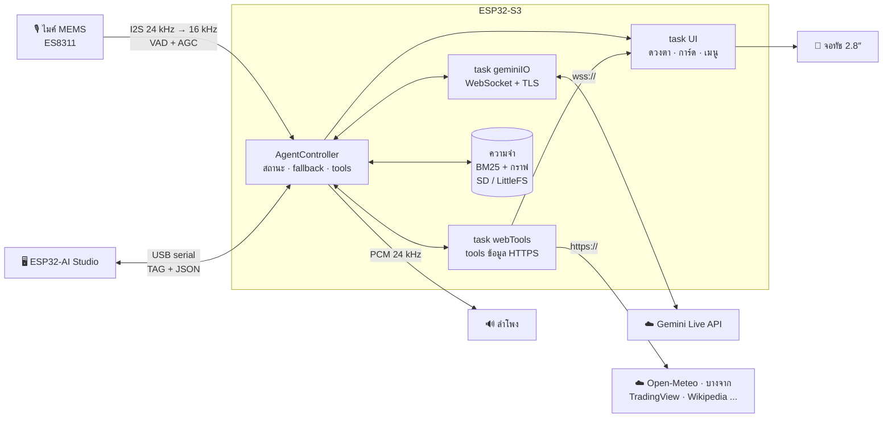

<div align="center">

# 🤖 PersonalAIBot-ESP32

### ผู้ช่วย AI คุยด้วยเสียงภาษาไทยแบบเรียลไทม์ บนบอร์ด ESP32-S3 จอสัมผัส

**คุยเสียงด้วย Gemini Live** · **ความจำระยะยาวในตัวเครื่อง** · **42 tools พร้อมการ์ดกราฟิกบนจอ** · **แอปคู่หูบน PC**

[](wiki/01-Hardware-ES3C28P-Pinout.md)
[](platformio.ini)
[](wiki/05-Gemini-Live-API-Protocol.md)
[](src/app/AppConfig.h)
[](host_tests/)
[](#)
[](LICENSE)

[English](README.md) · **ภาษาไทย**


</div>

---

## ✨ ทำอะไรได้บ้าง

คุยกับมันได้เหมือนคุยกับคน — ภาษาไทยหรืออังกฤษ มันตอบด้วยเสียงที่เป็นธรรมชาติ แสดงอารมณ์ด้วยดวงตาบนจอ
จำเรื่องของคุณข้ามวันได้ และดึงข้อมูลสด (อากาศ, ราคาน้ำมัน, หุ้น, ข่าว ฯลฯ) มาแสดงเป็นกราฟิกบนจอระหว่างที่อธิบาย
ทุกอย่างทำงานบนบอร์ดเอง: **ไม่ต้องมี server, ไม่ต้องมี Raspberry Pi, ไม่ต้องมี vector database** — ใช้แค่ Wi-Fi กับ Gemini API key

| | |
|---|---|
| 🎙️ **คุยเสียงเรียลไทม์** | เสียงสองทางผ่าน WebSocket ที่ตรวจใบรับรอง TLS (ไมค์ 16 kHz ขึ้น / เสียง AI 24 kHz ลง) มี VAD + AGC ในเครื่อง แตะจอเพื่อขัดจังหวะได้ |
| 🤖 **ทำงานแบบเอเจนต์** | เสียงคือช่องทางหลัก ไม่ต้องอ่านจอ: ตอบละเอียด ตัวเลขตรงตามข้อมูล (ทศนิยม 2 หลัก) เรื่องที่มีรายละเอียดมากเล่ายาวจนครบ พูดมีอารมณ์ร่วมแบบคนจริง บอกว่าตัวเลขแปลว่าอะไร ลงมือเรียกเครื่องมือเอง ต่อกันหลายขั้นได้ ("พรุ่งนี้ฝนตกไหม ถ้าตกตั้งเตือนพกร่ม 7 โมง" → ดูอากาศ → ตั้งเตือนให้) ตอบคำถามซ้อนให้ครบ บน Gemini 3.8 Live ระหว่างดึงข้อมูลจากเน็ต AI พูด "ขอเช็คแป๊บนึง" แทนการเงียบรอ ถามราคาทองได้ราคาทองแท่งไทยบาทละโดยประมาณด้วย |
| 🧠 **ความจำระยะยาว** | เก็บข้อเท็จจริง, กราฟความสัมพันธ์ (GraphRAG-lite ค้นด้วย BM25) และบันทึกบทสนทนารายวันลง MicroSD — ไม่มีการ์ดก็ใช้แฟลชในตัว จัดระเบียบความจำเบื้องหลังด้วย Flash-Lite |
| 🧑‍💼 **บุคลิก** | โปรไฟล์สำเร็จรูป 8 แบบ (ไข่มุก, ภูมิ, ลีน่า, ธันวา, มะปราง, โอม, น้ำ, ครูเก่ง), เสียง 30 แบบ, นิสัย 7 แบบ, ลงท้าย ค่ะ/ครับ — เปลี่ยนผ่านเมนูทัชหรือสั่งด้วยเสียง |
| 👀 **ใบหน้ามีชีวิต** | ดวงตาสไตล์ Cozmo 14 อารมณ์, ซับไตเติลภาษาไทย, ปุ่มเปิด/ปิดไมค์บนจอ, โหมดมืด — พักนานจะเปลี่ยนเป็น**นาฬิกาหรี่แสง** (ประหยัดไฟ) และตื่นพร้อมจอสว่างทันทีที่ได้ยินเสียง |
| 📊 **การ์ดข้อมูลสด** | อากาศ + PM2.5, ราคาน้ำมันไทย, หุ้น/ทอง/คริปโต/ค่าเงิน, วิเคราะห์เทคนิค, สแกนหุ้น, ปฏิทินเศรษฐกิจ, ข่าว, Wikipedia — วาดเป็นกราฟิกขณะ AI พูด |
| 📻 **วิทยุออนไลน์** | หน้าจอแบบแอปวิทยุ พร้อม 16 สถานีไทยที่ทดสอบแล้ว (เพิ่มได้ถึง 40 — `python tools/radio_check.py` ตรวจรายชื่อสถานีแบบเดียวกับที่บอร์ดเล่น; ถอดรหัส AAC ที่เฟรมเสียไม่ค้างจนรีบูตแล้ว): เลื่อนแล้วแตะเลือกสถานี ปุ่มเพิ่ม/ลดเสียง ปุ่ม ⏸ หยุดชั่วคราว ปุ่ม ⏻ ปิดวิทยุ (สีแดง) และแตะกลางจอเพื่อสั่งงาน AI ได้เหมือนเดิม พูด "เปิดวิทยุลูกทุ่ง" หรือ "สถานีที่ 4" แล้ว AI จะเลือกจากรายการให้ แก้รายการ (เพิ่ม แก้ ลบ เรียงลำดับ ทดสอบ URL) ได้ใน ESP32-AI Studio ถอดรหัส MP3/AAC ด้วย Helix และวิทยุจะเบาลงเหลือ 12% ระหว่างคุย ปุ่มปรับเสียงและคำสั่ง "เบาเสียงหน่อย" ปรับเฉพาะวิทยุ — เสียง AI ล็อกไว้ที่ระดับของตัวเอง (ค่าเริ่มต้น 80, `set aivolume`) สั่งเปิดวิทยุแล้ว AI บอกชื่อสถานีแล้วพักทันที (ไม่ฟังหรือตอบเสียงดีเจ) และสั่ง "เปิดวิทยุ" เฉยๆ จะเล่นสถานีล่าสุด ถามข้อมูล (อากาศ ข่าว ...) ระหว่างเปิดวิทยุ เซสชันจะรอจน AI ตอบเสร็จ (T119) [wiki/12](wiki/12-Internet-Radio.md) |
| 🏁 **หน้าปัดรถ** (ใหม่) | หน้าปัดรถยนต์และมอเตอร์ไซค์ 3 รูปแบบ — **รถแข่ง** (บาร์รอบ), **วงกลมดิจิทัล สปอร์ต** (วงแหวนไฟ) และ **เข็มวงกลม คลาสสิก** (วัดรอบ + ความเร็ว) — มี shift light, ความเร็ว, เกียร์, ช่องอุณหภูมิเครื่อง / แบต / อากาศเข้า เปลี่ยนเป็นเหลือง/แดงเมื่อเกินเกณฑ์ เปิดด้วยปุ่มรูปหน้าปัดมุมขวาล่างของหน้าหลัก หรือพูด "เปิดหน้าปัด" (ยังไม่ได้เลือกแหล่งข้อมูล = เปิดตัวจำลองให้) แตะแถบหัวเพื่อสลับแบบ ข้อมูลจาก **Honda K-Line** (Wave 110i / 125i, Click, PCX ... ผ่านบอร์ดแปลงแบบ L9637D), OBD-II ผ่าน ELM327 ต่อสาย, ข้อความจากบอร์ดอื่น หรือตัวจำลองในตัว (นิ้วเป็นคันเร่ง) — ELM327 แบบ Bluetooth LE (หรือ dual-mode) ใช้เฟิร์มแวร์แยก `pio run -e esp32s3-ble -t upload` — ตั้งแต่ T113 ใช้ OBD ผ่านบลูทูธพร้อมผู้ช่วยเสียงได้ (ย้าย buffer/ออบเจกต์ไป PSRAM, pool ของ NimBLE อยู่ใน PSRAM, ฟังคำปลุกคำเดียวขณะใช้บลูทูธ; บลูทูธเปิดเฉพาะตอนเปิดหน้าปัด ปิดหน้าปัดแล้วได้ RAM คืน) **ล็อกภาษาของ AI (T116):** ตั้งค่า "ภาษาที่ AI พูด" ไทย (ล็อก, ค่าเริ่มต้น) / English / ตามภาษาที่ผู้ใช้พูด (`set language th` / `en` / `auto`, Studio) **log OBD + เล่นย้อนหลัง (T115; ตรวจ log จากรถจริงครั้งแรกใน T117: แก้ VIN ที่รถตอบ "รอสักครู่"):** ทุกคำสั่ง/คำตอบของ adapter สถานะ เหตุการณ์ ค่าทุกวินาที รหัสปัญหา และสุขภาพรถ ลง SD card (`agent/obdlog`, sync ทุก 2 วิ) ดึงลง PC ด้วย `python tools/obd_log.py` (`pull`, `summary`, `csv`, `replay`) และแหล่งหน้าปัด "เล่นย้อนหลังจาก log" เล่นการขับที่บันทึกไว้ผ่านตัวคุยกับ ELM327 ตัวเดิม — อัปเดต OTA จะได้เฟิร์มแวร์ปกติที่ไม่มีบลูทูธ AI อ่านค่าสดได้ ("เครื่องร้อนไหม") และพูดเตือนเองเมื่อเครื่องร้อนจัดหรือไดชาร์จไม่ชาร์จ **OBD-II อัจฉริยะ (T112):** หาโปรโตคอลของรถเอง (จำไว้ และลองทีละตัวเมื่อ adapter หาเองไม่เจอ) และหา baud ของ adapter เอง อ่าน**ทุก PID ที่รถมี** โดยอ่านตัวที่จำเป็นก่อน (เร็วตอนเปิดหน้าปัด ช้าลงตอนปิด) **รหัสปัญหาพร้อมความหมาย** (stored / pending / permanent) freeze frame, VIN, readiness และล้างรหัส **วิเคราะห์สุขภาพรถ**จากค่าสด (ความร้อนขึ้นเร็ว ไดชาร์จไม่ชาร์จ แบตอ่อนตอนจอด/ตอนสตาร์ท ส่วนผสมบาง/หนาหรือมีรอยรั่วอากาศ เดินเบาไม่นิ่ง น้ำมันใกล้หมด) และ**ทริปพร้อม กม./ลิตร** (จาก PID อัตราใช้น้ำมัน, MAF หรือ MAP) ใช้ความเร็วจาก GPS มือถือเมื่อกล่องมอเตอร์ไซค์ไม่มี หน้าปัดแบบที่ 4 **"ข้อมูลรถ + วิเคราะห์"** (9 ค่า, รหัสปัญหา, สิ่งผิดปกติที่ร้ายแรงสุด) และไอคอนเครื่องยนต์สีอำพันเมื่อไฟเช็คเครื่องติด ถาม "รถเป็นยังไงบ้าง" "สแกนรถให้หน่อย" "P0420 คืออะไร" (ไม่ต้องมีรถ) หรือ "ล้างรหัสปัญหา" — ตัวจำลองในตัวมีรหัสปัญหาด้วย ลองได้ทั้งหมดโดยไม่มีรถ — ยังไม่ได้ทดสอบกับรถจริง [wiki/16](wiki/16-Vehicle-Dash.md) |
| 🧭 **นำทางร่วมกับมือถือ** (ใหม่ ยังไม่ได้ลองในรถ) | Google Maps บนมือถือ Android คำนวณเส้นทาง บอร์ดแสดงจุดเลี้ยวถัดไป (ลูกศร ระยะ ชื่อถนน เวลาถึง) เป็นจอนำทางหรือแถบบนหน้าปัด และ AI **พูดเตือนก่อนเลี้ยว ~20 วินาที** ("อีก 300 เมตร เลี้ยวขวาเข้า ถ.พระราม 4") พูด "นำทางไปเซ็นทรัลเวิลด์" มือถือจะเปิด Google Maps ให้ ถาม "อีกไกลไหม" "ถึงกี่โมง" "ตอนนี้อยู่ไหน" ได้ GPS มือถือใช้เป็นความเร็วของหน้าปัดได้ด้วย (รถทุกคัน) เชื่อมผ่าน Hotspot มือถือ (Wi-Fi) หรือ USB จับคู่ด้วย USB ครั้งเดียว ทั้งสองฝั่งพิสูจน์การจับคู่ (HMAC โดยบอร์ดพิสูจน์ก่อน) และทุกบรรทัดทาง Wi-Fi มีตราประทับ HMAC คนอื่นใน Wi-Fi เดียวกันแทรกข้อมูลไม่ได้ [wiki/18](wiki/18-Phone-Link-Navigation-Plan.md) |
| ⏰ **ผู้ช่วยส่วนตัว** | ตั้งเวลา, แจ้งเตือน (ทุกวัน/วันทำงาน/ทุกสัปดาห์), รายการงาน, สมุดโน้ต, แจ้งเตือนราคาด้วยเสียง, เครื่องคิดเลข, แปลงหน่วย, เวลาต่างประเทศ |
| 🔁 **ซ่อมตัวเองได้** | สลับโมเดลอัตโนมัติ, หยุดพักเมื่อติดโควตา, ปิด Google Search อัตโนมัติเมื่อโควตาหมด, resume เซสชัน, ต่อ Wi-Fi ใหม่ — และ**จำ Wi-Fi ที่เคยต่อได้ 6 เครือข่าย** ถ้า Wi-Fi หลักใช้ไม่ได้จะสลับไปตัวที่สัญญาณแรงที่สุดเอง และย้ายไปตัวที่จำไว้ที่แรงกว่าชัดเจน (≥ 10 dB) เมื่อกลับมาอยู่ในระยะ เมนู Wi-Fi บอกว่าต่อตัวไหนอยู่จริง |
| 🖥️ **ESP32-AI Studio** | แอป PC โหมดมืด: ตั้งค่าทุกอย่าง, debug log สด, แชท, จอเสมือนแตะได้, อัดเสียงไมค์, รัน tool, build & flash |

## 🖼️ ภาพตัวอย่าง

<div align="center">

**การ์ดข้อมูลสด** — AI ดึงข้อมูล บอร์ดวาดกราฟิก แล้ว AI พูดสรุปให้ฟัง


**ESP32-AI Studio** — แอปคู่หูบน PC

 

</div>

## 🔧 ฮาร์ดแวร์

| ชิ้นส่วน | รายละเอียด |
|---|---|
| **บอร์ด** | **ES3C28P** — ESP32-S3R8 (ดูอัลคอร์ 240 MHz, แฟลช 16 MB, PSRAM 8 MB) จอ IPS 2.8" 320×240 (ILI9341V) ทัชแบบ capacitive (FT6336G) |
| **เสียง** | codec ES8311, ไมค์ MEMS บนบอร์ด, แอมป์ FM8002E → **ต้องต่อลำโพงเล็ก 4–8 Ω ที่ขั้ว JST 2 ขา** |
| **อื่นๆ** | ไฟ RGB WS2812 · ช่อง MicroSD (FAT32, ไม่บังคับ) · ขั้วแบตเตอรี่ LiPo พร้อมวัดระดับแบต · ปุ่ม BOOT ใช้เป็นปุ่มกด |
| **เครือข่าย** | Wi-Fi 2.4 GHz (ESP32 ใช้ 5 GHz ไม่ได้ — ถ้าเราเตอร์แยกชื่อ เช่น `..._2.4G` ให้เลือกชื่อนั้น) |

ผังขา, ภาพบอร์ด, ตำแหน่งคอนเน็กเตอร์ → [wiki/01-Hardware-ES3C28P-Pinout.md](wiki/01-Hardware-ES3C28P-Pinout.md)

## 🚀 เริ่มใช้งาน

> **โปรเจกต์นี้ไม่มีรหัสหรือ key ของใครติดมา** สิ่งที่ต้องมีคือ **Wi-Fi 2.4 GHz** ของคุณเอง และ **Gemini API key** ฟรีจาก
> **[aistudio.google.com/api-keys](https://aistudio.google.com/api-keys)** — ใส่ที่บอร์ดหลังแฟลช และเก็บแบบเข้ารหัสในบอร์ด*ของคุณ*เท่านั้น

### ทางเลือก A — ใช้เฟิร์มแวร์สำเร็จรูป (ไม่ต้องลงโปรแกรมพัฒนา)

1. ดาวน์โหลด `PersonalAIBot-ESP32-v…-factory.bin` จากหน้า **[Releases](https://github.com/skyliner2008/PersonalAIBot-ESP32/releases)**
2. เปิด **[espressif.github.io/esptool-js](https://espressif.github.io/esptool-js/)** ด้วย Chrome หรือ Edge เสียบบอร์ดด้วยสาย USB-C แล้วกด **Connect**
   (ถ้าหาบอร์ดไม่เจอ: กด **BOOT** ค้าง → แตะ **RESET** → ปล่อย BOOT แล้วกด Connect ใหม่)
3. ช่อง Flash Address ใส่ **`0x0`** → เลือกไฟล์ `.bin` → **Program** เสร็จแล้วกด **RESET** ที่บอร์ด

ใช้ command line ก็ได้: `esptool.py --chip esp32s3 write_flash 0x0 PersonalAIBot-ESP32-v4.7.0-factory.bin`

**📱 แฟลชจากมือถือ Android (ไม่ต้องมีคอม):** ติดตั้งแอปมือถือ **Personal AI Bot** (`PersonalAIBot-Mobile.apk` จากหน้า release หรือ build เอง:
`python tools/build_mobile_apk.py`) แตะไอคอนชิปที่แถบบนเพื่อเปิดหน้า **บอร์ด ESP32** เสียบสาย USB-C จากมือถือเข้าบอร์ด (มือถือต้องรองรับ USB OTG) แล้วกด **แฟลชลงบอร์ด**
แอปดาวน์โหลด release ล่าสุดเองและตรวจ sha256 (และลายเซ็นของ release) · **อัปเดต** เขียนไฟล์ `-app.bin` โดยค่าที่ตั้งไว้และความจำอยู่ครบ ·
**ติดตั้งใหม่ทั้งหมด** เขียนไฟล์ factory · เลือกไฟล์ `.bin` ในเครื่องก็ได้ · ใช้ได้เฉพาะ Android 8 ขึ้นไป (iOS ไม่ให้แอปใช้ USB serial)
แอปเดียวกันนี้ใช้เป็น **ESP32-AI Studio ฉบับพกพา** ผ่านสายเส้นเดิมได้ด้วย: ดูสถานะ + ปุ่มด่วน (ไมค์ / พัก / ปลุก / ต่อ AI ใหม่ / บทสนทนาใหม่ / รีบูต),
พิมพ์แชทกับผู้ช่วย, log สด (กรอง, แชร์, พิมพ์คำสั่ง console) และตั้งค่า (สแกน Wi-Fi, API key + ทดสอบ, โปรไฟล์, เสียง, โมเดล, ความดัง, ความสว่าง ...) — ดู [wiki 17](wiki/17-Mobile-Flasher.md)
แอป**อัปเดตตัวเองได้**จากหน้า release: ตั้งค่า → **อัปเดตแอป** (ตรวจเองวันละครั้ง ตรวจ sha256 แล้ว Android ถามก่อนติดตั้ง ข้อมูลในแอปอยู่ครบ) — ใช้ได้กับ release ที่มี `PersonalAIBot-Mobile.json` (ตั้งแต่ v4.4.2)

> ไฟล์ factory เริ่มที่ `0x0` จึง**ล้างค่าตั้งค่าเดิมในบอร์ด**ไปด้วย (ติดตั้งใหม่สะอาด)
>
> **บอร์ดเป็น v3.5.0 ขึ้นไปแล้ว?** อัปเดตผ่าน Wi-Fi ได้เลย: เมนูตั้งค่า → **อัปเดตเฟิร์มแวร์** บอร์ดดาวน์โหลดไฟล์ `-app.bin` ของ release ล่าสุด ตรวจ (sha256, header, เวอร์ชัน และลายเซ็นของ release เมื่อตั้งกุญแจแล้ว) แล้วติดตั้ง โดย**ค่าที่ตั้งไว้และความจำอยู่ครบ** ถ้าเวอร์ชันใหม่เปิดไม่ผ่านจะกลับเป็นเวอร์ชันเดิมเอง · เช็คอัปเดตได้แม้เปิดวิทยุหรือ AI กำลังพูด (T121: handshake TLS กับ GitHub รันที่ priority สูงขึ้น — เดิมช้าจน GitHub ตัด ขึ้น "ติดต่อ GitHub ไม่ได้ (HTTP -1)") — ดู [wiki 13](wiki/13-OTA-Update.md)

### ทางเลือก B — build จากซอร์สโค้ด

```bash
git clone https://github.com/skyliner2008/PersonalAIBot-ESP32.git
cd PersonalAIBot-ESP32
pio run -t upload
pio device monitor
```

ต้องมี [PlatformIO](https://platformio.org/install) (extension ของ VS Code หรือ `pip install platformio` บน **Python 3.10–3.14** เพราะ platform ESP32 ไม่รับ 3.15) ไลบรารีดาวน์โหลดให้อัตโนมัติ ·
host tests ต้องมี Visual Studio 2022 C++ Build Tools (หรือ g++/clang++)
อัปเดตด้วยวิธีนี้ Wi-Fi / API key ที่บันทึกไว้ยังอยู่

> **ไม่บังคับ:** ใส่ Wi-Fi และ API key ไว้ล่วงหน้าตอน build ได้ โดยคัดลอก `include/secrets.example.h` เป็น `include/secrets.h`
> (ไฟล์นี้ถูก git-ignore ไว้) — ห้ามเผยแพร่เฟิร์มแวร์ที่ build แบบนั้น (`tools/make_release.py` จะไม่ยอมสร้างให้)

### บูตครั้งแรก — ใส่ Wi-Fi และ API key ของคุณเอง

1. **ปรับแต่งทัช** — แตะเป้า 3 จุด
2. แตะ ⚙ (หรือกด **BOOT** ค้าง 1.5 วิ) → **Wi-Fi** → สแกนแล้วเลือกเครือข่าย → พิมพ์รหัสด้วยคีย์บอร์ดไทย/อังกฤษบนจอ
3. **API key** → พิมพ์ key → **ทดสอบ API key** จะบอกว่า key ใช้โมเดลไหนได้บ้าง
4. เมื่อจอขึ้น **"พร้อมคุย"** — พูดได้เลย

**หรือตั้งค่าจากคอมพิวเตอร์ผ่านการ์ด SD:** คัดลอก [`tools/sd_card/ai-setup.txt`](tools/sd_card/ai-setup.txt) ไปไว้ที่หน้าแรกของการ์ด
micro SD (FAT32) กรอก `WIFI_SSID`, `WIFI_PASSWORD`, `GEMINI_API_KEY` แล้วเสียบการ์ดเข้าบอร์ดและเปิดเครื่อง
บอร์ดจะอ่านไฟล์ เก็บค่าแบบเข้ารหัสใน `agent/secrets.json` บนการ์ด แล้วลบไฟล์ข้อความธรรมดาทิ้ง
(ปุ่ม **💾 ไฟล์สำหรับการ์ด SD...** ใน Studio สร้างไฟล์นี้ให้ได้)

ไม่อยากพิมพ์บนจอเล็ก? ใช้แอป PC (หัวข้อถัดไป) ตั้งค่าได้ทุกอย่าง

### ESP32-AI Studio (แอปบน PC, ไม่บังคับ)

ต้องมี Python 3.9+ (ตัวติดตั้งจาก python.org มี Tkinter มาให้) ดาวน์โหลด repo (`git clone` หรือ **Code → Download ZIP**) แล้ว:

```bash
pip install -r tools/pc_app/requirements.txt
python tools/pc_app/esp32_ai_studio.py
```

บน Windows ดับเบิลคลิก `tools\pc_app\run_studio.bat` ได้เลย — ก่อนแฟลชด้วยโปรแกรมอื่นให้ปิด Studio (หรือกด **ตัดการเชื่อมต่อ**)
หรือแฟลชจากแท็บ **🔧 เฟิร์มแวร์** ใน Studio ซึ่งปล่อยพอร์ตให้เอง

## 💬 วิธีใช้

| ทำแบบนี้ | ผลลัพธ์ |
|---|---|
| พูดเมื่อจอขึ้น **พร้อมคุย** | ตอบเป็นเสียง + ซับไตเติล (และการ์ดข้อมูลถ้าเกี่ยวข้อง) |
| แตะ 🎤 (มุมซ้ายบน) | ปิด/เปิดไมค์ |
| แตะจอหรือกด BOOT ขณะ AI พูด | หยุดพูด |
| แตะจอขณะพัก / หยุดเชื่อมต่อ | ปลุก / ต่อใหม่ทันที |
| พูด **"Hi ESP"** ขณะพัก | คำปลุกออฟไลน์ (ESP-SR WakeNet หลังตัดเสียงสะท้อนของเรา ใช้ได้ขณะวิทยุเล่น) — เมนู ⚙ "ปลุกด้วยเสียง" / Studio / `set wake level\|word\|both`, `set wakeword hiesp\|jarvis`, `set wakethreshold 0.5` |
| พูด **"Hi ESP"** ตอน AI กำลังพูด | AI หยุดพูดแล้วฟังทันที — ตัดเสียงลำโพงออกจากไมค์ก่อน เสียง AI เองจึงไม่ขัดจังหวะตัวเอง |
| "เปิดพัดลม", "หรี่ไฟโต๊ะเหลือ 30", "ประตูปิดอยู่ไหม" | สั่ง/อ่านอุปกรณ์ที่ต่อเองกับขาว่าง (รีเลย์, ไฟหรี่, ปุ่ม/เซนเซอร์, analog) ตั้งชื่อไว้ใน `agent/devices.json` บนการ์ด SD — พอร์ตว่างและต่ออะไรได้ดู [wiki 15](wiki/15-Expansion-Ports.md) |
| กดค้างบนจอ 1.5 วิ | เริ่มบทสนทนาใหม่ (ความจำระยะยาวยังอยู่) |
| เงียบ 3 นาที → พัก (ตาหลับ) ต่ออีก 5 นาที → **นาฬิกาหรี่แสง** | พูดหรือแตะเพื่อปลุก: จอสว่างเหมือนเดิม + ตาลืม (ตั้งเวลาได้ที่เมนู ⚙ / Studio / สั่งด้วยเสียง) |
| "ลดเสียงลงหน่อย", "เพิ่มความสว่าง", "พักหน้าจอ", "ปิดไมค์" | ปรับเสียง/แสงขึ้นลง เข้าโหมดนาฬิกาทันที ปิดไมค์ด้วยเสียงได้ — **เปิด**ไมค์ได้เฉพาะปุ่ม 🎤 บนจอ (ปิดไว้แล้วรีบูตก็ยังปิดอยู่) |
| แตะการ์ดข้อมูล | ปิดการ์ด (ปิดเองหลัง ~30 วิ) |

**ลองพูดว่า**

```text
"จำไว้นะว่าฉันแพ้กุ้ง"                    → บันทึกความจำ
"อากาศที่เชียงใหม่วันนี้เป็นยังไง ฝุ่นเยอะไหม" → การ์ดอากาศ + PM2.5
"ราคาน้ำมันดีเซลวันนี้เท่าไหร่"               → ตารางราคาน้ำมัน
"วิเคราะห์ทองคำทุกกรอบเวลา"                 → การ์ดเกจหลายกรอบเวลา
"หุ้นไทยตัวไหนขึ้นแรงวันนี้"                  → หุ้น SET ขึ้นแรง
"สัปดาห์นี้มีข่าวเศรษฐกิจอะไรสำคัญ"            → ปฏิทินเศรษฐกิจเวลาไทย
"เตือนฉันถ้าบิทคอยน์ต่ำกว่า 80,000"           → แจ้งเตือนราคาด้วยเสียง (ตรวจทุก 2 นาที)
"เตือนกินยาทุกวันสองทุ่ม"                    → แจ้งเตือนรายวันพร้อมเสียงกริ่ง
"ห้าร้อยไร่เป็นกี่ตารางเมตร"                  → แปลงหน่วยไทย
"เปลี่ยนเป็นเสียงผู้ชาย" / "ราตรีสวัสดิ์"         → เปลี่ยนเสียง / พักเครื่อง
```

## 🛠️ Tools

AI เลือกเรียกเองตามบทสนทนา tool ข้อมูลทำงานใน task เบื้องหลังและวาดการ์ดบนจอขณะ AI พูดต่อได้ • ถามข้อมูลเดิมซ้ำภายในเวลาที่ข้อมูลยังสด (อากาศ 10 นาที, น้ำมัน 30 นาที, ข่าว 5 นาที, ราคา 1 นาที) ตอบจากที่จำไว้ทันที ไม่ต้องดึงใหม่ • ถามอากาศจังหวัดใดก็ได้ใน 77 จังหวัด ~3 วิ (มีพิกัดในตัว ไม่ต้องค้นหาตำแหน่ง และงานที่มีคนรออยู่ได้ CPU ก่อนภาพเคลื่อนไหวบนจอ)

<details>
<summary><b>Tools ทั้งหมด 42 ตัว</b> (36 ตัวถ้าปิดชุด tool การเงิน)</summary>

| กลุ่ม | Tools |
|---|---|
| **ความจำ** | `save_memory` · `save_relation` · `recall_memory` · `forget_memory` · `recall_conversation` |
| **เวลา & งาน** | `set_timer` · `set_reminder` · `list_reminders` · `cancel_reminder` · `add_task` · `list_tasks` · `update_task` |
| **ผู้ช่วย & เครื่อง** | `about_me` (ตัวตน + ทุกความสามารถ สร้างตอนถูกเรียกจาก tool ที่มีจริง) · `get_device_status` · `set_expression` · `configure_assistant` · `list_assistant_options` · `set_volume` · `set_brightness` (ระบุค่าหรือปรับ +/-) · `configure_device` (ไมค์, เวลาพัก, โหมดนาฬิกา) · `rest_screen` (พักหน้าจอทันที) · `play_radio` / `stop_radio` (วิทยุออนไลน์) · `mute_microphone` · `control_led` · `go_to_sleep` · `device` (เมื่อมี `agent/devices.json`) · `vehicle` (เปิด/ปิดหน้าปัด, ค่าสด, สุขภาพรถ + ทริป, รหัสปัญหา `scan` / `explain` / `clear_codes`) |
| **ข้อมูลสด** 🖼️ | `get_weather` (Open-Meteo + PM2.5, ไม่ระบุที่ = ใช้ตำแหน่งจาก IP) · `get_oil_price` (บางจาก) · `get_market_quote` (TradingView) · `convert_currency` · `get_news` (Google News) |
| **เครื่องมือทั่วไป** 🖼️ | `calculate` · `convert_units` (รวม ไร่/งาน/ตารางวา, บาททอง) · `get_world_time` (รองรับ DST) · `get_location` · `search_knowledge` (Wikipedia ไทย/อังกฤษ) · `notes` |
| **น้ำ** 🖼️ | `water` — ระดับน้ำรายจังหวัด (แท่ง % ความจุลำน้ำ, กราฟ 2 วันของสถานีเดียว), ฝน 24 ชม. / 3 / 5 / 7 วัน, อันดับ 8 จังหวัดทั้งประเทศ (ฝน / สถานการณ์น้ำ), พายุใกล้ประเทศไทย จากคลังข้อมูลน้ำแห่งชาติ (ThaiWater); ปิดได้ด้วย `set water 0` |
| **ชุดการเงิน** 🖼️ | `market_overview` (+ ดัชนีกลัว/โลภคริปโต) · `market_analysis` (RSI, MACD, EMA, ADX, หลายกรอบเวลา, P/E, ปันผล) · `market_scan` (ขึ้นแรง/ลงแรง/วอลุ่ม/RSI — ไทย/สหรัฐ/คริปโต) · `economic_calendar` (ForexFactory เวลาไทย) · `position_size` · `price_alert` |
| **ค้นเว็บ** | ปิดการค้นเว็บทั่วไปเป็นค่าเริ่มต้น: Google Search grounding ต้องใช้ key ที่มีสิทธิ์ Search (โปรเจกต์ free tier ไม่มี — เปิดด้วย `set search 1` เมื่อใช้ key แบบเสียเงิน) เรื่องล่าสุดใช้ `get_news` (Google News 7 วันล่าสุดก่อน) ข้อเท็จจริงใช้ `search_knowledge` · ทดลอง DuckDuckGo แล้วใช้ไม่ได้ (ไม่มี API ค้นเว็บฟรี และหน้า HTML บล็อกโปรแกรมอัตโนมัติ) |

แหล่งข้อมูลทั้งหมดฟรีและไม่ต้องใช้ key ทุกการเชื่อมต่อ HTTPS ตรวจใบรับรอง
ผลลัพธ์บอก**ว่าข้อมูลเป็นของเวลาไหน** เพื่อไม่ให้ผู้ช่วยเรียกข้อมูลเก่าว่า "วันนี้": `as_of` ในทุก tool ข้อมูลสด, วันที่ราคาน้ำมันมีผล, ตลาดเปิด/ปิด + เวลาของราคา, เวลาที่ข่าวเผยแพร่
ข้อมูลตลาดมาจาก scanner สาธารณะของ TradingView (ไม่เป็นทางการ) และเป็นการ**อ่านข้อมูลอย่างเดียว** — ผู้ช่วยส่งคำสั่งซื้อขายหรือเชื่อมต่อโบรกเกอร์ไม่ได้ **เพื่อประกอบการรับรู้เท่านั้น ไม่ใช่คำแนะนำการลงทุน**

รายละเอียดและเวลาที่ใช้ → [wiki/11-Data-Tools-and-Cards.md](wiki/11-Data-Tools-and-Cards.md) · [wiki/09-Assistant-Profiles-and-Tools.md](wiki/09-Assistant-Profiles-and-Tools.md)

</details>

## 🏗️ สถาปัตยกรรม



- **โมเดล:** Live model ที่เลือก → `gemini-3.8-live` → `gemini-3.8-live-extended-thinking` (ตอนนี้เรียก tool ไม่ได้ — ปัญหาฝั่ง Google) → `gemini-3.1-flash-live-preview` งานข้อความใช้ `gemini-3.5-flash-lite` → `gemini-3.1-flash-lite` — แยกประเภท error (โควตา / server ล้น / key ผิด) และพักแต่ละโมเดลแยกกัน
- **หน่วยความจำ:** บัฟเฟอร์เสียง, sprite จอ, frame WebSocket และบัฟเฟอร์ TLS ทั้งหมดอยู่ใน PSRAM — RAM ภายในเหลือ ~85 KB แม้ทำงานเต็มที่ · ตั้งแต่ T119 ออบเจกต์ TLS ทุกตัวไป PSRAM เมื่อ RAM ภายในเหลือ < 32 KB, JSON ที่แปลงระหว่างคุยและคิวอายุยาวอยู่ใน PSRAM, การจอง PSRAM ไม่ตกไปกิน 24 KB สุดท้ายของ RAM ภายใน และ OTA เช็ครายวันรอจน RAM ว่าง (`[Health]` กับ `diag` แสดงก้อนใหญ่สุด)
- **โทเคน:** VAD ในเครื่อง, บีบอัด context และพักอัตโนมัติ ช่วยให้ใช้ต่ำกว่าลิมิต Live 65k โทเคน/นาที

การออกแบบทั้งหมด → [PROJECT_ARCHITECTURE_SPEC.md](PROJECT_ARCHITECTURE_SPEC.md)

## 🖥️ ESP32-AI Studio

| แท็บ | ทำอะไรได้ |
|---|---|
| 📜 Debug log | log สดแยกสี, กรองด้วย regex, คัดลอก/บันทึก, ช่องพิมพ์คำสั่งพร้อมประวัติ |
| 💬 แชท | พิมพ์คุยกับผู้ช่วย ตอบออกลำโพงบอร์ด |
| ⚙️ ตั้งค่า | สแกน Wi-Fi, API key + ทดสอบ, โปรไฟล์/เสียง/นิสัย, โมเดล, Search, ความไวไมค์, tool การเงิน, นำเข้า/ส่งออก (ไม่มีความลับ) |
| 🧰 เครื่องมือ | อัดเสียงที่ AI ได้ยิน (กราฟ + WAV), ทดสอบลำโพง, รัน tool ของ AI ทุกตัว, อารมณ์ดวงตา, เครื่องมือความจำ |
| 🖥️ หน้าจอ | ภาพจอสด — คลิก = แตะ, ลาก = เลื่อน, คลิกขวา = กดค้าง |
| 📊 สถานะ | เซสชัน, โมเดล & เวลาพัก, กราฟโทเคน/นาที, RAM, ที่เก็บข้อมูล, แบตเตอรี่ |
| 🔧 เฟิร์มแวร์ | Build, Build + Upload, host unit tests, อัปเดตผ่าน Wi-Fi, **สร้าง / สำรอง / นำกุญแจเซ็นอัปเดตกลับมา** (กดปุ่มเดียว) |
| 📻 วิทยุ | รายการสถานี: เล่น/หยุด, เพิ่ม, แก้ไข, ลบ, เรียงลำดับ, คืนค่าเริ่มต้น, ทดสอบ URL สตรีมจาก PC |

คัดลอก/วางได้ทั้งแป้นพิมพ์ไทยและอังกฤษ เอกสาร → [wiki/10-PC-Studio-App.md](wiki/10-PC-Studio-App.md)

## 🧪 การทดสอบ

โมดูลที่ไม่ผูกกับฮาร์ดแวร์ (ความจำ, tools, ตัวตั้งเวลา, รายการงาน, บุคลิก, model fallback, เครื่องคิดเลข, แปลงหน่วย …) ทดสอบบน PC:

```bat
host_tests\run_tests.bat
```

77 ชุดทดสอบ · 2,945 checks · ต้องมี Visual Studio Build Tools (`cl.exe`) และรัน `pio run` ก่อน 1 ครั้ง (เพื่อดึง ArduinoJson)
Linux / macOS / CI: `bash host_tests/run_tests.sh` (g++ หรือ clang++)

แอปมือถือมี unit tests ของตัวเอง 58 ข้อ (console/การตั้งค่า, เชื่อมบอร์ดรวม handshake Wi-Fi จริง, อ่าน Google Maps + ตัวแฟลชที่ทดสอบกับ ROM bootloader ของ ESP32-S3 จำลอง + flash เสมือน 16 MB):
`cd tools/mobile_app && ./gradlew :esp32:testDebugUnitTest` · แอป build ได้โดยไม่มี warning Kotlin · PC เครื่องใหม่หรือลง Windows ใหม่จะได้กุญแจเซ็น
debug ใหม่ → ถอนแอปเดิมบนมือถือครั้งเดียว หรือคัดลอก `~/.android/debug.keystore` เดิมกลับมา ([wiki 17](wiki/17-Mobile-Flasher.md))
· Gradle daemon ("OpenJDK Platform binary" ใน Task Manager) ปิดเองหลังว่าง 15 นาที หรือสั่ง `gradlew --stop` ให้ปิดทันที

## 📁 โครงสร้างโปรเจกต์

```text
src/agent      AgentController (สมอง: setup/loop) + AgentSession (Wi-Fi, Live session, fallback, tool calls),
               AgentMic (VAD/AGC), AgentRoutines (หลับ, การแจ้งเตือน, สรุปความจำ), AgentDevice (สถานะ, อุปกรณ์, วิทยุ),
               AgentTools, WebTools + WebToolsExtra (tools ข้อมูล), Personas, Scheduler, TaskList
src/ai         GeminiLiveClient (task geminiIO), TextModelClient, ModelFallback, root CA
src/ui         ดวงตา, FaceScreen, CardScreen (การ์ดข้อมูล), เมนู, คีย์บอร์ดไทย
src/audio      AudioManager (I2S), ไดรเวอร์ ES8311, resampler
src/memory     MemoryStore (BM25 + กราฟ), EpisodicLog
src/display    ตั้งค่า LovyanGFX, ไดรเวอร์ทัช, ฟอนต์ไทย 26/20 px
src/system     บัส I2C, ที่เก็บข้อมูล (SD / LittleFS) · src/util  UTF-8, เครื่องคิดเลข, หน่วย, เวลา, JSON
src/phone      เชื่อมแอปมือถือ: GPS, นำทาง Google Maps, AI พูดเตือนก่อนเลี้ยว (USB / Wi-Fi, จับคู่ทาง USB) + src/ui/NavScreen
src/vehicle    หน้าปัดรถ: ค่าจากรถ, โมเดลหน้าปัด, ตัวจำลอง, ELM327, Honda K-Line, UART / BLE (+ src/ui/DashScreen)
tools/pc_app   ESP32-AI Studio (Python + Tkinter + pyserial)
tools/mobile_app  แอปมือถือ "Personal AI Bot": ผู้ช่วย Jarvis (composeApp จากโปรเจค PersonalAIBot; TradingView อย่างเดียว ไม่มี MT5; คำปลุก "Hey Jarvis" หรือคำของตัวเอง เช่น "จาวิส" ฝึกด้วยเสียงตัวเอง ในเครื่อง) + หน้าบอร์ด ESP32
               (โมดูล esp32: แฟลชผ่าน USB OTG, สถานะ / log / ตั้งค่า / แชท แบบ Studio, นำทาง GPS ให้บอร์ด)
tools/         gen_thai_font.py, gen_root_ca.py
host_tests/    unit tests บน PC
wiki/          คลังความรู้ Obsidian: ฮาร์ดแวร์, ติดตั้ง, protocol, UI, ความจำ, บันทึกการแก้ปัญหา
```

## 📚 เอกสาร

| | |
|---|---|
| [00 หน้าหลัก](wiki/00-Home-Dashboard.md) | สารบัญและบันทึกการเปลี่ยนแปลง |
| [01 ฮาร์ดแวร์](wiki/01-Hardware-ES3C28P-Pinout.md) · [02 การติดตั้ง](wiki/02-Installation-and-Setup.md) · [03 ไลบรารี](wiki/03-Libraries-and-Dependencies.md) | บอร์ด, ติดตั้ง, dependencies |
| [04 สถาปัตยกรรม](wiki/04-System-Architecture.md) · [05 Gemini Live protocol](wiki/05-Gemini-Live-API-Protocol.md) | ระบบทำงานอย่างไร |
| [06 ดวงตา & UI ไทย](wiki/06-Avatar-and-Thai-UI.md) · [08 ความจำระยะยาว](wiki/08-Long-Term-Memory-GraphRAG.md) | ใบหน้า, เมนู, การออกแบบความจำ |
| [09 โปรไฟล์ & tools](wiki/09-Assistant-Profiles-and-Tools.md) · [11 Tools ข้อมูล & การ์ด](wiki/11-Data-Tools-and-Cards.md) | ผู้ช่วยทำอะไรได้บ้าง |
| [10 PC Studio](wiki/10-PC-Studio-App.md) · [07 บันทึกการแก้ปัญหา](wiki/07-Troubleshooting-Log.md) | เครื่องมือ และปัญหาที่แก้แล้ว 40+ เรื่อง |
| [12 วิทยุออนไลน์](wiki/12-Internet-Radio.md) | สตรีม, ผสม/ลดเสียง, ปลุกด้วยเสียงขณะเปิดเพลง |
| [13 อัปเดตเฟิร์มแวร์ (OTA)](wiki/13-OTA-Update.md) | ผ่าน Wi-Fi จาก GitHub Releases, ตรวจไฟล์, กลับเวอร์ชันเดิมอัตโนมัติ |
| [16 หน้าปัดรถ](wiki/16-Vehicle-Dash.md) | OBD-II (ELM327 สาย; Bluetooth LE อยู่ในเฟิร์มแวร์ release ตั้งแต่ T118), Honda K-Line, ตัวจำลอง; การต่อสาย, layout, tool `vehicle`, งบ RAM |
| [18 เชื่อมมือถือ + นำทาง](wiki/18-Phone-Link-Navigation-Plan.md) | GPS มือถือบนหน้าปัด, นำทาง Google Maps บนจอบอร์ด, AI พูดเตือนก่อนเลี้ยว, สั่ง "นำทางไป…" ด้วยเสียง (Wi-Fi / USB) |
| [17 แอปมือถือ](wiki/17-Mobile-Flasher.md) | แอป Android ผ่านสาย USB-C: แฟลช (อัปเดตโดยเก็บการตั้งค่า, ตรวจไฟล์), สถานะ, log, ตั้งค่า, แชท |

## 🔒 ความปลอดภัย & ความเป็นส่วนตัว

**รหัส Wi-Fi และ API key เก็บอยู่ที่ไหน**

| ที่ | มีความลับไหม |
|---|---|
| ซอร์สโค้ดใน repo นี้ | **ไม่มี** — ความลับพิมพ์ใส่บนเครื่อง (เมนูทัชหรือ Studio) ไม่ได้อยู่ในโค้ด |
| `include/secrets.h` (ค่าเริ่มต้นตอน build, ไม่บังคับ) | มีเฉพาะถ้าคุณกรอกเอง — ไฟล์นี้ถูก **git-ignore** จึงไม่ถูกอัปโหลด ส่วน `secrets.example.h` มีแค่ค่าตัวอย่าง |
| ไฟล์เฟิร์มแวร์ที่ build แล้ว (`.pio/`) | มีเฉพาะถ้าใช้ `secrets.h` — โฟลเดอร์ build ถูก git-ignore |
| การ์ด SD — `agent/secrets.json` (ถ้าไม่ได้ใส่การ์ด: NVS ในแฟลชบอร์ด) | **มี แต่เข้ารหัส** AES-256-GCM ด้วยกุญแจที่คำนวณจาก MAC + eFuse unique ID ของชิปตัวนั้น (`src/app/SecretBox.*`) — ไฟล์เปิดได้เฉพาะบอร์ดที่สร้าง (ย้ายการ์ดไปบอร์ดอื่น = ตั้งค่าใหม่ด้วย `ai-setup.txt`) เปิดการ์ดบนคอมพิวเตอร์จะไม่เห็นรหัส และ `ai-setup.txt` ถูกเขียนทับแล้วลบทันทีหลังอ่าน สำเนาแบบข้อความธรรมดาเดิมถูกล้างอัตโนมัติครั้งเดียว (รวมสำเนาที่ไดรเวอร์ Wi-Fi เก็บเอง ซึ่งปิดแล้วด้วย `WiFi.persistent(false)`) |

- ไม่ใช่ flash encryption เต็มรูปแบบ: คนที่ได้ทั้งบอร์ด**และ**เฟิร์มแวร์นี้ไปยังคำนวณกุญแจได้ ควรใช้ API key แยกเฉพาะบอร์ดนี้ และเปลี่ยน key ถ้าบอร์ดหาย
- เฟิร์มแวร์และ Studio **ไม่เคยพิมพ์** API key หรือรหัส Wi-Fi ออกมา — `config` แสดงแค่ตัวย่อที่ซ่อนแล้วและ `secretsSealed` ไฟล์ตั้งค่าที่ส่งออกไม่มีความลับ ไฟล์เสียงที่อัด (`recordings/`) ถูก git-ignore
- ขณะเปิดไมค์ เสียงจะถูกส่งไปที่ Gemini API ของ Google ส่วนความจำและโน้ตอยู่ใน SD/แฟลชของบอร์ด
- Gemini API key ส่งใน header `x-goog-api-key` (ไม่อยู่ใน URL) และ tools ข้อมูลใช้เฉพาะ HTTPS ที่ตรวจใบรับรอง — `http://` ธรรมดาถูกปฏิเสธ

## 🧑‍💻 สำหรับนักพัฒนา

- **Fork & build:** `pio run` build ได้จาก clone ใหม่โดยไม่ต้องมี `secrets.h` — ค่าตั้งค่าอยู่ใน NVS (`src/app/Settings.*`) key ของคุณจึงไม่เข้าไปอยู่ในซอร์สโค้ด
- **เพิ่ม tool:** ประกาศใน `AgentTools::addDeclarations` (`src/agent/AgentTools.cpp`) tool ที่ใช้เน็ตใส่ใน `src/agent/WebToolsExtra.cpp` และวาด `CardData` (ดู [wiki/11](wiki/11-Data-Tools-and-Cards.md))
- **ทดสอบไม่ต้องมีบอร์ด:** `host_tests\run_tests.bat` — บนบอร์ดเรียก tool ทุกตัวได้จากแท็บ 🧰 ใน Studio หรือ serial (`tool <name> {json}`)
- **ดูบทสนทนากับ Live API:** พิมพ์ `trace on` ใน serial → ขึ้นบรรทัด `[Trace]` ทุกข้อความจากเซิร์ฟเวอร์ (transcript, การเรียก tool, `generationComplete` / `turnComplete` — ก้อนเสียงแค่นับจำนวน) และทุกข้อความ JSON ที่บอร์ดส่ง (`trace off` ปิด, ไม่บันทึกค่า) — ใช้หาสาเหตุ AI ตอบซ้ำ 2 รอบหลังเรียก tool ([T071](wiki/07-Troubleshooting-Log.md))
- **ออก Release:** แก้ `FIRMWARE_VERSION` ใน `src/app/AppConfig.h` → commit → `git push` → `python tools/publish_release.py` สคริปต์จะ build ไฟล์ factory (`tools/make_release.py`) สร้าง Release แบบร่าง แนบไฟล์ factory และไฟล์ OTA `-app.bin` (พร้อม `.sha256`) และแอปมือถือ `PersonalAIBot-Mobile.apk` (build ให้อัตโนมัติเมื่อเครื่องมี Android SDK ไม่ต้องสร้าง keystore — เซ็นด้วย debug key ของ SDK เว้นแต่สร้าง keystore เองด้วย `--create-keystore`) เผยแพร่ แล้วดาวน์โหลดกลับมาเทียบ sha256 โดยรัน host tests ก่อนเผยแพร่เสมอ (`--skip-tests` ใช้เฉพาะเครื่องที่ไม่มี compiler) — Release ของ repo นี้เป็นแบบ **immutable** เผยแพร่แล้วแก้ไฟล์หรือใช้ชื่อ tag ซ้ำไม่ได้ ทุกครั้งต้องใช้เลขเวอร์ชันใหม่ (`--dry-run` = ตรวจอย่างเดียว) รหัส Wi-Fi และ API key ไม่ต้องใช้กุญแจ release เลย: เก็บใน SD card ของบอร์ดแบบเข้ารหัสด้วยกุญแจที่คำนวณจากชิปของบอร์ดนั้น (เปลี่ยนการ์ดหรือเปลี่ยนบอร์ด = ตั้งใหม่) และอัปเดต OTA แล้วยังอยู่ครบ **ทางเลือก — เซ็นอัปเดต OTA:** ESP32-AI Studio แท็บ 🔧 เฟิร์มแวร์ → **🔑 สร้างกุญแจ** (หรือ `pip install cryptography` → `python tools/ota_keygen.py`) → commit `src/app/OtaPublicKey.h` และสำรองกุญแจส่วนตัวที่สคริปต์บอกที่อยู่ไว้ (อยู่นอก repo) — บอร์ดที่ build พร้อมกุญแจนั้นจะติดตั้งเฉพาะอัปเดตที่เซ็นด้วยกุญแจนี้ ([wiki 13](wiki/13-OTA-Update.md))
- **CI:** [`.github/workflows/firmware.yml`](.github/workflows/firmware.yml) ทำแบบเดียวกันบน GitHub Actions แต่ตอนนี้ตั้งเป็นกดรันเองเท่านั้น (*Actions → Firmware → Run workflow*) และ job ออก release จะรอ job host-tests ผ่านก่อน — `tools/make_release.py` ไม่ยอมทำงานถ้า `include/secrets.h` มีค่าจริง และสแกนไฟล์หาสิ่งที่หน้าตาเหมือน API key
- **เอกสาร:** โฟลเดอร์ `wiki/` เป็น Obsidian vault — ปัญหาที่แก้ได้ช่วยบันทึกใน [wiki/07-Troubleshooting-Log.md](wiki/07-Troubleshooting-Log.md)

ยินดีรับ Pull request และ Issue

## 📄 License

[MIT](LICENSE) © 2026 skyliner2008 — ใช้ แก้ไข และเผยแพร่ต่อได้ฟรี โดยคงข้อความลิขสิทธิ์ไว้ ฟอนต์ ไลบรารี และบริการข้อมูลภายนอกเป็นไปตาม license/เงื่อนไขของเจ้าของ (ดู [LICENSE](LICENSE))

## 🙏 ขอบคุณ

- [Google Gemini Live API](https://ai.google.dev/gemini-api/docs/live) · [LovyanGFX](https://github.com/lovyan03/LovyanGFX) · [ArduinoJson](https://arduinojson.org/) · [Adafruit NeoPixel](https://github.com/adafruit/Adafruit_NeoPixel)
- ฟอนต์ไทย: **TH Sarabun New** (SIPA, ฟอนต์แห่งชาติ) · ถอดรหัส MP3/AAC: **RealNetworks Helix** (RPSL, `lib/helix-*`) · รายการสถานีเริ่มต้นตรวจด้วย [Radio Browser](https://www.radio-browser.info)
- ข้อมูล: [Open-Meteo](https://open-meteo.com/) · [บางจาก](https://www.bangchak.co.th/) · [TradingView](https://www.tradingview.com/) · [Wikipedia](https://www.wikipedia.org/) · [ForexFactory](https://www.forexfactory.com/) · [alternative.me](https://alternative.me/crypto/fear-and-greed-index/) · [ipwho.is](https://ipwho.is/) · Google News
- tools และฟีเจอร์การเงินพอร์ตมาจากแอป **PersonalAIBot** บน Android

<div align="center">

สร้างด้วย ❤️ ในประเทศไทย · ⭐ กดดาวให้ repo ถ้ามีประโยชน์

</div>
