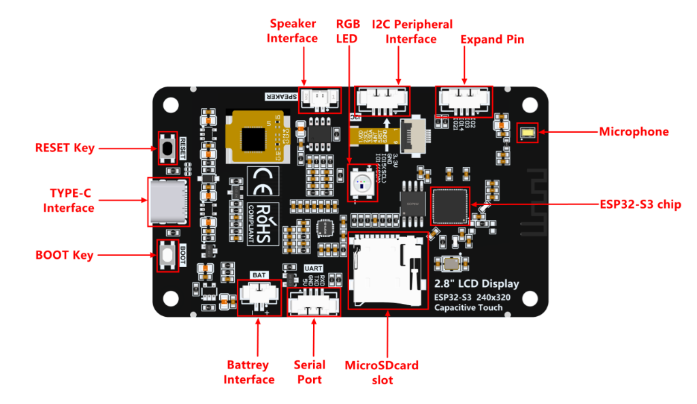
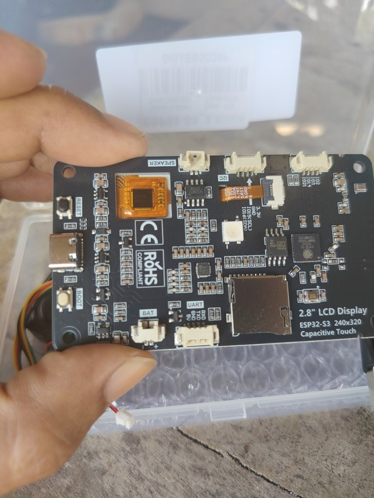
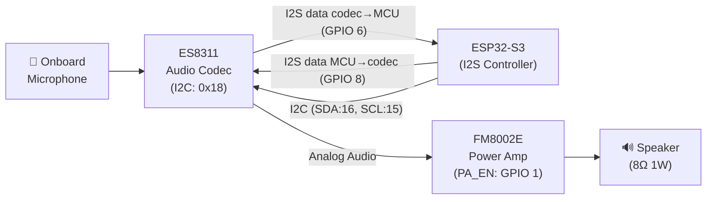

# 🔌 Hardware Reference — ES3C28P Board Pinout

> **Board:** ES3C28P — ESP32-S3 2.8" IPS LCD Capacitive Touch  
> **Related:** [[00-Home-Dashboard]] | [[03-Libraries-and-Dependencies]] | [[04-System-Architecture]]

---

---

## 🖼️ ภาพบอร์ดจริงและตำแหน่งอุปกรณ์ (Board Layout)



*ภาพผังตำแหน่งคอนเน็กเตอร์และอุปกรณ์สำคัญด้านหลังบอร์ด ES3C28P*



*ภาพถ่ายบอร์ดจริง ES3C28P*

### ตารางระบุตำแหน่งคอนเน็กเตอร์และอุปกรณ์บนบอร์ด (Connector Guide)

| คอนเน็กเตอร์ / อุปกรณ์ | ตำแหน่งบนบอร์ด | หมายเลขขา / รายละเอียด | หมายเหตุ |
|-----------------------|---------------|------------------------|----------|
| **Speaker Interface** | ขอบบน ซ้าย | ขั้วต่อ 2-Pin JST | ขับด้วยแอมป์ FM8002E (GPIO 1 Active LOW) |
| **RGB LED** | กึ่งกลางบอร์ด | **GPIO 42** (WS2812 NeoPixel) | ไฟแสดงสถานะระบบ AI Agent |
| **I2C Interface** | ขอบบน กลาง | 3.3V, GND, **IO15 (SCL)**, **IO16 (SDA)** | บัสเดียวกับ Touch FT6336G & Codec ES8311 |
| **Expand Pin** | ขอบบน ขวา | **IO21**, **IO14**, **IO3**, **IO2** | ขาต่อขยาย GPIO อิสระ |
| **Microphone** | มุมขวาบน | SMD MEMS Mic (ข้างเสาอากาศ) | อินพุตไมโครโฟนสำหรับคุยกับ Gemini Live |
| **ESP32-S3 Chip** | ขวากลาง | ESP32-S3 (16MB Flash, 8MB PSRAM) | ชิปประมวลผลหลัก |
| **MicroSD Slot** | กลางล่าง | 4-bit SDIO (IO38, 39, 40, 41, 47, 48) | สล็อตใส่ MicroSD Card สำหรับเก็บ Log/Cache |
| **Serial Port (UART)** | ขอบล่าง กลางขวา | 5V, GND, TXD, RXD | พอร์ต Serial สำหรับ Debug หรือเชื่อมต่อโมดูล |
| **Battery Interface (BAT)**| ขอบล่าง กลางซ้าย | 2-Pin JST (เครื่องหมาย `-` และ `+`) | ต่อแบตเตอรี่ LiPo 3.7V (วัดไฟผ่าน ADC GPIO 9) |
| **TYPE-C Interface** | ขอบซ้าย กลาง | USB Type-C | สำหรับ Upload โปรแกรม, Serial Monitor และไฟเลี้ยง |
| **RESET Key** | ขอบซ้าย บน | เชื่อมต่อขา CHIP_PU | กดเพื่อรีสตาร์ต MCU |
| **BOOT Key** | ขอบซ้าย ล่าง | เชื่อมต่อขา **GPIO 0** (Active LOW) | กดค้างขณะเสียบ USB เพื่อเข้า Bootloader หรือใช้เป็นปุ่มกด |

---

## MCU Specifications

| Parameter | Value |
|-----------|-------|
| **SoC** | ESP32-S3R8 (Dual-Core Xtensa LX7) |
| **Clock Speed** | 240 MHz |
| **Flash** | 16 MB QSPI (N16R8 variant) |
| **PSRAM** | 8 MB OPI (Octal SPI) |
| **Wi-Fi** | 802.11 b/g/n (2.4 GHz) |
| **Bluetooth** | BLE 5.0 |
| **USB** | Native USB-OTG + CH340 UART |
| **Operating Voltage** | 3.3V |
| **Input Voltage** | 5V (USB-C) / 3.7V (LiPo battery) |

---

## 📺 LCD Display — ILI9341V (240×320, 2.8" IPS)

**Interface:** 4-Wire SPI  
**Color Depth:** 16-bit RGB565  
**Driver IC:** ILI9341V

| Signal | GPIO | Direction | Notes |
|--------|------|-----------|-------|
| MOSI (SDA) | **11** | MCU → LCD | SPI data out |
| MISO | **13** | LCD → MCU | SPI data in (read-back) |
| SCK (SCLK) | **12** | MCU → LCD | SPI clock |
| CS | **10** | MCU → LCD | Chip select (Active LOW) |
| DC (RS) | **46** | MCU → LCD | Data/Command select |
| RST | **-1** | — | Tied to CHIP_PU (hardware reset) |
| BL (Backlight) | **45** | MCU → LCD | PWM backlight control |

> [!WARNING] Backlight (GPIO 45) — Active HIGH  
> The backlight pin defaults to **OFF** at boot. You **MUST** set GPIO 45 HIGH in your initialization code to turn on the display. Without this, the screen will appear completely black even if the LCD driver is working correctly.  
> ```cpp
> // In setup() or LovyanGFX config:
> pinMode(45, OUTPUT);
> digitalWrite(45, HIGH);  // Turn on backlight
> ```
> For PWM brightness control, use `ledcWrite()` with a value of 0–255.

### SPI Bus Configuration
```
SPI Bus: SPI2_HOST (HSPI)
SPI Mode: 0
SPI Frequency: 40 MHz (LCD), 27 MHz (Read)
DMA Channel: Auto
```

---

## 👆 Capacitive Touch — FT6336G

**Interface:** I2C  
**I2C Address:** `0x38`  
**Max Touch Points:** 2 (multi-touch)

| Signal | GPIO | Direction | Notes |
|--------|------|-----------|-------|
| SDA | **16** | Bidirectional | Shared I2C bus with ES8311 |
| SCL | **15** | MCU → Devices | Shared I2C bus with ES8311 |
| INT | **17** | Touch → MCU | Interrupt (Active LOW) |
| RST | **18** | MCU → Touch | Hardware reset |

> [!NOTE] Shared I2C Bus  
> The I2C bus (SDA=16, SCL=15) is **shared** between the FT6336G touch controller (addr `0x38`) and the ES8311 audio codec (addr `0x18`). Use the same `Wire` instance for both devices. I2C clock speed: 400 kHz (Fast Mode).
> Firmware v2 reads the touch through `src/system/I2cBus.h` (Wire + mutex) — **not** through LovyanGFX's own touch driver — so only one I2C driver owns the peripheral. Verified: `i2c` console scan finds `0x18` and `0x38`.

---

## 🔊 Audio System — ES8311 Codec + FM8002E Amplifier

### ES8311 Audio Codec
**Interface:** I2C (control) + I2S (audio data)  
**I2C Address:** `0x18`  
**Features:** ADC+DAC, built-in microphone preamp, 8–96 kHz sample rate

#### I2C Control Bus
| Signal | GPIO | Notes |
|--------|------|-------|
| SDA | **16** | Shared with FT6336G touch |
| SCL | **15** | Shared with FT6336G touch |

#### I2S Audio Data Bus
| Signal | GPIO | Direction | Notes |
|--------|------|-----------|-------|
| MCLK | **4** | MCU → Codec | Master clock (typ. 256×fs) |
| BCLK (SCK) | **5** | MCU → Codec | Bit clock |
| LRCK (WS) | **7** | MCU → Codec | Word select / L-R clock |
| DOUT (MCU) | **8** | MCU → Codec (DSDIN) | Audio data: MCU to codec (playback) |
| DIN (MCU) | **6** | Codec (ASDOUT) → MCU | Audio data: codec to MCU (microphone) |

> [!WARNING] I2S data pins — verified on hardware (2026-10-14)
> The vendor table names IO6/IO8 from the **codec** side. Measured with an ES8311
> DAC→ADC loopback (`reg 44 60` + `tone`): **GPIO 8 = MCU→codec, GPIO 6 = codec→MCU**.
> With 6/8 the other way round the speaker is silent and the mic reads all zeros.
> See [[07-Troubleshooting-Log#T013 I2S DIN/DOUT สลับกัน - ไมค์อ่านได้ 0 ตลอด]]

### FM8002E Speaker Amplifier
| Signal | GPIO | Direction | Notes |
|--------|------|-----------|-------|
| PA_ENABLE | **1** | MCU → Amp | Enable amplifier |

> [!CAUTION] Speaker Amplifier (GPIO 1) — Active LOW  
> The FM8002E amplifier enable pin is **Active LOW**. You must pull GPIO 1 **LOW** to enable audio output through the speaker.  
> ```cpp
> // Enable speaker amplifier
> pinMode(1, OUTPUT);
> digitalWrite(1, LOW);   // LOW = Speaker ON
> // To mute/disable:
> digitalWrite(1, HIGH);  // HIGH = Speaker OFF
> ```
> **Common mistake:** Leaving GPIO 1 floating or HIGH will result in **no sound** from the speaker, even if I2S audio is playing correctly.

### Audio System Block Diagram


---

## 🌈 RGB LED — WS2812

| Signal | GPIO | Notes |
|--------|------|-------|
| Data | **42** | Single addressable RGB LED (WS2812/NeoPixel) |

**Protocol:** Single-wire (800 kHz)  
**Library:** FastLED or Adafruit NeoPixel  
**Voltage:** 3.3V data, 5V power (level-shifted on board)

---

## 🔋 Battery Monitoring — ADC

| Signal | GPIO | Notes |
|--------|------|-------|
| VBAT_ADC | **9** | Battery voltage through resistor divider (÷2) |

**Formula:**
```
V_battery = ADC_reading × (3.3 / 4095) × 2
```

**ADC Configuration:**
- Resolution: 12-bit (0–4095)
- Attenuation: 11dB (0–3.3V range)
- Actual battery range: 3.0V (empty) to 4.2V (full)

---

## 🔘 BOOT Button

| Signal | GPIO | Notes |
|--------|------|-------|
| BOOT | **0** | Active LOW, internal pull-up. Used for boot mode + user button |

> [!TIP] Using BOOT as User Button  
> GPIO 0 can be used as a general-purpose button input after boot. Use `INPUT_PULLUP` mode and read LOW when pressed.

---

## 💾 MicroSD Card — 4-bit SDIO

| Signal | GPIO | Notes |
|--------|------|-------|
| CLK | **38** | SD clock |
| CMD | **40** | SD command |
| D0 | **39** | SD data bit 0 |
| D1 | **41** | SD data bit 1 |
| D2 | **48** | SD data bit 2 |
| D3 | **47** | SD data bit 3 (also CS in SPI mode) |

**Interface:** 4-bit SDIO (preferred) or SPI mode  
**Max Speed:** 40 MHz (SDIO), 25 MHz (SPI)

---

## 📌 Expansion GPIOs

The following GPIOs are available on the expansion header for custom peripherals:

| GPIO | ADC Channel | Notes |
|------|-------------|-------|
| **2** | ADC1_CH1 | General purpose I/O |
| **3** | ADC1_CH2 | General purpose I/O |
| **14** | ADC2_CH3 | General purpose I/O |
| **21** | — | General purpose I/O |

---

## 📊 Complete GPIO Allocation Summary

| GPIO | Function | Peripheral | Interface |
|------|----------|------------|-----------|
| 0 | BOOT Button | User Input | Digital |
| 1 | PA_ENABLE | FM8002E Amp | Digital (Active LOW) |
| 2 | Expansion | — | GPIO |
| 3 | Expansion | — | GPIO |
| 4 | I2S MCLK | ES8311 | I2S |
| 5 | I2S BCLK | ES8311 | I2S |
| 6 | I2S data in (codec → MCU, mic) | ES8311 | I2S |
| 7 | I2S LRCK | ES8311 | I2S |
| 8 | I2S data out (MCU → codec, speaker) | ES8311 | I2S |
| 9 | VBAT ADC | Battery | ADC |
| 10 | SPI CS | ILI9341V LCD | SPI |
| 11 | SPI MOSI | ILI9341V LCD | SPI |
| 12 | SPI SCK | ILI9341V LCD | SPI |
| 13 | SPI MISO | ILI9341V LCD | SPI |
| 14 | Expansion | — | GPIO |
| 15 | I2C SCL | FT6336G + ES8311 | I2C |
| 16 | I2C SDA | FT6336G + ES8311 | I2C |
| 17 | Touch INT | FT6336G | Digital (Active LOW) |
| 18 | Touch RST | FT6336G | Digital |
| 21 | Expansion | — | GPIO |
| 38 | SD CLK | MicroSD | SDIO |
| 39 | SD D0 | MicroSD | SDIO |
| 40 | SD CMD | MicroSD | SDIO |
| 41 | SD D1 | MicroSD | SDIO |
| 42 | RGB LED | WS2812 | Single-wire |
| 45 | LCD BL | ILI9341V LCD | PWM (Active HIGH) |
| 46 | LCD DC | ILI9341V LCD | Digital |
| 47 | SD D3 | MicroSD | SDIO |
| 48 | SD D2 | MicroSD | SDIO |

---

> [!IMPORTANT] Before You Code  
> Always cross-reference this pinout table when writing drivers or modifying hardware initialization. Incorrect pin assignments can damage the board or cause silent failures.

---

*Last updated: 2026-10-14*  
*Back to [[00-Home-Dashboard]]*
