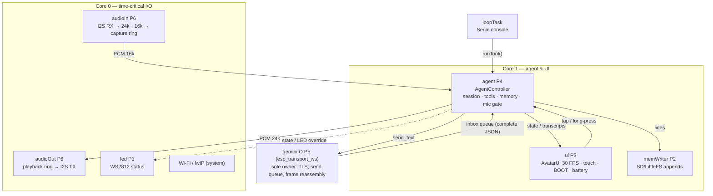

# 🏗️ System Architecture (v3 — Personal Assistant, Eyes UI, Model Fallback)

> **Related:** [[00-Home-Dashboard]] | [[01-Hardware-ES3C28P-Pinout]] | [[03-Libraries-and-Dependencies]] | [[05-Gemini-Live-API-Protocol]] | [[08-Long-Term-Memory-GraphRAG]]

---

## ภาพรวม



| Task | Core | Prio | Stack | หน้าที่ |
|---|---|---|---|---|
| `audioOut` | 0 | 6 | 4 KB | อ่าน playback ring (PSRAM 1 MB) → แปลง mono→stereo → `i2s_write` (DMA เป็นตัวคุมจังหวะ), prebuffer 120 ms |
| `audioIn` | 0 | 6 | 6 KB | `i2s_read` 20 ms → เลือกช่อง L/R อัตโนมัติ → resample 24→16 kHz → capture ring (64 KB) |
| `geminiIO` | any | 5 | 10 KB | เจ้าของการเชื่อมต่อคนเดียว (v3.1): `esp_transport_ws` + SSL (Google roots), ส่งจาก outbox, อ่าน/ประกอบ frame ใหญ่, ping 15 s, reconnect back-off, close handshake |
| `agent` | 1 | 4 | 12 KB | ทุก 10 ms: settings → คำสั่ง UI → Wi-Fi/NTP/Gemini (fallback) → `poll()` → mic gate + VAD → แจ้งเตือน → พัก/ตื่น → consolidation → state |
| `ui` | 1 | 3 | 10 KB | UiManager: ทัช → gesture → screen stack (Face/เมนู/คีย์บอร์ด) → sprite 320×240 → LCD, ปุ่ม BOOT, แบตเตอรี่ |
| `memWriter` | 1 | 2 | 4 KB | เขียนบรรทัด JSONL ลง SD ตามลำดับ (ไม่ให้ SD latency หน่วงเสียง) |
| `textModel` | 0 | 1 | 8 KB | HTTPS generateContent (Flash-Lite) สำหรับจัดระเบียบความจำเบื้องหลัง |
| `led` | 0 | 1 | 3 KB | สีตาม state หรือสีจาก tool `control_led` |
| `loopTask` | 1 | 1 | 8 KB | Serial console (`help`) |

**กฎเรื่อง thread-safety**
- ความจำ (`MemoryStore`, `EpisodicLog`) ถูกแตะจาก **agent task เท่านั้น** — console ใช้ `AgentController::runTool()` ส่งคำขอเข้า queue
- I2C (ทัช + ES8311) ใช้ `I2cBus` = Arduino `Wire` + mutex ตัวเดียว (LovyanGFX ไม่แตะ I2C)
- UI ได้ข้อมูลผ่าน setter ที่มี mutex (`pushTranscript`, `setStatus`) และ state แบบ atomic

---

## เส้นทางเสียง (Audio Pipeline)

```mermaid
flowchart LR
    MIC["🎤 MEMS mic"] --> ADC["ES8311 ADC\nPGA 30 dB + 18 dB"]
    ADC -->|"I2S 24 kHz stereo\nGPIO 6"| RX["audioIn\nauto L/R"]
    RX --> RS["Downsampler 24→16 kHz\npolyphase FIR 48 taps @7 kHz"]
    RS --> CAP["capture ring 64 KB"]
    CAP -->|"40 ms chunks\n(gate open)"| B64E["Base64 → JSON\nrealtimeInput.audio"]
    B64E --> GEM["☁️ Gemini Live"]
    GEM -->|"inlineData PCM 24 kHz"| B64D["Base64 decode"]
    B64D --> PB["playback ring 1 MB\n(~21 s)"]
    PB --> TX["audioOut\nmono→stereo"]
    TX -->|"I2S GPIO 8"| DAC["ES8311 DAC"] --> PA["FM8002E\nGPIO1 LOW = ON"] --> SPK["🔊"]
```



- **I2S รันที่ 24 kHz ทั้งสองทาง** เพราะ ES8311 ใช้ LRCK ร่วมกัน และ Gemini ส่งเสียง 24 kHz (เดิมรัน 16 kHz → เสียง AI ช้า/ทุ้มลง 2/3)
- MCLK = 256 × fs = 6.144 MHz, codec เป็น I2S slave 16-bit
- **Half-duplex echo gate**: ไม่ส่งเสียงไมค์ระหว่างที่ลำโพงกำลังเล่น + 350 ms (ไม่มี AEC → Gemini จะได้ยินเสียงตัวเองแล้ว interrupt ตัวเอง)
  ปิด gate เมื่อไร ส่ง `audioStreamEnd` ให้ server ปิด turn ผู้ใช้ · หยุด AI พูดด้วยการ**แตะจอ/ปุ่ม BOOT**
- คิวเสียงเต็ม → นับ `dropped audio` (ดูได้จาก console `status`)

---

## สถานะ (Derived State)

AgentController คำนวณ state ใหม่ทุก 10 ms จากข้อเท็จจริง (ไม่ใช่ event ที่อาจหลุด):

| ลำดับ | เงื่อนไข | State | Avatar | LED |
|---|---|---|---|---|
| 1 | config ผิด / server ปฏิเสธ (1007/1008) | `ERROR` | ตา X, ปากคว่ำ | แดงกะพริบเร็ว |
| 2 | Wi-Fi ยังไม่ต่อ หรือ Gemini ยังไม่ ready | `CONNECTING` | ตาหรี่, ปากตรง | น้ำเงินกะพริบ |
| 3 | มีเสียงในคิว playback | `SPEAKING` | ปากขยับตาม RMS | เขียว pulse |
| 4 | ไมค์มีเสียงพูด < 400 ms | `LISTENING` | ตาโต มองลง, ปาก O | น้ำเงิน |
| 5 | tool กำลังทำงาน / รอคำตอบหลังผู้ใช้พูด (≤ 12 s) | `THINKING` | ตาสแกน, ปากตรง | เหลือง pulse |
| 6 | อื่นๆ | `IDLE` | ยิ้ม กะพริบตา | เขียวสลัว (ม่วงแดงสลัวถ้าปิดไมค์) |

---

## การควบคุม

| Input | ผล |
|---|---|
| แตะจอ / กด BOOT ขณะ AI พูด | หยุดเสียงทันที (ทิ้งเสียงที่เหลือของ turn นี้) |
| แตะจอ / กด BOOT ขณะอื่น | ปิด/เปิดไมค์ (มีเสียง beep) · ขณะพัก = ปลุก · ขณะแจ้งเตือน = ปิดเสียงกริ๊ง |
| แตะไอคอนเฟือง | เมนูตั้งค่า |
| กดค้างบนจอ ≥ 1.5 s | เริ่ม session ใหม่ (ล้าง resumption handle — ความจำระยะยาวยังอยู่) |
| กดปุ่ม BOOT ค้าง ≥ 1.5 s | เปิดเมนูตั้งค่า (เข้าได้เสมอแม้ทัชยังไม่ calibrate) |
| Serial console | `help` — status, audio, tone, mic, vol, i2c, regs, tool, say, expr, sleep, wake, ui ..., set ..., time, screenshot, reboot |

---

## หน่วยความจำ (วัดบนบอร์ดจริง)

| ส่วน | ตำแหน่ง | ขนาด |
|---|---|---|
| Playback ring | PSRAM | 1 MB |
| Capture ring | PSRAM | 64 KB |
| LCD sprite | PSRAM | 150 KB |
| WebSocket RX/TX buffers + reassembly | PSRAM | 16 KB ×2 + ตามขนาดข้อความ |
| JSON documents (server messages) | PSRAM (`JsonPsramAllocator`) | ชั่วคราว |
| ความจำระยะยาว (index) | PSRAM | ~0.8 KB/รายการ (สูงสุด 2,000) |
| **คงเหลือหลังบูต** | — | heap ภายใน **~243 KB**, PSRAM **~6.9 MB** |

Flash: firmware 1.24 MB จาก app partition 6.25 MB (`default_16MB.csv`, รองรับ OTA) + LittleFS 3.4 MB สำรองเมื่อไม่มี SD

---

## สถานะเพิ่มใน v3
`SLEEP` (ปิด session หลังเงียบ, ตาหลับ Zzz, LED ม่วงหายใจ) และ `SETUP` (ยังไม่มี Wi-Fi/API key, ตา curious + เฟืองกะพริบ, LED ขาวกะพริบช้า)
รายละเอียดโปรไฟล์ tools และ fallback: [[09-Assistant-Profiles-and-Tools]]

## โครงสร้างโค้ด

```
src/
├── main.cpp                 # boot, ui/led tasks, serial console
├── app/AppConfig.h          # ค่าคงที่: เสียง, VAD, งบโทเคน, ความจำ
├── app/Settings.*           # การตั้งค่าใน NVS (Wi-Fi, API key, ชื่อ, เสียง, นิสัย, โมเดล, calibration)
├── agent/
│   ├── AgentController.*    # สมองของ agent (GeminiListener + DeviceOps + UiHost)
│   ├── AgentTools.*         # 20 function declarations + dispatch
│   ├── Personas.*           # 30 เสียง, 7 นิสัย, 8 โปรไฟล์, 8 สีตา
│   ├── Scheduler.* / TaskList.*  # timers & reminders / to-do
│   └── Consolidation.*      # prompt/schema/parser/rate-limit สำหรับ Flash-Lite
├── ai/
│   ├── GeminiLiveClient.*   # geminiIO task (esp_transport_ws) + protocol
│   ├── TextModelClient.*    # HTTPS generateContent (task เบื้องหลัง)
│   ├── ModelFallback.*      # จัดประเภทความล้มเหลว + cool-down + เลือกโมเดล
│   └── GoogleRootCA.h       # GTS R1/R3/R4 + GlobalSign ECC R4 (gen_root_ca.py)
├── audio/
│   ├── AudioManager.*       # I2S 24 kHz stereo, rings, tone, diagnostics
│   ├── ES8311.*             # codec driver (ลำดับตาม Espressif)
│   └── Resampler.h          # 24→16 kHz polyphase
├── display/
│   ├── TouchFT6336.h        # ทัชผ่าน I2cBus
│   ├── LGFX_ES3C28P.hpp     # จอ ILI9341V (ไม่มี touch driver)
│   └── fonts/ThaiFont26/20  # TH Sarabun New VLW (gen_thai_font.py)
├── ui/                      # Eyes, FaceScreen, UiManager, ListScreen, KeyboardScreen, SettingsScreens
├── memory/                  # ความจำระยะยาว standalone — ดู [[08-Long-Term-Memory-GraphRAG]]
├── system/                  # I2cBus, Storage (SD/LittleFS)
└── util/                    # UTF-8, Base64, TextWrap (ตัดบรรทัดไทย), TimeFmt, JsonFrame, PSRAM allocators
host_tests/                  # unit tests บน PC (MSVC) — run_tests.bat
tools/                       # gen_thai_font.py, gen_root_ca.py
```
