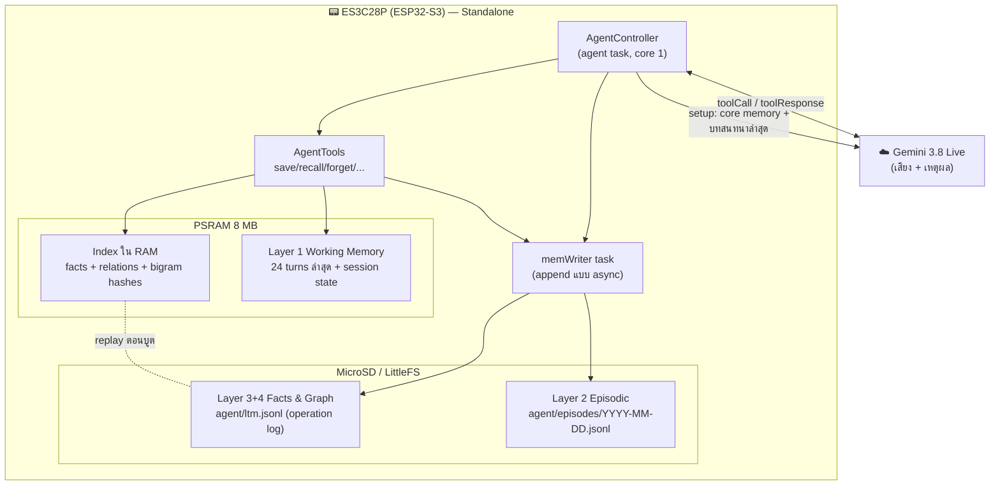
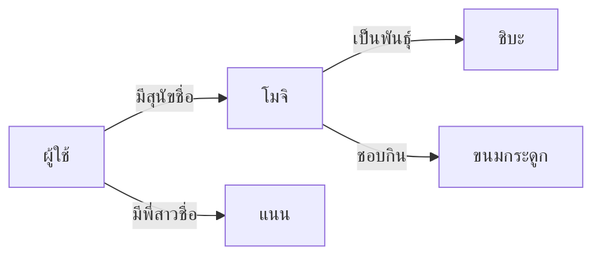
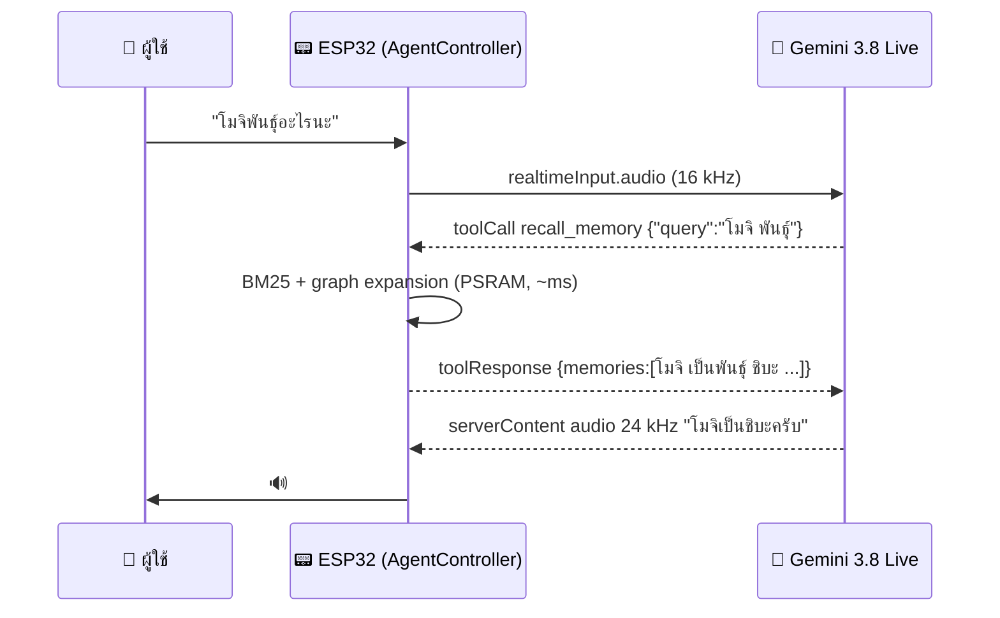

# 🧠 Long-Term Memory แบบ Standalone (4-Layer + GraphRAG-lite)

> **Related:** [[00-Home-Dashboard]] | [[04-System-Architecture]] | [[05-Gemini-Live-API-Protocol]] | [[07-Troubleshooting-Log]]
> **Code:** `src/memory/` (MemoryStore, EpisodicLog, TextFeatures, AsyncFileSink) · `src/agent/AgentTools.*` · `src/agent/AgentController.*` + `AgentRoutines.cpp` (consolidation, episodic log)
> **Tests:** `host_tests/test_main.cpp` (รันบน PC) + ทดสอบบนบอร์ดจริงผ่าน Serial console

---

## 🎯 แนวคิด: ความจำทั้งหมดอยู่ในตัวเครื่อง

เวอร์ชันแรกของเอกสารนี้ออกแบบ Layer 3-4 ให้อยู่บน Cloud/Server (Pinecone, Neo4j, Backend Bridge)
**v2 เปลี่ยนเป็น Standalone ทั้งหมด** — ไม่มี Backend, ไม่มี Vector DB ภายนอก, ไม่มี Embedding API:

- ความจำทุกชั้นเก็บใน **MicroSD** (`/sdcard/agent/`) หรือ **LittleFS ในแฟลช** ถ้าไม่ได้ใส่การ์ด (`/littlefs/agent/`)
- การค้นหา (retrieval) ทำบน ESP32-S3 เองด้วย **BM25 บน character bigram** + **ขยายกราฟ 1-hop**
- Gemini Live เป็นแค่ "สมองภาษา" ที่เรียกใช้ความจำผ่าน **Function Calling**
- ข้อมูลส่วนตัวไม่ออกจากเครื่อง ยกเว้นข้อความที่ Gemini ดึงไปใช้ตอบในบทสนทนานั้น



---

## 🏗️ 4 ชั้นความจำ (ที่ใช้งานจริงใน v2)

| Layer | ชื่อ | เก็บที่ | อายุข้อมูล | ใช้ทำอะไร |
|---|---|---|---|---|
| **1** | Working Memory | PSRAM (`EpisodicLog::_working`) | 24 turns ล่าสุด | ใส่ "บทสนทนาล่าสุด" ใน system prompt ของ session ใหม่ |
| **2** | Episodic Memory | `agent/episodes/YYYY-MM-DD.jsonl` | 365 วัน (SD) / 30 วัน (flash) | บันทึกทุก turn พร้อมเวลา → tool `recall_conversation` |
| **3** | Semantic Facts | `agent/ltm.jsonl` (`k:"f"`) | ถาวรจนกว่าจะลบ (สูงสุด 2,000 รายการ) | ประโยคความจริง เช่น "ผู้ใช้แพ้กุ้ง" → `save_memory` / `recall_memory` |
| **4** | Knowledge Graph | `agent/ltm.jsonl` (`k:"r"`) | ถาวร | triple `(ผู้ใช้, มีสุนัขชื่อ, โมจิ)` → `save_relation` + ขยายกราฟตอน recall |

นอกจากนี้ **Core Memory** = facts ที่ importance ≥ 4 หรือหมวด `profile` จะถูกฉีดเข้า system prompt
ทุกครั้งที่เปิด session ใหม่ (สูงสุด ~1.8 KB) — Gemini จึง "รู้จัก" ผู้ใช้ตั้งแต่ประโยคแรกโดยไม่ต้องเรียก tool

**กันความจำผิด (v3.4.4, T054):** ความจำผิดที่เข้า core memory จะถูกพูดซ้ำทุกครั้งที่ทัก ("ทริปโตเกียว" ที่บันทึกจากเสียงวิทยุ)
- facts จากตัวจัดระเบียบเบื้องหลัง (Flash-Lite) importance สูงสุด **3** (`consolidate::kMaxImportance`) → ไม่เข้า core memory เอง (ยกเว้นหมวด profile)
- prompt ของตัวจัดระเบียบ: ข้อความผู้ใช้คือเสียงที่ถอดจากห้องที่มีวิทยุ/ทีวี — เก็บเฉพาะสิ่งที่ผู้ใช้พูดถึงตัวเองชัดเจน ข้ามเศษประโยค คำสั่งทดสอบ เสียงดีเจ
- **T069:** จุดที่จัดระเบียบไปแล้ว (`_consolidatedUntil`) เก็บใน NVS `rt/consol` — เดิมเริ่ม 0 ทุกบูต ครั้งแรกหลังบูตส่ง 24 เทิร์นเก่าซ้ำ และความจำที่ลบด้วย `forget_memory` อาจกลับมา
- `memclear` รอให้ `AsyncFileSink` เขียนบรรทัดสุดท้ายเสร็จจริง (`_writing`) ก่อน compact ไฟล์
- system prompt: บันทึกเฉพาะสิ่งที่ผู้ใช้พูดถึงตัวเองชัดเจน · core memory และบทสนทนาล่าสุด "ใช้เมื่อเกี่ยวข้อง อย่ายกขึ้นมาเองตอนทักทาย"
  (บทสนทนาล่าสุดมีประโยคของ AI ด้วย: คำทักที่ยกเรื่องเก่าเคยถูกป้อนกลับเข้า session ถัดไปเป็นวงวน)
- ลบความจำผิด: บอก AI "ลืมเรื่อง X" (`forget_memory`) หรือ console `tool forget_memory {"memory_id":N}` (หา id ด้วย `tool recall_memory {"query":"..."}`)

---

## 🔍 การค้นหาแบบ Standalone (ทำไมไม่ใช้ Embedding)

ภาษาไทยไม่มีช่องว่างระหว่างคำ การตัดคำต้องใช้พจนานุกรมขนาดใหญ่ และ Embedding ต้องเรียก API ภายนอก
จึงใช้ **lexical retrieval ที่ไม่ขึ้นกับภาษา** (`src/memory/TextFeatures.cpp`):

1. ถอดรหัส UTF-8 → ตัด **วรรณยุกต์** (่ ้ ๊ ๋) ทิ้ง เพื่อให้ทนต่อการถอดเสียงที่คลาดเคลื่อน, เลขไทย → เลขอารบิก
2. ข้อความไทย/อักษรอื่น → **character bigram** เช่น `สุนัข` → `สุ ุน นั ัข`
3. อังกฤษ/ตัวเลข → **คำทั้งคำ** ตัวพิมพ์เล็ก (`iPhone` → `iphone`)
4. hash ด้วย FNV-1a → ชุด `uint32` ที่เรียงและไม่ซ้ำ

**จัดอันดับด้วย BM25** (`MemoryStore::search`): k1 = 1.2, b = 0.5 (เอกสารสั้น), คูณ boost ตาม importance
และกรองด้วย **coverage** = สัดส่วน IDF ของคำค้นที่ "มีอยู่ในความจำ" ที่ตรงกัน ≥ 25%
(คำฟุ่มเฟือยอย่าง "จำได้ไหม", "อะไร" ที่ไม่มีในความจำจึงไม่ทำให้หาไม่เจอ)

> ข้อจำกัด: คำพ้องความหมาย (หมา/สุนัข) ไม่จับคู่กันเอง — tool description สั่งให้ Gemini
> ลองค้นด้วยคำพ้องถ้าไม่เจอ และ Knowledge Graph ช่วยเชื่อมผ่านชื่อ entity

### GraphRAG-lite (ขยายกราฟ 1 hop)

หลังได้ผลจาก BM25 จะหา **entity seed** จาก
- subject/object ของ relation ที่ค้นเจอ และ
- ชื่อ entity ที่ปรากฏตรงๆ ในคำค้น

แล้วดึง relation อื่นที่ใช้ entity เดียวกัน + facts ที่เอ่ยชื่อ entity นั้น (สูงสุด 6 รายการ, ติดป้าย `"via":"knowledge_graph"`)
**Hub entity** อย่าง "ผู้ใช้/ฉัน/ผม/user" และ entity ที่เชื่อมเกิน 8 เส้น **ไม่ถูกใช้เป็น seed** ไม่งั้นจะดึงทุกอย่างมา


ค้น `"สุนัข"` → เจอ `ผู้ใช้ มีสุนัขชื่อ โมจิ` → seed `โมจิ` → ได้ `โมจิ เป็นพันธุ์ ชิบะ`, `โมจิ ชอบกิน ขนมกระดูก`
(ไม่ดึง `แนน` เพราะเชื่อมผ่าน hub "ผู้ใช้" เท่านั้น) — *ทดสอบผ่านทั้งบน PC และบนบอร์ดจริง*

---

## 💾 รูปแบบไฟล์ (Persistence)

**`agent/ltm.jsonl`** — operation log แบบ append-only (หนึ่งบรรทัดต่อการเปลี่ยนแปลง)
```json
{"op":"add","id":1,"k":"f","c":"profile","i":5,"t":1760432400,"u":1760432400,"x":"ผู้ใช้ชื่อโจโจ้ เป็นนักพัฒนา ESP32"}
{"op":"add","id":3,"k":"r","c":"person","i":3,"t":1760432460,"u":1760432460,"s":"ผู้ใช้","p":"มีสุนัขชื่อ","o":"โมจิ"}
{"op":"upd","id":1,"k":"f","c":"profile","i":5,"t":1760432400,"u":1760519000,"x":"..."}
{"op":"del","id":2}
```
- ตอนบูต: replay ทุกบรรทัด → สร้าง index ใน PSRAM (วัดจริง: 3 รายการ = 6 ms)
- ถ้าบรรทัดเกิน `2 × จำนวนจริง + 32` → **compact** เขียนไฟล์ใหม่ (`.tmp` → rename) และกู้คืนอัตโนมัติถ้าไฟดับกลางคัน
- ข้อความเกือบซ้ำ (Jaccard ≥ 0.75) → **อัปเดตของเดิม** แทนการเพิ่มใหม่
- เต็ม 2,000 รายการ → ลบรายการ importance ต่ำสุด/เก่าสุด

**`agent/episodes/YYYY-MM-DD.jsonl`** — 1 บรรทัดต่อ turn (`r`: `u` ผู้ใช้ / `a` ผู้ช่วย)
```json
{"t":1760432400,"r":"u","x":"พรุ่งนี้ต้องไปหาหมอฟัน"}
{"t":1760432403,"r":"a","x":"ขอให้ไม่เจ็บนะครับ"}
```
ก่อน NTP sync จะเขียนลง `undated.jsonl` · การเขียนทั้งหมดผ่าน `AsyncFileSink` (task `memWriter`) เพื่อไม่ให้ SD หน่วงเสียง

---

## 🛠️ Tools ที่ประกาศให้ Gemini (ทั้งหมด `behavior: BLOCKING`)

> `gemini-3.8-live` ตั้งค่า default เป็น NON_BLOCKING — ต้องระบุ BLOCKING ไม่งั้นโมเดลจะตอบก่อนได้ผล recall

| Tool | Parameters | ผลลัพธ์ |
|---|---|---|
| `save_memory` | `content`*, `category` (profile/preference/person/event/task/knowledge/other), `importance` 1-5 | `saved` / `updated_existing_memory` + `memory_id` |
| `save_relation` | `subject`*, `relation`*, `object`*, `category` | `saved` / `already_known` |
| `recall_memory` | `query`*, `limit` 1-10 | `memories[]` (id, type, category, content, importance, saved, via) |
| `forget_memory` | `memory_id`* | `deleted_content` |
| `recall_conversation` | `query`, `days_back` 1-90, `limit` 1-12 | `turns[]` (time, speaker, text) |
| `get_device_status` | — | วันเวลา, แบตเตอรี่, Wi-Fi, volume, storage, จำนวนความจำ |
| `set_volume` | `level`* 0-100 | volume ที่ตั้งจริง (บันทึกใน NVS) |
| `control_led` | `color`* red/green/blue/white/yellow/purple/orange/off/auto | — |

ตัวอย่าง flow:


---

## 🧪 ทดสอบ

**บน PC** (`host_tests\run_tests.bat`, MSVC): 14 ชุด / 1,171 checks — ranking ภาษาไทย, merge, graph, persistence + compaction + กู้ไฟล์ `.tmp`, capacity, core memory, episodic search/prune, tools ครบทุกตัว

**บนบอร์ดจริง** (Serial console, COM4) — 2026-10-14:
```text
> tool save_relation {"subject":"ผู้ใช้","relation":"มีสุนัขชื่อ","object":"โมจิ"}
{"result":{"status":"saved","memory_id":3}}
> tool recall_memory {"query":"สุนัข"}
{"result":{"count":2,"memories":[{"id":3,"content":"ผู้ใช้ มีสุนัขชื่อ โมจิ",...},
                                  {"id":4,"content":"โมจิ เป็นพันธุ์ ชิบะ",...,"via":"knowledge_graph"}]}}
> reboot  → ความจำยังอยู่ครบ (โหลดจาก SD 6 ms)
```

---

## 📋 Roadmap

- [x] Layer 1-4 แบบ standalone บน SD/LittleFS
- [x] Tool calling ครบชุด + core memory ใน system prompt + บทสนทนาล่าสุดสำหรับ session ใหม่
- [x] Session resumption + context window compression (คุยต่อเนื่องเกิน 15 นาที)
- [x] Unit tests บน PC + ทดสอบบนบอร์ดจริง (SD card)
- [ ] ทดสอบ end-to-end กับ Gemini จริง (ต้องใส่ Wi-Fi + API key ใน `include/secrets.h`)
- [ ] (ทางเลือก) สรุปบทสนทนารายวันอัตโนมัติ (consolidation) เป็น facts
- [ ] (ทางเลือก) พจนานุกรมคำพ้องขนาดเล็ก (หมา↔สุนัข, แม่↔มารดา) ช่วย recall

## SD card หยุดตอบ (T125)

การเขียนความจำ/บทสนทนาที่ล้ม (`[Memory] write failed`) แจ้ง `Storage::reportError()` → task agent อ่าน sector 0 ของการ์ด ถ้าไม่ตอบจะ mount ใหม่ที่ path เดิม (ไฟล์ความจำเปิด-เขียน-ปิดทุกครั้ง จึงเขียนต่อได้เอง) · `diag` มี `sd_remounts` — ดู [[07-Troubleshooting-Log#T125]]
