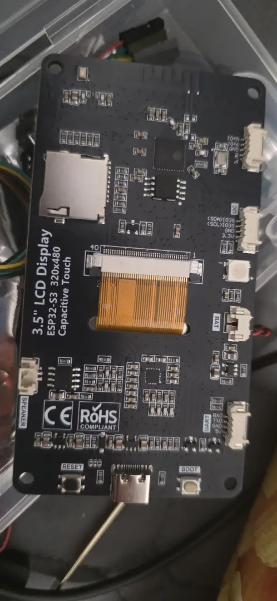

# 25 — บอร์ด ES3C35P (ESP32-S3 จอ 3.5" 320×480)

> **Related:** [[01-Hardware-ES3C28P-Pinout]] (บอร์ด 2.8" ต้นแบบ) · [[24-Tool-Matrix-Per-Board]] · [[07-Troubleshooting-Log#T205]] · [[15-Expansion-Ports]]

**LCDWIKI ES3C35P** (ขายในชื่อ "3.5inch ESP32-S3 Display", ES3C35P = มีลำโพง, ES3C35P-NS = ไม่มี) — ESP32-S3-N16R8, IPS 3.5" 320×480,
ทัชแบบ capacitive, ES8311 + แอมป์ FM8002E, ไมค์, ไฟ RGB, ช่อง SD, ช่องแบต · ข้อมูลจาก [lcdwiki.com/3.5inch_ESP32-S3_Display](https://www.lcdwiki.com/3.5inch_ESP32-S3_Display)

**เฟิร์มแวร์ ES3C28P (2.8") ใช้กับบอร์ดนี้ไม่ได้** — จอคนละชิป (ST77922 QSPI แทน ILI9341 SPI) และขาเกือบทั้งหมดต่างกัน
→ ใช้ build แยก `pio run -e es3c35p` (ซอร์สเดียวกับ ES3C28P, T205) · release: `-factory-es3c35p.bin` / `-app-es3c35p.bin`

## ขา (เทียบ ES3C28P)

| หน้าที่ | ES3C35P | ES3C28P |
|---|---|---|
| จอ | **ST77922 QSPI**: CS 10, CLK 12, D0–D3 11 / 13 / 14 / 9, reset = EN | ILI9341 SPI: CS 10, SCK 12, MOSI 11, MISO 13, DC 46 |
| ไฟจอ | **41** | 45 |
| ทัช | **ST77922 ในตัว, I2C 0x55**, INT 47, RST 48 | FT6336G 0x38, INT 17, RST 18 |
| I2C (ทัช + ES8311 + ช่อง I2C) | **SDA 38 / SCL 39** | SDA 16 / SCL 15 |
| I2S | MCLK **17**, BCLK **18**, LRCK **21**, ออก (→codec) **15**, เข้า (ไมค์) **16** | 4 / 5 / 7 / 8 / 6 |
| แอมป์ (active LOW) | 1 | 1 |
| ไฟ RGB | **40** | 42 |
| แบต ADC | **8** (ตัวหารไม่ระบุ — ใช้ ×2 ไปก่อน) | 9 (×2) |
| SD 4-bit | CLK **5**, CMD **4**, D0–D3 **6 / 7 / 2 / 3** | 38 / 40 / 39 / 41 / 48 / 47 |
| ช่องเสริม (devices.json) | **45, 46** (ไม่มี ADC) + UART 43 / 44 | 2, 3, 14, 21 + UART 43 / 44 |
| BOOT | 0 | 0 |

ทิศ I2S ของบอร์ดนี้ตั้งชื่อจากฝั่ง MCU (ตรงกับบอร์ด `lcdwiki-es3c35p` ของ xiaozhi-esp32 ที่ใช้งานจริง) — ต่างจาก ES3C28P ที่ตารางผู้ผลิตกลับด้าน

## จอ: ทำไมต้องหมุนภาพเอง

- LovyanGFX 1.2.33 ไม่มี ST77922 แต่มี `Panel_ST77916` (ตระกูล Sitronix QSPI เดียวกัน: คำสั่ง 1 สาย `02 00 cmd 00`, พิกเซล 4 สาย `32 00 2C 00`)
  → `Panel_ST77922` (`src/display/LGFX_ES3C35P.hpp`) = ST77916 + init table ของจอนี้ (59 คำสั่ง จาก port LovyanGFX ของ ES3C35P, MIT — มีประกาศ license ในไฟล์) + SWRESET นำหน้า
- **ST77922 สลับแกน X/Y ไม่ได้** (ไม่มี MADCTL MV) → แผงจออยู่แนวตั้งเสมอ (rotation 0), `UiManager::present()` หมุนภาพ UI 320×240 เป็นแนวนอนและขยาย 4:3 → 428×320
  ตรงกลาง มีแถบดำซ้าย/ขวา 26 px — ทุกหน้าจอเดิมใช้ได้โดยไม่ต้องแก้ (ภาพขยายแบบ nearest pixel)
- จอเขียนคอลัมน์ทีละคู่ (x เริ่มคู่, กว้างคู่) → `present()` ส่งทีละแถวเต็ม 320 px เสมอ · QSPI 60 MHz (80 MHz ข้อมูลเพี้ยน)
- กระจก IPS นี้ต้อง INVON สีถึงจะปกติ: `Panel_ST77922::setInvert()` เอาค่า "invert" ของผู้ใช้ XOR กับค่าของแผง
- ภาพ screenshot / Studio ยังเป็น 320×240 เหมือน ES3C28P

## ทัช

- `src/display/TouchST77922.h`: อ่าน 0x0010 (bit 3 = มีข้อมูลใหม่) แล้ว 0x0014 (7 ไบต์/จุด) ผ่าน `I2cBus::readRegs16()` (bus เดียวกับ ES8311) · นิ้วนิ่งไม่ส่งข้อมูลใหม่ → ค้างจุดเดิม 80 ms
- แปลงพิกัดเป็นช่วงเดียวกับ FT6336 (x 0–239, y 0–319) ผ่าน inverse ของ `present()` → หน้าปรับเทียบทัช (เปิดเองตอนบูตครั้งแรก) และ `set touch` ใช้ได้เหมือนเดิม
- หมุนจอ 180° (`set rotation 3`) แล้วทัชตามไปด้วย

## แอปแฟลช

Studio / ESP32-AI Flasher (Windows 2.1.1) / Flasher Android (2.1.1) รู้จักบอร์ดนี้ (`es3c35p`):
แยกจาก ES3C28P และ XH-S3E-AI ด้วย pull-up ของขา I2C — ES3C35P = GPIO 38 + 39 ขึ้น 1
(ES3C28P วัดจริง 2026-11-15: 15=1 16=1 38=0 39=1 41=1 42=0 → ไม่ชนกัน) · ถ้าสแกนแล้วไม่ชัด แอปจะให้เลือกรุ่นเอง

## สถานะ (2026-11-15)

- ✅ build ผ่าน (`pio run -e es3c35p`), ES3C28P build เดิมผ่าน, host tests 4,348 ผ่าน, tests แอปแฟลช Python / C# / Android ผ่าน
- ❌ **ยังไม่ได้ลองบนบอร์ดจริง** (บอร์ดไม่ได้เสียบ) — สิ่งที่ต้องตรวจเมื่อเสียบ:
  1. จอติด + สีถูก (ถ้าแดง/น้ำเงินสลับ → แก้ `cfg.rgb_order`; ถ้าสีกลับ → `set invert 1`)
  2. ภาพไม่กลับหัว (ถ้ากลับ → `set rotation 3`) แล้วทัชตรง (ถ้าไม่ตรง → หน้าปรับเทียบทัช)
  3. log `[Touch] ST77922 (0x55) found` · เสียง/ไมค์ (`[ES8311] chip id 0x83`) · SD · ไฟ RGB · แบต (เทียบมิเตอร์ แก้ `VBAT_DIVIDER`)
  4. ความลื่นของภาพ (เฟรม UI ขยาย ~15 ms/เฟรม โดยประมาณ — ยังไม่ได้วัด)

---

*Back to [[00-Home-Dashboard]]*
